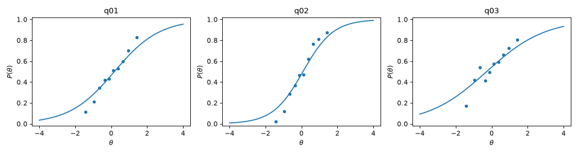
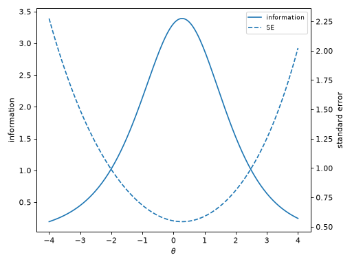
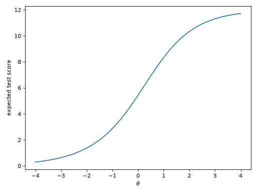
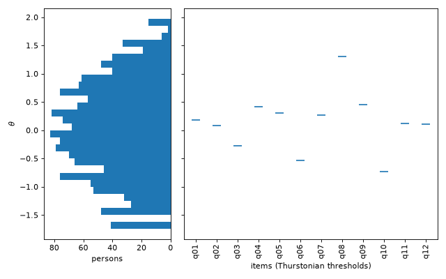
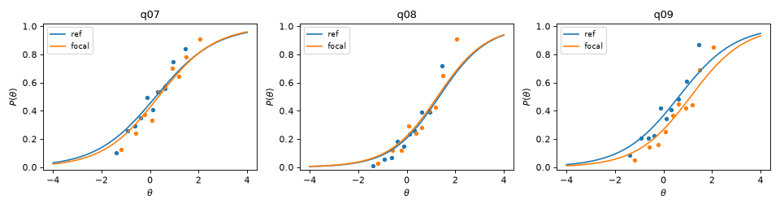

# ユーザーガイド

[English](guide.md) | 日本語

flexpyirt で IRT モデルを指定・推定・解釈する手順をまとめる。このページのコード例は上から順に 1 つの
スクリプトとして実行できる。関数ごとの引数は [API リファレンス](reference.ja.md)、背後にあるモデルと
アルゴリズムは [理論](theory.ja.md) を参照。

1. [準備](#1-準備)
2. [データの形式](#2-データの形式)
3. [モデルを指定する](#3-モデルを指定する)
4. [推定する](#4-推定する)
5. [結果を読む](#5-結果を読む)
6. [標準誤差](#6-標準誤差)
7. [スコアリング](#7-スコアリング)
8. [潜在分布と識別性](#8-潜在分布と識別性)
9. [多母集団](#9-多母集団)
10. [固定項目パラメタ推定（FIPC）](#10-固定項目パラメタ推定fipc)
11. [事前分布と MAP 推定](#11-事前分布と-map-推定)
12. [ParameterTable を編集する](#12-parametertable-を編集する)
13. [求積格子の選び方](#13-求積格子の選び方)
14. [確認的多次元モデル](#14-確認的多次元モデル)
15. [尺度リンキング](#15-尺度リンキング)
16. [ポリコリック相関](#16-ポリコリック相関)
17. [次元数](#17-次元数)
18. [局所依存と次元性のレポート](#18-局所依存と次元性のレポート)
19. [DETECT](#19-detect)
20. [ユーザー定義の項目モデル](#20-ユーザー定義の項目モデル)
21. [古典的項目分析](#21-古典的項目分析)
22. [エラーと警告](#22-エラーと警告)

## 1. 準備

flexpyirt は 64 ビット浮動小数点で計算する。JAX の設定はユーザーのものなので、ライブラリは import 時に
変更しない。推定の前に有効にする（無効のまま `fit()` を呼ぶと `PrecisionError`）。

```python
import jax

jax.config.update("jax_enable_x64", True)

import numpy as np
import pandas as pd

from flexpyirt import (
    BAEM,
    GPCM,
    GRM,
    PCM,
    BetaPrior,
    FitResult,
    FourPL,
    LogNormalPrior,
    Model,
    Nominal,
    Normal,
    NormalPrior,
    Quadrature,
    Rasch,
    ThreePL,
    TwoPL,
    fit,
)
```

以下の例で使うデータをシミュレーションしておく。

```python
rng = np.random.default_rng(2026)


def simulate_2pl(a, d, theta, rng):
    """2PL の 0/1 反応を生成する。"""
    p = 1.0 / (1.0 + np.exp(-(np.outer(theta, a) + d)))
    return (rng.random(p.shape) < p).astype(float)


n_items = 12
items = [f"q{j:02d}" for j in range(1, n_items + 1)]
a_true = rng.lognormal(0.0, 0.3, n_items)
d_true = rng.normal(0.0, 1.0, n_items)
df = pd.DataFrame(simulate_2pl(a_true, d_true, rng.normal(0, 1, 1500), rng), columns=items)
```

## 2. データの形式

- **行が回答者、列が項目**。列名が項目名になる。
- pandas の DataFrame、polars の DataFrame、2 次元の numpy 配列を受け付ける。numpy 配列の場合は
  `item_names=` で列名を渡す（省略するとモデルの項目順とみなす）。
- 値はカテゴリ番号 `0, 1, ..., K-1`。2 値項目は 0/1。**欠測は NaN**（MAR を仮定して尤度から除く）。
- モデルにない列や、モデルにあってデータにない列はエラーになる。不要な列は先に落とす。
- 推定するパラメタを持つ項目は、すべてのカテゴリがデータに 1 回以上現れている必要がある
  （現れないカテゴリの閾値は発散するため。カテゴリをまとめるか、項目を固定する）。

```python
arr = df.to_numpy()
spec = Model.uniform(TwoPL(), items=items)
res_np = fit(spec, arr, item_names=items, se=None)
```

## 3. モデルを指定する

モデルは `Model` という変更不可能なオブジェクトで表す。`.fix()` や `.with_groups()` などのメソッドは
新しい `Model` を返し、元のオブジェクトは変わらない。

```python
spec = Model.uniform(TwoPL(), items=items)  # 全項目に同じ項目モデル
# 項目ごとに指定
mixed = Model.from_items({"x1": TwoPL(), "x2": Rasch(), "s1": GRM(n_categories=4)})
print(spec.item_names[:3], mixed.item_names)
```

### 項目モデル

| クラス | 反応確率 | 内部パラメタ | 表示用（`items` に追加） |
|---|---|---|---|
| `TwoPL()` | $P(y=1)=\sigma(a\theta+d)$ | `a`, `d` | `b = -d/a` |
| `Rasch()` | $P(y=1)=\sigma(\theta+d)$（$a=1$ 固定） | `a`（固定）, `d` | `b = -d` |
| `ThreePL()` | $P(y=1)=g+(1-g)\sigma(a\theta+d)$（$u=1$ 固定） | `a`, `d`, `g`, `u`（固定） | `b = -d/a` |
| `FourPL()` | $P(y=1)=g+(u-g)\sigma(a\theta+d)$ | `a`, `d`, `g`, `u` | `b = -d/a` |
| `GRM(n_categories=K)` | $P(y\ge k)=\sigma(a\theta+d_k)$, $d_1>\dots>d_{K-1}$ | `a`, `d1`…`d{K-1}` | `bk = -dk/a` |
| `GPCM(n_categories=K)` | $P(y=k)\propto\exp(k\,a\theta+d_k)$, $d_0=0$ | `a`, `d1`…`d{K-1}` | `bk = -(dk - d{k-1})/a` |
| `PCM(n_categories=K)` | $P(y=k)\propto\exp(k\theta+d_k)$（$a=1$ 固定、$d_0=0$） | `a`（固定）, `d1`…`d{K-1}` | `bk = -(dk - d{k-1})` |
| `Nominal(n_categories=K)` | $P(y=k)\propto\exp(a\,\mathrm{ak}_k\,\theta+d_k)$（$\mathrm{ak}_0=0, \mathrm{ak}_{K-1}=K-1, d_0=0$） | `a`, `ak1`…`ak{K-2}`, `d1`…`d{K-1}` | — |

パラメタ化は mirt（`itemtype = "2PL"`, `"Rasch"`, `"3PL"`, `"4PL"`, `"graded"`, `"gpcm"`, `"nominal"`。多値に対する
`"Rasch"` は `PCM`）と同じ傾き・切片形式。3PL / 4PL の `g`, `u` は自然尺度（$0 < g < u \le 1$）で推定する
（mirt は logit 尺度で最適化するが、内点の最尤推定値は一致する）。多値項目のカテゴリは 0 始まり（mirt の
`Science` のように 1 始まりのデータは 1 を引く）。`Nominal` には表示用の `b` 列がない。カテゴリに順序がない
ため $\theta$ 尺度の隣接カテゴリ閾値は一般には定義できず（$\mathrm{ak}_k=\mathrm{ak}_{k-1}$ で特異になる）、mirt の
`coef(m, IRTpars = TRUE)` も代わりに Bock のゼロ和の傾きと切片を返す。表にないモデルはユーザーが書ける
（[20 節](#20-ユーザー定義の項目モデル)）。

```python
theta3 = rng.normal(0, 1, 2000)
a3 = np.array([1.6, 1.8, 1.7, 1.6, 1.9, 1.7, 1.8, 1.6, 1.9, 1.7])
d3 = np.array([-1.0, -0.7, -1.2, -0.8, -0.9, -0.6, -1.1, -0.8, -1.0, -0.7])
g3 = np.full(len(a3), 0.2)
p3 = g3 + (1.0 - g3) / (1.0 + np.exp(-(np.outer(theta3, a3) + d3)))
df_3pl = pd.DataFrame(
    (rng.random(p3.shape) < p3).astype(float), columns=[f"c{j}" for j in range(1, len(a3) + 1)]
)
res_3pl = fit(Model.uniform(ThreePL(), items=df_3pl.columns), df_3pl)
print(res_3pl.items[["item", "a", "d", "g", "b"]].round(3))
```

```python
n_categories = 4
cuts = np.array([-1.0, 0.2, 1.3])
theta = rng.normal(0, 1, 800)
latent_cont = np.outer(theta, np.ones(5)) + rng.logistic(0, 1, (800, 5))
grm_df = pd.DataFrame(
    np.searchsorted(cuts, latent_cont).astype(float), columns=[f"s{j}" for j in range(1, 6)]
)
grm = fit(Model.uniform(GRM(n_categories=n_categories), items=grm_df.columns), grm_df)
print(grm.items[["item", "a", "d1", "d2", "d3", "b1", "b2", "b3"]].round(3))
```

```python
gpcm = fit(Model.uniform(GPCM(n_categories=n_categories), items=grm_df.columns), grm_df)
print(gpcm.items[["item", "a", "d1", "d2", "d3", "b1", "b2", "b3"]].round(3))
```

```python
nominal = fit(Model.uniform(Nominal(n_categories=n_categories), items=grm_df.columns), grm_df)
print(nominal.items[["item", "a", "ak1", "ak2", "d1", "d2", "d3"]].round(3))
```

### パラメタを固定する

`.fix(item=..., <パラメタ>=値)` で、内部パラメタ（傾き・切片形式）の値に固定する。
固定したパラメタは推定されず、標準誤差も NaN になる。

```python
spec_fixed = Model.uniform(TwoPL(), items=items).fix(item="q01", a=1.0, d=0.0)
```

## 4. 推定する

```python
res = fit(
    spec,
    df,
    method=BAEM(tol=1e-4, max_iter=2000, m_step_newton_steps=3, squarem=False),  # 既定値
    quadrature=Quadrature.equispaced(61, bounds=(-6, 6)),  # 既定値
    se="oakes",  # 既定値
)
```

- **`method`**: EM の設定。収束は「採択された連続する反復間での自由パラメタの最大絶対変化 < `tol`」
  （mirt の `TOL` と同じ定義）。`max_iter` に達すると `ConvergenceWarning`。M-step は Newton 法を
  `m_step_newton_steps` 回だけ進める（毎回の M-step で期待対数尤度が減らないので、EM の単調性は保たれる）。
- **`squarem=True`**: SQUAREM 加速（スキーム S3; Varadhan & Roland, 2008）を有効にする。1 回の SQUAREM 反復で
  EM 写像を 2 回評価してステップ方向に外挿し、安定化の EM ステップを 1 回行う（採択 1 回あたり EM 評価 3 回。
  単調性・実行可能性の安全装置が $\theta_2$ に戻した場合は 2 回）。収束の遅いモデル（分散を推定する Rasch / PCM、
  多母集団、3PL / 4PL、厳しい `tol`）で有効にする。同じ不動点に収束し、`history["loglik"]` は単調で、
  EM の評価回数が大きく減る。既定は通常の EM（`squarem=False`）。
- **`m_step_scale="unconstrained"`**（既定は `"natural"`）: 範囲のあるパラメタについて、M-step の Newton 法を
  $\operatorname{logit}$ / $\log$ 尺度で進める。$g$・$u$ は $\operatorname{logit}$、潜在分散は $\log$、因子間相関は
  $2\operatorname{atanh}\rho$ で、傾きは `LogNormalPrior` や編集した範囲で $(0, \infty)$ に制限されているときだけ
  $\log$ になる。傾きのような範囲のないパラメタは変換しないので、負の傾きもそのまま推定できる。目的関数は同じなので
  内点解は既定と同じで、推定値・パラメタ表・事前分布・標準誤差は自然尺度のまま。違いは境界にある: 既定は境界上
  （例: $g=0$）でちょうど止まるが、非拘束尺度は境界に近づくだけで、かなり多くの反復を要することがある。どちらも
  パラメタが境界から `1e-4` 以内になると `HeywoodWarning` を出す。
- **`quadrature`**: 潜在変数の求積格子。既定は等間隔 61 点・$[-6, 6]$（mirt の既定と同じ）。
  広げるべき場合は [13 節](#13-求積格子の選び方)。
- **`se`**: `"oakes"`（既定）、`"hessian"`、`"sandwich"`、`"crossprod"`、`None`（計算しない）。
  [6 節](#6-標準誤差)を参照。

```python
res_sq = fit(spec, df, method=BAEM(tol=1e-6, squarem=True), se=None)
print(res_sq.n_iter, res_sq.n_em_evaluations, res_sq.n_safeguards)
print(res_sq.history.tail(3))  # iter, loglik, max_change, em_evaluations, safeguard
```

初回の推定には JAX のコンパイル時間がかかる。同じ形のデータを続けて推定すると 2 回目以降は速い。

### 標本ウェイト

複雑な標本設計のデータ（抽出確率が等しくない調査、大規模学力調査）では、`weights=` に行ごとのウェイトを渡す。
推定値は重み付き対数尤度 $\sum_i w_i \log L_i$ を最大化する（mirt の `survey.weights`）。

```python
sampling_weights = np.random.default_rng(7).uniform(0.5, 2.0, len(df))
# 任意: 合計が行数になるように調整する。
sampling_weights *= len(df) / sampling_weights.sum()
res_w = fit(spec, df, weights=sampling_weights, se=None)
print(res_w.loglik, res_w.bic)
```

- `weights` は行ごとに 1 つの有限で非負の数を持つ配列（`group=`、欠測、固定パラメタ、事前分布、どの潜在分布とも
  併用できる）。ウェイト 0 の行は無視する。整数ウェイトは、行をその回数だけ繰り返した結果と同じになる。
- ウェイトは与えられたまま使う。`loglik`・`aic`・`bic` はウェイトの尺度に従い、`bic` は $\log N$ の代わりに
  ウェイトの和の対数を使う。ウェイトなしの推定と比べたい場合は、合計が行数になるようにウェイトを調整する。
- **標準誤差**: `se="oakes"` と `se="hessian"` は重み付き対数尤度の情報行列の逆行列を返す。度数ウェイト
  （行の繰り返し）では正しいが、**標本ウェイトのもとでは正しい分散推定量ではない**。`weights` とともに
  どちらかを使うと `fit()` は警告（`FlexpyirtWarning`）を出す。ウェイトが度数でなければ `se=None` を渡す。
- スコアリング（`res_w.score(...)`）はふだんどおり使える。`item_fit()`、`m2()`、`local_dependence()`、
  `jsi()`、`dif()`、`model_parallel_analysis()` はウェイト付きの推定結果には使えず、`SpecificationError` を出す。

## 5. 結果を読む

`fit()` は `FitResult` を返す。`res.summary()` で読みやすいテキスト要約が得られる（Jupyter
ノートブックでは `res` を評価すると `_repr_html_()` により同等の HTML 要約が表示される）。

```python
print(res)  # FitResult(loglik=..., n_params=..., n_obs=..., converged in ... iterations, se=oakes)
print(res.summary())  # モデル・適合度・潜在分布・項目表の読みやすい要約
print(res.items.head(3))  # 項目ごとの推定値と SE（b とデルタ法 b_se を含む）
print(res.latent)  # 群ごとの潜在分布（mean, var と SE）
print(res.loglik, res.aic, res.bic, res.n_params, res.n_obs)
print(res.converged, res.n_iter, res.n_em_evaluations, res.n_safeguards)
print(res.history.tail(3))  # iter, loglik, max_change, em_evaluations, safeguard
```

| 属性・メソッド | 内容 |
|---|---|
| `summary(digits=4)` | モデル・データ規模・群・収束情報・対数尤度・対数事後確率・AIC/BIC（MAP 時は注意文つき）・潜在分布表・項目表の読みやすい要約。Jupyter では `_repr_html_()` が HTML で表示する |
| `items` | 1 項目 1 行（多母集団では群 × 項目）。`model`、内部パラメタ、`<param>_se`、表示用の `b` / `bk` とデルタ法による `b_se` / `bk_se` |
| `latent` | 1 群 1 行。`group`, `mean`, `var`, `mean_se`, `var_se`（固定値の SE は NaN） |
| `parameters` | ParameterTable（[12 節](#12-parametertable-を編集する)）に `estimate` と `se` を足したもの |
| `loglik`, `log_posterior`, `aic`, `bic` | 周辺対数尤度、対数事後確率（事前分布なしでは `loglik` と同値）、情報量規準（$-2\ell+2k$, $-2\ell+k\log N$。MAP 時は `FlexpyirtWarning`） |
| `n_params`, `n_obs` | 自由パラメタ数、回答者数 |
| `converged`, `n_iter`, `n_em_evaluations`, `n_safeguards` | 収束したか、採択された反復回数、EM 写像の評価回数の合計（通常の EM では `n_iter` と同じ）、SQUAREM の安全装置が働いた回数 |
| `history` | 採択された反復ごとの `iter`, `loglik`, `log_posterior`, `max_change`, `em_evaluations`（累計）, `safeguard`（SQUAREM の安全装置が働いたか） |
| `vcov`, `se_method` | 自由パラメタの共分散行列（`free_id` 順）と計算方法 |
| `to_json(path=None, *, indent=2)` / `FitResult.from_json(source)` | 推定結果を厳格な JSON として保存（`path` 指定時はファイル書き出し）し、再推定なしで復元する |

`history.loglik` は反復ごとに減らない（EM の単調性）。減っていたらバグなので報告してほしい。

```python
assert (res.history["loglik"].diff().dropna() >= -1e-8).all()
```

### 保存と読み込み（JSON）

`to_json()` で推定結果をバージョン付きの素の JSON として保存し、`FitResult.from_json()` で再推定なしに
復元できる。`pickle` や `eval` は使わず、有限な float64 値は `repr` 厳密な JSON 数値、非有限値
（`NaN`, `±inf`）は明示的な文字列として符号化するため、出力は厳格な JSON でありビット単位で正確に往復する。
復元後の結果はすべての属性・`summary()`・`_repr_html_()`・`score()` で完全に一致する。`from_json()` を
呼ぶ前に JAX の 64 ビット浮動小数点を有効にしておく必要がある（無効なら `PrecisionError`）。

```python
import tempfile
from pathlib import Path

json_str = res.to_json()  # 厳格な JSON 文字列を返す（indent=None でコンパクト出力）
loaded_str = FitResult.from_json(json_str)

with tempfile.TemporaryDirectory() as tmp:
    out_path = Path(tmp) / "fit_result.json"
    res.to_json(out_path)  # UTF-8 JSON をファイルに書き出し、文字列も返す
    loaded = FitResult.from_json(out_path)

assert loaded.summary() == res.summary()
np.testing.assert_array_equal(loaded.score(df).to_numpy(), res.score(df).to_numpy())
```

### 項目適合度（S-X2）

`item_fit(data)` は各項目の Orlando と Thissen の S-X2 を計算する。合計得点ごとの各反応カテゴリの観測度数とモデルによる
期待度数を比べ、度数の少ないセルは mirt の `itemfit()` と同じ方法でまとめる（既定 `min_cell=1`）。欠測のないデータ、
すべての反応カテゴリが観測されていること、`Normal` 潜在分布が必要。2〜3 因子の確認的モデル（`with_factors()`、
単一群）でも使える。合計得点は全項目の合計のままで、期待度数は推定時の直積格子の上で積分する。多母集団モデルでは `group=` を
渡すと、（mirt と同じく）群ごとに S-X2 を計算し、先頭に `group` 列がつく。

```python
fit_table = res.item_fit(df)  # item, s_x2, df, rmsea, p (one row per item)
print(fit_table.round(3))
```

### 受験者適合度と infit / outfit

`person_fit(data)` は、受験者ごとの回答パターンが推定したモデルに合っているかを、その受験者の能力推定値で調べる
（`method=` は `score()` と同じく `"EAP"`・`"MAP"`・`"ML"`・`"WLE"`。欠測は飛ばす）。受験者 1 人 1 行で、
`theta`、要求した統計量と `n_items`（回答した項目数）を返す。

- `lz`: 標準化対数尤度 $l_z$（Drasgow, Levine & Williams, 1985。mirt の `Zh`）。大きな負の値は、回答がモデルの予想より
  起こりにくいことを示す（当て推量、不注意な回答、難易度に逆らう正誤など）。
- `lz_star`: $\theta$ の代わりに $\hat\theta$ を使うことを補正した $l_z^*$（Snijders, 2001。多値項目は Sinharay, 2016）。
  モデルのもとで $N(0, 1)$ に近い。$l_z$ そのものは分散が 1 より小さく保守的になる。`method="ML"`・`"MAP"`・`"WLE"` が
  必要。手元に実装した R パッケージがないので、式を R で再計算した値と、帰無分布のシミュレーションで確かめている。
- `infit` / `outfit` と `z_infit` / `z_outfit`: 標準化残差の情報量重み付き・重みなしの平均平方と、その
  Wilson–Hilferty 変換の $z$ 値（Wright & Masters, 1982）。1 に近ければ当てはまっている。1 より大きく上回れば予想外の回答
  （outfit は $\hat\theta$ から離れた項目での外れた回答に敏感）、大きく下回ればモデルより予測しやすすぎる回答を示す。
  mirt と同じく全項目モデルで計算するが、参照分布は Rasch 系モデルで導かれたものなので、それ以外のモデルでは記述的に読む。

`item_fit(data, statistics=...)` は項目の `"infit"` と `"outfit"` も計算する。各項目に回答した受験者にわたって集計する
（既定は S-X2 のまま。`"infit"` / `"outfit"` は欠測があってもよい）。多母集団モデルでは `group=` を渡すと、各受験者を
その群のパラメータで評価し、項目統計量は群ごとに計算する。

```python
# すべての項目に逆の回答をした受験者は検出される。
aberrant = df.copy()
aberrant.iloc[0] = 1.0 - aberrant.iloc[0]
pf = res.person_fit(aberrant, method="WLE", statistics=("lz", "lz_star", "infit", "outfit"))
flagged = pf[pf["lz_star"] < -1.645]  # 片側 5% の検定
print(f"{len(flagged)} of {len(pf)} respondents flagged")
print(pf.sort_values("lz_star").head().round(3))
assert 0 in flagged.index

item_table = res.item_fit(df, statistics=("s_x2", "infit", "outfit"), method="WLE")
print(item_table.round(3))
```

### 合計得点の分布

`summed_score_distribution(probs)` は、項目得点が独立でカテゴリ確率が `probs`（形は `(..., J, K)`）のときの
合計得点の分布を返す。$\theta$ を固定した IRT モデルがちょうどこの状況にあたる。2 値項目なら Poisson 二項分布で、
既定の方法は Lord–Wingersky 再帰（上の S-X2 も同じものを使う）。先頭の軸はバッチ軸なので、1 回の呼び出しで
全求積節点を計算できる。

```python
import jax.numpy as jnp

from flexpyirt import summed_score_distribution

theta_grid = jnp.linspace(-3.0, 3.0, 7)
a_ss = jnp.array([1.2, 0.8, 1.5, 1.0, 1.7])
b_ss = jnp.array([-1.0, -0.3, 0.0, 0.6, 1.2])
p_correct = 1.0 / (1.0 + jnp.exp(-a_ss * (theta_grid[:, None] - b_ss)))  # (7 nodes, 5 items)
probs_ss = jnp.stack([1.0 - p_correct, p_correct], axis=-1)  # (7, 5, 2)

score_dist = summed_score_distribution(probs_ss)  # (7, 6): P(S = 0..5 | theta)
print(np.round(np.asarray(score_dist), 3))
print(np.asarray(score_dist).sum(axis=1))  # each row sums to 1
```

`method="fft"` はもう 1 つの厳密な方法だが、誤差が絶対誤差（約 `1e-16`）なので、ごく小さい裾の確率には向かない。
`"normal"`・`"refined_normal"`・`"poisson"` は 2 値項目用の近似。`log=True` は対数確率を返し、アンダーフローする
裾も保つ。結果は R の `poibin` と mirt の合計得点の表と照合している。詳しくは
[リファレンス](reference.ja.md#summed_score_distribution)を参照。

### 情報関数・期待得点・信頼性

`item_information(res, theta)` と `test_information(res, theta)` は、`theta` の各値での項目ごと・テスト全体の
Fisher 情報量を返す。`expected_score(res, theta)` は項目の期待得点とその和（テスト特性曲線）を返す。どの
項目モデルでも使える。どれも `theta` をインデックスにした DataFrame を返すので、`.plot()` でそのまま曲線が描ける
（多次元モデルは [14 節](#多次元モデルの情報量)）。`test_information` には条件付き標準誤差 `se` $=1/\sqrt{I(\theta)}$ も入る（1 次元モデル）。

`reliability(res)` は周辺信頼性を返す。誤差分散 $1/I(\theta)$ の得点の信頼性
$\sigma^2/(\sigma^2+1/I(\theta))$ を、推定された潜在分布で平均したもの。反応データを渡して
`reliability(res, data)` とすると、その受検者の EAP 得点の経験的信頼性（得点の分散を、その分散と標準誤差の
2 乗の平均との和で割った値）が加わる。

```python
from flexpyirt import expected_score, item_information, reliability, test_information

theta_values = np.linspace(-3.0, 3.0, 13)
item_info = item_information(res, theta_values)  # インデックスは theta、項目ごとに 1 列
test_info = test_information(res, theta_values)  # 列 information, se
tcc = expected_score(res, theta_values)  # 項目ごとの列と total
print(item_info.iloc[:3, :3].round(3))
print(test_info.head(3).round(3))
print(tcc["total"].head(3).round(2))

print(reliability(res))  # 列 marginal
print(reliability(res, df))  # データを渡すと列 marginal, empirical
```

- 多母集団モデルでは、`theta` の関数 3 つに `group="<群名>"` が必要。`reliability()` は群ごとに 1 行を返す
  （`data` を渡すときは `group=labels` も渡す）。
- 潜在分布が $N(0, 1)$ なら、周辺信頼性は mirt の `marginal_rxx()` と一致する。平均や分散がそれ以外のとき、
  mirt の関数は推定された分布を使わない。flexpyirt の値は推定された分布を使い、潜在尺度を線形変換しても
  変わらない。
- `reliability()` は潜在分布が `Normal` のときに使える。

### 図

`flexpyirt.plotting` は、毎回の分析で見る図を描く: 観測比率つきの項目特性曲線、情報関数、テスト特性
曲線、項目–受検者（Wright）マップ。matplotlib が必要で、`pip install "flexpyirt[plot]"` で入る。
入っていなくても `import flexpyirt` は動き、描画関数が `MissingDependencyError` を投げる。描画関数は
matplotlib のオブジェクトを返し（`fig.savefig(...)` で保存できる）、`plt.show()` は呼ばない。

図の数値はすべて DataFrame を返す関数から来るので、ほかのライブラリでも同じ図を描ける:

- `item_probabilities(res, theta)`: カテゴリ確率 $P_{jk}(\theta)$（mirt の `probtrace()`）。項目・
  カテゴリ・`theta` ごとに 1 行。
- `empirical_item_curve(res, data)`: 回答者を EAP の $\theta$ で並べて `n_bins` 個の等人数区間に分け
  （mirt の `itemfit()` と同じ）、区間・カテゴリごとに `theta` の平均、人数 `n`、観測比率 `observed`、
  その平均でのモデルの確率 `expected` を返す。
- `wright_map_table(res, data)`: `persons`（EAP 推定値）と `items`（項目とカテゴリ $k\ge1$ ごとに、
  $P(Y\ge k\mid\theta)=1/2$ となる `location`。サーストン閾値で、2PL 項目では $b$）。

```python
from flexpyirt import empirical_item_curve, item_probabilities, wright_map_table

trace = item_probabilities(res, np.linspace(-3.0, 3.0, 7), items="q01")
print(trace.head(3).round(3))  # item, category, theta, probability
observed = empirical_item_curve(res, df, items=["q01"], n_bins=10)
print(observed.head(4).round(3))  # item, bin, theta, n, category, observed, expected
wright = wright_map_table(res, df)
print(wright.items.head(3).round(3))  # item, category, location
```

```python
from flexpyirt.plotting import (
    plot_expected_score,
    plot_information,
    plot_item_curves,
    plot_wright_map,
)

fig_curves = plot_item_curves(res, items[:3], data=df)  # 項目ごとのパネル、観測比率の点
ax_information = plot_information(res, standard_error=True)  # テスト情報量とその SE
ax_expected = plot_expected_score(res)  # テスト特性曲線
fig_wright = plot_wright_map(res, df)  # 受検者と項目位置を並べる
```








- `plot_item_curves` は 2 値項目では $P(Y=1\mid\theta)$、多値項目では全カテゴリを描く。`ax=` を渡すと
  1 項目を既存の Axes に描く。
- `plot_information(res, items=[...])` はテスト情報量の代わりに項目情報量を描く。
- 多群モデルでは全群の曲線を描く（[DIF](#特異項目機能dif) を参照）。`data` を渡すときは `score()` と
  同じく `group=labels` も渡す。

### 限定情報の適合度（M2）

`m2(data)` は Maydeu-Olivares & Joe (2005, 2006) の限定情報の適合度統計量を、項目得点の平均とペアごとの交差積
（mirt の既定 `M2(type = "M2*")`。2 値項目では厳密に $M_2$）から計算する。あわせて RMSEA とその信頼区間（既定
`ci=0.90`）、SRMSR、および 2 値モデルでは独立帰無モデルに対する TLI と CFI を返す（多値モデルでは `tli`・`cfi` は
`NaN`。独立帰無モデルは 2 値項目でのみ定義されるため）。欠測のないデータと、`Normal` 潜在分布の単一群の MLE 推定
（事前分布なし）が必要で、1 次元モデルと 2〜3 因子の確認的モデル（`with_factors()`）に対応する。因子間相関を推定する
モデルでは、値は mirt の `M2()` よりわずかに小さい（mirt は相関を自由度では数えるが、微分の行列には入れない）。
双因子モデルと two-tier モデルは、`m2()` も `item_fit()` もまだ対応していない。

```python
m2_table = res.m2(df)  # m2, df, p, rmsea, rmsea_5, rmsea_95, srmsr, tli, cfi
print(m2_table.round(3))
```

### モデルの比較（AIC・BIC・尤度比検定）

`compare_fits()` は同じデータへの複数の当てはめを、最も制約の強いモデルから弱いモデルの順に 1 つの表にまとめる:
`n_params`、`loglik`、AIC、標本サイズ調整 BIC（`sabic`）、Hannan–Quinn（`hq`）、BIC、および 2 行目以降は直前の行に
対する尤度比検定（`x2`、`df`、`p`）。mirt の `anova(mod1, mod2, ...)` に当たる。

```python
from flexpyirt import compare_fits

res_rasch = fit(Model.uniform(Rasch(), items=items), df, se=None)
table = compare_fits(res_rasch, res, names=["Rasch", "2PL"])
print(table.round(3))  # model, n_params, loglik, aic, sabic, hq, bic, x2, df, p
```

- 尤度比検定が正しいのは、各モデルが次のモデルに入れ子になっていて、制約がパラメタ空間の境界にないときだけ。
  flexpyirt はどちらも確かめられない。分散を 0 に固定する、混合の成分を減らす、`DavidianCurve` と `Normal` の
  潜在分布を比べる、といった場合は $\chi^2_{df}$ では正しく検定できないので、情報量規準を使う。
- 回答者数の異なる当てはめは `SpecificationError`。パラメタ数が増えない行（`p` は NaN）、パラメタを増やしたのに
  対数尤度が下がる場合、事前分布のある当てはめは `FlexpyirtWarning` を出す。

### 回答データのシミュレーション

`simulate_responses()` は推定済みのモデル、または項目パラメタを与えたモデルから回答データを生成する（検出力の検討、
パラメタの復元の確認、教育用）。乱数は明示した JAX のキーから取るので、同じキーからは同じデータができる。

```python
from flexpyirt import simulate_responses

sim = simulate_responses(res, n_obs=2000, key=jax.random.key(1))
print(sim.responses.head())  # 項目ごとの整数の列。そのまま fit() に渡せる
print(sim.theta[:5])  # 回答者の潜在特性
refit = fit(spec, sim.responses, se=None)

bank = pd.DataFrame({"item": items, "a": a_true, "d": d_true})
sim_true = simulate_responses(spec, parameters=bank, n_obs=1000, key=jax.random.key(2))
```

- 能力は各群の推定された潜在分布（1 因子・多因子の `Normal`、`NormalMixture`、`DavidianCurve`、
  `EmpiricalHistogram` のグリッドの点）から引くか、`theta=` で与える。多母集団モデルでは `n_obs` は群ごとの人数
  （または `{"ref": 500, "focal": 800}` のような対応）で、`sim.group` に `fit(..., group=)` に渡すラベルが入る。
- `Model` から生成するときの `parameters` は、[`Model.fix_from()`](#10-固定項目パラメタ推定fipc) と同じ項目
  バンク（傾き・切片表現の列）で、すべての項目パラメタを含む。潜在分布は仕様のもの（`Normal(mean=, var=)`、
  または `NormalMixture` の `means`、`variances`、`weights`）。
- 回答はすべて観測される。テストデザインや欠測をまねるには、`sim.responses` の要素を NaN にする。

## 6. 標準誤差

- **`se="oakes"`**（既定）: Oakes (1999) の恒等式で観測情報行列を求める。E-step の期待度数を通した
  2 階微分を JAX の自動微分で計算する。
- **`se="hessian"`**: 周辺対数尤度を直接 2 回微分する。

- **`se="crossprod"`**: 受検者ごとのスコア（各受検者の対数尤度の勾配）のクロス積の逆行列。
- **`se="sandwich"`**: ロバスト（Huber–White）共分散。情報行列の逆行列でクロス積を両側から挟む。

`"oakes"` と `"hessian"` は数学的に同じ量で、数値的にも丸め誤差の範囲で一致する。`vcov` の行と列は
自由パラメタの番号（ParameterTable の `free_id`）の順。

```python
res_h = fit(spec, df, se="hessian")
print(np.max(np.abs(res.vcov - res_h.vcov)))  # ほぼ 0

params = res.parameters
labels = params[params["free"]].drop_duplicates("free_id").sort_values("free_id")
vcov = pd.DataFrame(
    res.vcov,
    index=labels["item"] + "." + labels["param"],
    columns=labels["item"] + "." + labels["param"],
)
print(vcov.iloc[:2, :2])
```

**ロバスト標準誤差。** `"oakes"` と `"hessian"` はモデルが正しいことを仮定している。モデルが正しくない
（局所依存、項目モデルの誤り、仮定から大きく外れた潜在分布）ときも推定値は最もよく当てはまるパラメタに
収束するが、これらの標準誤差は妥当でなくなる。`se="sandwich"` はその場合も妥当である。`se="crossprod"` は
3 つ目の推定で、モデルが正しければ大標本でほかの 2 つと一致する。サンドイッチの SE が Oakes の SE と
はっきり違うこと自体が、当てはまりの悪さを示す。

```python
res_sw = fit(spec, df, se="sandwich")
print((res_sw.parameters["se"] / res.parameters["se"]).describe())  # モデルが合っていれば 1 に近い
```

- `vcov` から計算するものはすべて、選んだ共分散を使う: `se` 列、`b_se` / `bk_se`、潜在分布の
  `sd` / `cor` の SE、`link()`。
- 事前分布があるときは、情報行列と同じように事前分布の曲率をクロス積にも加える。
- `EmpiricalHistogram` では、ほかの方法と同じくヒストグラムを推定値に固定する。
- `DavidianCurve`・`NormalMixture`、双因子・two-tier モデルでは使えない（`SpecificationError`）。
- 受検者は互いに独立として扱う。標本ウェイトやクラスタ抽出には対応しておらず、`weights=` と併用すると
  どちらも `SpecificationError` になる。
- `"sandwich"` と `"crossprod"` には、自由パラメタ数より多い異なる応答パターンが必要。小標本では
  `"oakes"` よりばらつきが大きい。

情報行列が正定値でない（推定値が境界にある、識別が弱いなど）と警告を出し、SE は NaN になる。
`FitResult.items` には、表示用の IRT 閾値（`b = -d/a`、GRM の `bk = -dk/a`、GPCM/PCM のステップ困難度
`bk = -(dk - d{k-1})/a`）に対するデルタ法標準誤差（`b_se` / `bk_se`）も含まれる。ヤコビアンは JAX の自動微分で
`vcov` から計算し、固定パラメタは分散に寄与しない（`a = 1` 固定の Rasch / PCM では `b_se = d_se` /
`b1_se = d1_se`）。`se=None` のとき、または閾値に入るパラメタがすべて固定のときは NaN になる。

## 7. スコアリング

`FitResult.score()` は 6 つの手法で回答者ごとの潜在能力 $\theta$ を推定する。

| `method` | 内容 | 極端パターン（全最低・全最高） | 全項目欠測の行 | 使い分け |
|---|---|---|---|---|
| `"EAP"`（既定） | 推定時の求積格子上の事後平均と事後 SD（Bock & Mislevy, 1982） | 有限 | 事前分布の平均・SD | 高速で個人スコアの MSE が小さい。標準の既定値 |
| `"MAP"` | 連続正規事前分布 $N(\mu_g,\sigma_g^2)$ による事後最頻値と観測曲率 SE | 有限 | 事前分布の最頻値 $\mu_g$ と SD $\sigma_g$ | 格子離散化を避けたベイズ最頻値推定 |
| `"ML"` | 最尤推定と観測情報量 SE | $-\infty$ / $+\infty$、SE は NaN | NaN、SE は NaN | 事前分布による縮小を避けて個人の反応のみで評価したいとき |
| `"WLE"` | 重み付き最尤推定 $\partial\log L/\partial\theta + I'(\theta)/(2I(\theta))=0$ と観測曲率 SE（Warm, 1989; Firth, 1993） | 有限 | NaN、SE は NaN | 事前分布なしで有限テストのバイアスを抑え、極端パターンも有限にしたいとき |
| `"PV"` | 事後分布から回答者ごとに独立に `n_draws` 個を抽出（Mislevy, 1991）、列 `pv1..pvM` | 有限 | 事前分布から抽出 | 測定誤差を伝播させる母集団統計・回帰などの二次解析 |

| `"EAPsum"` | 反応パターンではなく合計得点を与えたときの事後平均と事後 SD（Thissen et al., 1995） | 有限 | NaN、SE は NaN | 合計得点だけで決まる得点がほしいとき（得点換算表） |

- ベイズ手法（`"EAP"`, `"MAP"`, `"PV"`, `"EAPsum"`）は回答者の群の推定済み潜在分布を事前分布に使い、`"ML"` と
  `"WLE"` は項目尤度のみを使う。
- `"EAPsum"` 以外の手法では、欠測反応は尤度（`"WLE"` ではテスト情報量 $I(\theta)$ も）から除かれる。`"EAPsum"` は
  欠測が 1 つでもある行に NaN を返す（下記）。3PL / 4PL では、
  当て推量により尤度が $-\infty$ へ向かって単調増加する低得点パターンも `"ML"` で $-\infty$・SE NaN となる。
  `Nominal` 項目の「最低」「最高」はカテゴリ傾き $a\,\mathrm{ak}_c$ が最小・最大のカテゴリで、カテゴリ 0 / $K-1$
  とは限らない（例: $\mathrm{ak}_1<0$ では全 0 パターンの ML 推定値は有限。mirt はそこで $-\infty$ を返す。
  [精度と検証](accuracy.ja.md) を参照）。
- **`method="PV"` は明示的な JAX PRNG の `key`（例: `jax.random.key(0)`）が必須**: flexpyirt は
  グローバルな乱数状態を持たないため、同じ `key` で完全に再現可能であり、同じ反応パターンの回答者にも互いに
  独立な標本を与える。

```python
scores_eap = res.score(df)  # 既定: method="EAP" -> 列 theta, se
scores_map = res.score(df, method="MAP")
scores_ml = res.score(df, method="ML")
scores_wle = res.score(df, method="WLE")
print(scores_eap.head(3))  # theta, se（index は df と同じ）
print(scores_wle.head(3))

# Plausible values は明示的な JAX PRNG の key が必須（key に対して決定的）
key = jax.random.key(0)
pvs = res.score(df.iloc[:5], method="PV", key=key, n_draws=5)
print(pvs)  # 列 pv1..pv5

new = df.iloc[:2].copy()
new.iloc[0, :3] = np.nan  # 一部欠測でも採点できる
print(res.score(new, method="MAP"))
```

採点に使うデータは、推定に使ったデータと別でもよい（列は同じ項目）。

### 合計得点による EAP

`summed_score_table(res)` は、とりうる合計得点ごとに、その得点の受検者の $\theta$ の事後平均（`theta`）と事後
標準偏差（`se`）、および推定されたモデルの下でその得点になる確率（`probability`）を並べた表を返す。合計得点から
$\theta$ の尺度への換算表である。`score(data, method="EAPsum")` は各受検者をこの表で引く。

```python
from flexpyirt import summed_score_table

score_table = summed_score_table(res)  # 列 score, theta, se, probability
print(score_table.head(4).round(3))
scores_sum = res.score(df, method="EAPsum")  # 各行の合計得点に対応する theta, se
print(scores_sum.head(3))
```

- 欠測のある受検者は NaN になる。項目数の少ない合計得点はこの表と比べられないため（mirt も `NA` を返す）。
  欠測のあるデータには `"EAP"` を使う。
- 表は `"EAP"` と同じく、推定に使った求積格子と潜在分布を使う。多母集団モデルでは `group` 列がつき、各受検者は
  自分の群の表で採点される。
- 1 次元で、潜在分布が `Normal` のモデルに限る。

### 分類の正確さと一貫性

合否や到達度レベルのカット得点があるテストでは、`classification_accuracy(res, cut_scores=...)` が推定済みの
モデルから、観測されたカテゴリが真のカテゴリと一致する確率（**正確さ**）と、平行な 2 回の実施でカテゴリが一致する
確率（**一貫性**）、一貫性の Cohen の κ を求める。カット以上の得点は上のカテゴリに入る。

```python
from flexpyirt import classification_accuracy

cls = classification_accuracy(res, cut_scores=[5, 9])  # Lee (2010): 合計得点上のカット
print(round(cls.accuracy, 3), round(cls.consistency, 3), round(cls.kappa, 3))
print(cls.by_cut.round(3))  # カットごとの正確さ・一貫性・κ・偽陽性・偽陰性
print(cls.by_category.round(3))  # カテゴリごと: true_proportion, proportion, accuracy, consistency

cls_theta = classification_accuracy(res, cut_scores=[-0.5, 0.8], method="rudner")  # theta 上
cls_data = classification_accuracy(res, cut_scores=[5, 9], data=df)  # 受検者の EAP で平均
print(cls_theta.summary.round(3))
print(cls_data.summary.round(3))
```

- `method="lee"`（既定。Lee, 2010）は $\theta$ を与えたときの合計得点の厳密な分布を使う（全項目モデル）。真の
  カテゴリは期待合計得点のカテゴリ。`method="rudner"`（Rudner, 2001, 2005）は $\theta$ の推定値を、$\theta$ を
  中心とする標準誤差 $1/\sqrt{I(\theta)}$ の正規分布とみなす。結果は R パッケージ cacIRT と照合している。
- `data` がなければ推定された潜在分布で求積格子上で積分し、`data` があれば受検者の推定値（`score_method`、
  既定 `"EAP"`）で平均する。
- Lee で `scale="theta"`、Rudner で `scale="summed_score"` とすると、テスト特性曲線でカットを変換する
  （変換後のカットは `by_cut` に出る）。
- `conditional` は求積点または受検者ごとの正確さと一貫性、`accuracy_table`（真 x 観測）と
  `consistency_table` は同時分布。
- 多母集団モデルでは群ごとに求め、どの表にも `group` 列がつく（`accuracy` / `consistency` / `kappa` の代わりに
  `summary` を使う）。
- 条件つきの正確さは真のカテゴリが変わるところで跳ぶので、推定時の格子での正確さは連続な潜在分布での値と、
  求積点の間隔程度まで違いうる（既定の 61 点なら 0.01 未満）。一貫性と κ はこの影響を受けない。

## 8. 潜在分布と識別性

潜在分布は正規分布 `Normal` で、格子上で密度を正規化した重みを使う。

```python
Normal.standard()  # N(0, 1)、何も推定しない
Normal(free_var=True)  # N(0, σ²)、分散を推定（平均 0 固定）
Normal.free()  # 平均と分散を推定
Normal(mean=0.5, var=1.2)  # 固定値
```

**既定**: 単一群のモデルで潜在分布を指定しないとき、全項目が Rasch または PCM なら $N(0,\sigma^2)$
（分散を推定）、それ以外は $N(0,1)$ 固定。Rasch と PCM は傾きが 1 に固定されているので、尺度は分散が担う
（mirt と同じ）。

```python
rasch = fit(Model.uniform(Rasch(), items=items), df)
print(rasch.latent[["mean", "var", "var_se"]])
```

潜在分布の平均・分散を推定するには、尺度を決める手がかりが必要になる。flexpyirt は推定の前に検査し、
足りなければ `IdentificationError` を出す。

- 分散を推定するには、値が 0 でない**固定された傾き**が 1 つ以上必要（Rasch 項目、`.fix(a=...)`、
  多母集団では傾きが群間で等しいアンカー項目）。
- 平均を推定するには、**固定された切片**が 1 つ以上必要（FIPC、多母集団ではアンカー項目）。

```python
from flexpyirt.errors import IdentificationError

try:
    fit(Model.uniform(TwoPL(), items=items).with_latent(Normal(free_var=True)), df)
except IdentificationError as e:
    print("IdentificationError:", e)
```

### 経験ヒストグラム（EH）

`EmpiricalHistogram()` は正規分布の代わりに求積節点上の自由な重みを使う（Woods, 2007）。歪んだ分布や多峰の分布に
向く。重みは毎 EM 反復で推定し直し、パラメタとして数える（`n_params`、AIC、BIC）。

```python
from flexpyirt import EmpiricalHistogram

eh = fit(Model.uniform(TwoPL(), items=items).with_latent(EmpiricalHistogram()), df)
print(eh.latent)  # group, mean, var, sd, skewness, kurtosis (excess)
print(eh.latent_weights.head())  # group, node, weight
```

- **識別**: 固定項目が尺度を決めない限り（FIPC 以外）、参照群のヒストグラムは毎反復で平均 0・分散 1 に制約する
  （Rasch / PCM は平均のみ）。FIPC ではヒストグラムは自由。多母集団では全群が EH を使い、焦点群はアンカー項目でつなぐ。
- `min_weight`（既定 `1e-10`）は各節点の重みの下限で、空の節点でも対数重みが有限になる。
- 標準誤差は、ヒストグラムを推定値に固定したときの項目パラメタの標準誤差（mirt と同じ）。
- 採点: EAP・ML・WLE・PV はヒストグラムを使う。MAP は連続な事前分布が必要なので `SpecificationError`。
- ヒストグラムの重みの多くは弱くしか決まらないため、厳しい収束基準では EM の収束が遅い。`BAEM(squarem=True)` が有効。

### Davidian 曲線

`DavidianCurve(degree)` は $k \in \{1,\dots,10\}$ 個の角度パラメタ `phi_1`…`phi_k` で滑らかな非正規 1 次元潜在密度
$h_k(z;\boldsymbol\phi) = P_k(z;\boldsymbol\phi)^2\varphi(z)$ を表す（Zhang & Davidian, 2001; Woods & Lin, 2009）。
解析的に標準化しているため、任意の $\boldsymbol\phi$ で連続平均・分散が `mean`（既定 `0`）・`var`（既定 `1`）に一致する。
`EmpiricalHistogram` と異なり増える潜在パラメタは $k$ 個だけで、項目パラメタと潜在パラメタの同時 Oakes / Hessian 標準誤差が得られる。

```python
from flexpyirt import DavidianCurve

theta_skew = (rng.chisquare(4.0, 1200) - 4.0) / np.sqrt(8.0)
skew_df = pd.DataFrame(simulate_2pl(a_true, d_true, theta_skew, rng), columns=items)

dc = fit(
    Model.uniform(TwoPL(), items=items).with_latent(DavidianCurve(3)),
    skew_df,
    method=BAEM(squarem=True),
)
print(dc.latent.round(3))  # mean, var, phi_1..phi_3 とその SE
print(dc.score(skew_df.iloc[:3], method="EAP").round(3))  # 推定した Davidian 事前分布を使う
```

- **識別性**: `mean` と `var` は `Normal` と同じ規則に従う（既定は `0`・`1` 固定。Rasch / PCM では `free_var=True`、
  FIPC では `DavidianCurve.free(degree)` を使う）。
- **対象範囲**: 単一群の 1 次元モデルのみ（`with_groups()` と `with_factors()` は `SpecificationError`）。
- **採点**: `"EAP"` と `"PV"` は推定した Davidian 密度を使い、`"ML"` と `"WLE"` は尤度のみ。Davidian 密度は多峰に
  なったり $P_k$ の実根で 0 になったりするため、`"MAP"` は `SpecificationError`。
- **正規に近い特性と局所最大**: $\boldsymbol\phi=\mathbf 0$（正規密度）では `phi_1` と `phi_2` の 1 次の効果が純粋な
  位置・尺度の変化で標準化により除去されるため、Fisher 情報行列はそこで特異になる（`degree=1` では `phi_1`）。特性が
  正規に近いと角度は不安定に定まり、その標準誤差は信頼できず、`Normal` に対する `DavidianCurve` の尤度比検定は通常の
  $\chi^2$ 分布に従わない。次数（と `Normal`）の比較は AIC / BIC で行う（Woods & Lin, 2009）。尤度は複数の局所最大を
  持つこともある（`degree=1` の例では既定の初期値が `phi_1 = 0.50` に達した一方、`-1.0` から始めると対数尤度が 2.2 点
  高い解に達した）。重要な分析では複数の初期角度から推定し直し（`Model.parameter_table()` の `phi_*` 行の `value` を
  変えて `table=` に渡す）、`loglik` が最も高い結果を採る。

### 混合正規

`NormalMixture(n_components)` は、潜在密度を $k \in \{2,\dots,10\}$ 個の正規成分の有限混合で表し、項目パラメタは
共通の 1 組とする（Mislevy, 1984）。例えば 2 つの下位集団からなる母集団に使う。形状は mirt の `dentype = "mixture-k"`
に従い（素の成分 1 が $N(0,1)$、成分 $c\ge 2$ は `rmean_c`・`rvar_c`・`logit_c` $=\log(\pi_c/\pi_1)$）、混合全体を
解析的に標準化して連続平均・分散が `mean`（既定 `0`）・`var`（既定 `1`）に一致するようにする（`DavidianCurve` と
同様）。`latent` には標準化した成分（混合比率 `pi_c`、平均 `mean_c`、分散 `var_c`）とデルタ法の SE が加わる。

```python
from flexpyirt import NormalMixture

group_b = rng.random(1500) < 0.35
theta_bi = np.where(group_b, rng.normal(2.2, 0.6, 1500), rng.normal(0.0, 1.0, 1500))
bi_df = pd.DataFrame(simulate_2pl(a_true, d_true, theta_bi, rng), columns=items)

mix = fit(
    Model.uniform(TwoPL(), items=items).with_latent(NormalMixture(2)),
    bi_df,
    method=BAEM(squarem=True),
)
print(mix.latent[["pi_1", "pi_2", "mean_1", "mean_2", "var_1", "var_2"]].round(3))
print(mix.score(bi_df.iloc[:3], method="EAP").round(3))  # 推定した混合事前分布を使う
```

- **識別性と対象範囲**: `DavidianCurve` と同じ（Rasch / PCM では `free_var=True`、FIPC では `NormalMixture.free(k)`。
  単一群の 1 次元モデルのみ）。等間隔格子と Gauss–Hermite 格子に対応する。
- **採点**: `"EAP"` と `"PV"` は推定した混合を使い、`"ML"` と `"WLE"` は尤度のみ。混合の事前分布は多峰になりうるため
  `"MAP"` は `SpecificationError`。`item_fit()` と `m2()` はまだ使えない。
- **初期値・ラベルスイッチング・退化した推定**: 成分は交換可能なので番号に意味はなく、尤度に局所最大が複数ありうる。
  いくつかの初期形状（`NormalMixture(2, means=[0, 2], variances=[1, 0.3], weights=[0.7, 0.3])`）から推定し直し、
  `loglik` が最も高いものを採る。重みがほぼ 0、格子より細い、格子の外に中心がある成分や、一致する 2 つの成分は
  `HeywoodWarning` で知らせる。データが支持する成分数はそれより少ない。
- **格子の解像度**: 細い成分と情報量の多い項目が多いと、事後分布の幅が格子の間隔と同程度になる。その場合は格子を
  細かくし（例: `Quadrature.equispaced(121)`、間隔 0.1）、`loglik` がもう変わらないことを確かめる。
- **mirt**: mirt の `dentype = "mixture-k"` は既定でクラスごとの項目パラメタを推定する（混合 IRT モデル）。flexpyirt の
  モデルは、全項目をクラス間で等値にした mirt のモデル（`invariance = c(<項目>, "free_means", "free_var")`）に
  $\theta$ の尺度を除いて一致する（[精度と検証](accuracy.ja.md) を参照）。

## 9. 多母集団

複数の集団（学年、受験年度、言語版など）の回答を同時に推定する。アンカー項目のパラメタを群間で等しくして
尺度をつなぎ、焦点群の潜在分布の平均・分散を推定する。

```python
n_per_group = 1200
theta_ref = rng.normal(0.0, 1.0, n_per_group)
theta_foc = rng.normal(0.5, 1.1, n_per_group)
d_foc = d_true.copy()
d_foc[6:] += rng.normal(0, 0.4, n_items - 6)  # 非アンカー項目は群で違ってよい
mg_df = pd.DataFrame(
    np.vstack(
        [simulate_2pl(a_true, d_true, theta_ref, rng), simulate_2pl(a_true, d_foc, theta_foc, rng)]
    ),
    columns=items,
)
group = np.repeat(["ref", "focal"], n_per_group)

anchors = items[:6]
# キーワードの順で群を定義し、最初の群が参照群になる。
mg_spec = (
    Model.uniform(TwoPL(), items=items)
    .with_groups(ref=Normal.standard(), focal=Normal.free())
    .equal_across_groups(items=anchors)  # 全パラメタを群間で等値
)
mg = fit(mg_spec, mg_df, group=group, quadrature=Quadrature.equispaced(81, bounds=(-8, 8)))
print(mg.latent)
print(mg.items[mg.items["item"] == "q01"])  # アンカーは両群で同じ値
```

- `group=` は行ごとの群ラベル。`with_groups()` で宣言した群名と一致しなければエラー。
- 既定では、等値にしない項目のパラメタは**群ごとに別々に**推定される（mirt `multipleGroup` の既定と同じ）。
- `equal_across_groups(items=..., params=["a"])` のように一部のパラメタだけを等値にもできる。
  `items=` には名前のリストのほか、`lambda name: name.startswith("q0")` のような関数も渡せる。
- アンカーがない、または切片しか等値でないのに焦点群の分散を推定すると `IdentificationError`。
  焦点群の平均が 1 つのパラメタだけでつながっている場合は不安定になりやすいので警告を出す。
- 多母集団の `items` には `group` 列が付く。採点では `score(data, group=labels)` で群を渡す。

```python
mg_scores = mg.score(mg_df.iloc[[0, -1]], group=["ref", "focal"])
print(mg_scores)
```

### 特異項目機能（DIF）

`dif(data, group=..., items=...)` は多母集団の尤度比検定を行う（項目ごとに 1 回推定し直す）。`scheme="add"`
（既定）では推定済みモデルを基準とし、その項目のパラメタを群間で等値にする。`scheme="drop"`（項目を等値にした
モデルから始める）では自由にする。`params=["d"]` で一部のパラメタだけを検定できる。
`x2 = 2(loglik_free - loglik_constrained)`、`df` は制約で減るパラメタ数、`aic`・`sabic`・`hq`・`bic` は項目を自由に
したモデルから制約したモデルを引いた差（負なら DIF を支持）で、mirt の `DIF()` と同じ。`adj_p` は既定で検定した
項目にわたる Holm の補正（`p_adjust="BH"` または `"none"` も可）。

```python
# 尤度比検定による DIF: アンカーでない各項目のパラメタを群間で等値にして推定し直す
# （mirt の DIF(scheme = "add")）。
dif_table = mg.dif(mg_df, group=group, items=items[6:9])
print(dif_table.round(4))  # item, converged, aic, sabic, hq, bic, x2, df, p, adj_p
```

多群の推定結果に `plot_item_curves` を使うと群ごとの曲線を描き、`data` と `group` を渡せば群ごとの
観測比率も描く。これが項目の DIF の図になる。

```python
from flexpyirt.plotting import plot_item_curves

fig_dif = plot_item_curves(mg, items[6:9], data=mg_df, group=group)
```



全項目をスクリーニングするには `dif_screen(spec, data, group=..., strategy=...)` を使う。モデルは `spec` から
自動で作り（アンカーと制約は `anchor_items`・`items`・`params` で決まる）、アンカーを純化する。

- `"all_others"`: 各項目を、他のすべての項目をアンカーとして検定する（1 ラウンド）。
- `"sequential_free"`: 続けて、検出された項目を自由にして他の項目を検定し直し、検出結果が変わらなくなるまで繰り返す。
- `"sequential_constrain"`: 既知のアンカー（`anchor_items=`）から、他の項目をすべて自由にして始める。DIF のない
  項目を等値にし、検出された項目を検定し直す。

スクリーニングでは `p_adjust="BH"` が既定で、検出の水準は `alpha=0.05`。`test="wald"` にすると、2 回の推定の
代わりに標準誤差つきの推定 1 回で検定する（自分で作ったモデルには `dif(..., test="wald")`）。結果には `table`
（最終的なアンカーに対する検定）、`history`（各ラウンド）、`flagged_items`、`anchor_items`、`fit`（検出された項目を
自由にした最終モデル。そのまま得点推定に使える）がある。

`dif_effect_sizes(result)` は多母集団モデルの差の大きさを、各焦点群と第 1 群の間で求める: 期待項目得点の差を焦点群の
潜在分布で積分した符号つき・符号なしの差（Chalmers, 2018）、`data` を渡すと期待得点の標準化差（Meade, 2010）と
各群の RMSD（不変モデルで求めるのがよい）、さらに期待テスト得点の行（`level == "test"`）。

```python
from flexpyirt import dif_effect_sizes, dif_screen

# q07–q09 をスクリーニングする（他の項目はアンカー）: アンカー q01–q06 から始め、各項目を Wald 検定し（1 ラウンドに
# 標準誤差つきの推定 1 回）、DIF のない項目を等値にし、検出された項目を検出結果が変わらなくなるまで
# 検定し直す（mirt の DIF(scheme = "add_sequential")）。
screen = dif_screen(
    Model.uniform(TwoPL(), items=items).with_groups(ref=Normal.standard(), focal=Normal.free()),
    mg_df,
    group=group,
    items=items[6:9],
    anchor_items=anchors,
    strategy="sequential_constrain",
    test="wald",
)
print(screen.table.round(4))  # item, x2, df, p, adj_p, flagged, converged
print("flagged:", screen.flagged_items)

# 最終的な部分不変モデルの効果量（焦点群 − 参照群）。
effects = dif_effect_sizes(screen, data=mg_df, group=group)
print(effects.round(3))
```

### 観測得点による DIF（Mantel–Haenszel、ロジスティック回帰）

flexpyctt は IRT モデルを推定せずに DIF のある項目を探せる。回答者を合計得点（または `anchor_items` の合計、外部の
`matching` 変数）でそろえ、得点ごとに群を比べる。`mantel_haenszel()` は Mantel–Haenszel の $\chi^2$、共通オッズ比
$\hat\alpha_{MH}$、ETS のデルタ $\Delta_{MH}=-2.35\ln\hat\alpha_{MH}$ と ETS の A / B / C 分類を、`logistic_dif()` は
入れ子のロジスティック回帰で均一・不均一 DIF を検定し、Nagelkerke の $\Delta R^2$ を返す。`mantel()`（順序のある
多値項目）と `generalized_mantel_haenszel()`（複数の焦点群、順序のないカテゴリ）も同じ引数をとる。`purify=True`
では、検出された項目をマッチング得点から外し、検出される項目の組が繰り返すまで検定をやり直す。

```python
from flexpyctt import logistic_dif, mantel_haenszel

# 2 値項目 20 個。焦点群は平均が低く、項目 q03 と q07 は焦点群にとって難しい（均一 DIF）。
dif_rng = np.random.default_rng(7)
dif_theta = np.concatenate([dif_rng.normal(0.0, 1.0, 1200), dif_rng.normal(-0.5, 1.0, 800)])
dif_group = np.repeat(["ref", "focal"], [1200, 800])
dif_shift = np.where(dif_group[:, None] == "focal", np.isin(np.arange(20), [2, 6]) * 0.8, 0.0)
dif_prob = 1 / (1 + np.exp(-1.2 * (dif_theta[:, None] - np.linspace(-1.5, 1.5, 20) - dif_shift)))
dif_df = pd.DataFrame(
    (dif_rng.random((2000, 20)) < dif_prob).astype(int),
    columns=[f"q{j:02d}" for j in range(1, 21)],
)

mh = mantel_haenszel(dif_df, group=dif_group, focal="focal", purify=True, p_adjust="holm")
print(mh.table[["item", "chi2", "delta", "ets_class", "adj_p", "flagged"]].round(3).head(8))
print(mh.flagged_items, mh.n_iter, mh.converged)
lr = logistic_dif(dif_df, group=dif_group, focal="focal", purify=True, p_adjust="holm")
print(lr.table.loc[lr.table["flagged"], ["item", "chi2", "delta_r2", "jodoin_gierl_class"]])
```

- $\Delta_{MH}<0$ は、同じ合計得点で項目が焦点群にとって難しいことを表す。C 分類（ここでは q03 と q07）には
  $|\Delta_{MH}|\ge1.5$ かつ 1 より有意に大きいことが要る。A 分類は $|\Delta_{MH}|<1$ または有意でないこと。
  `classification="effect_size"` は閾値だけを使う。
- 観測した合計得点でそろえるので、群の能力差が大きく項目が少ないと、DIF のない項目が検出されることがある（ここでは
  q17。効果量は無視できる大きさ）。p 値だけでなく効果量も見る。
- マッチングに使う項目は欠測がないこと。欠測のある行は先に除く。

## 10. 固定項目パラメタ推定（FIPC）

既に尺度化された項目バンクの値で一部の項目を固定し、新しい項目と潜在分布を推定する。固定項目が尺度を
決めるので、潜在分布の平均・分散を推定する（Kim, 2006 の MWU-MEM に相当）。

```python
theta_new = rng.normal(0.4, 1.15, 2000)
fipc_df = pd.DataFrame(simulate_2pl(a_true, d_true, theta_new, rng), columns=items)

bank = pd.DataFrame({"item": items[:6], "a": a_true[:6], "d": d_true[:6]})
fipc_spec = (
    Model.uniform(TwoPL(), items=items)
    .fix_from(bank)  # バンクにある項目を全群で固定
    .with_latent(Normal.free())  # 平均・分散を推定
)
fipc = fit(fipc_spec, fipc_df, quadrature=Quadrature.equispaced(81, bounds=(-8, 8)))
print(fipc.latent[["mean", "var"]])  # 生成値は平均 0.4、分散 1.3225
```

項目バンクが IRT 表記（$a, b$）なら `parameterization="irt"` を指定する（$d=-ab$ に変換。GRM は `b1`, `b2`, …
列を $d_k=-ab_k$、GPCM / PCM はステップ困難度 `b1`, `b2`, … を $d_k=-a\sum_{c=1}^{k}b_c$ で変換）。Rasch や
PCM 項目のバンクには `a` 列がなくてよい。

```python
bank_irt = pd.DataFrame({"item": items[:6], "a": a_true[:6], "b": -d_true[:6] / a_true[:6]})
fipc_spec_irt = (
    Model.uniform(TwoPL(), items=items)
    .fix_from(bank_irt, parameterization="irt")
    .with_latent(Normal.free())
)
```

## 11. 事前分布と MAP 推定

`Model.prior(*, param, dist, items=None)` で項目パラメタに事前分布を付けると、Bayes modal（MAP）推定を行う
（Mislevy, 1986; Swaminathan & Gifford, 1986）。自然尺度上の 4 種類の事前分布を用意している。

| クラス | 台（サポート） | 主な用途 |
|---|---|---|
| `NormalPrior(mean, sd)` | $(-\infty, \infty)$ | 切片 `d` / `dk`、または傾き `a` |
| `LogNormalPrior(mean_log, sd_log)` | $(0, \infty)$ | 傾き `a`（$\log a \sim N(\mu, s^2)$） |
| `BetaPrior(a, b)` | $(0, 1)$ | 3PL / 4PL の漸近線 `g`・`u` |
| `LogitNormalPrior(mean_logit, sd_logit)` | $(0, 1)$ | 3PL / 4PL の漸近線（$\operatorname{logit} g \sim N(\mu, s^2)$） |

事前分布は**ヤコビアンなしの自然パラメタ尺度**で直接評価する（R mirt の対数事前目的関数 `LL.Priors` と一致）。
`LogitNormalPrior` は $\operatorname{logit} g$ が正規分布に従うときの $g$ の密度（Aitchison & Shen, 1980）なので、式に
$-\log g - \log(1 - g)$ が入る。これは $g$ の密度の一部で、尺度の変更ではない。たとえば
`LogitNormalPrior(-1.0986, 0.5)` は $g$ の中心を 4 肢選択の当て推量の確率 $1/4$ に置く。flexMIRT の
`Guessing : Normal(mean, sd)`（と R mirt の `PRIOR = (..., g, norm, mean, sd)`）は $g$ の分布としては同じだが、
事後分布を $\operatorname{logit} g$ について最大化するのでこの項が入らず、$g$ の推定値はふつう少し $1/2$ に近くなる。
その推定値を再現するには `mode_scale="logit"` を渡す: `LogitNormalPrior(-1.0986, 0.5, mode_scale="logit")` は
ヤコビアンなしの $\log\phi(\operatorname{logit} g; \mu, s)$ を評価するので、MAP 推定値・対数事後・標準誤差は logit 尺度の
目的関数のものになる（$g$ の SE はデルタ法の SE $g(1-g)\,\mathrm{SE}(\operatorname{logit} g)$）。
多母集団モデルでは `.prior()` が全群に適用され、群間で共有されるパラメタ（同じ `free_id`）の事前分布は **1 回だけ**
数えられる。固定されたパラメタの事前分布は無視される。潜在分布パラメタ（`"mean"`, `"var"`）への事前分布は対象外
（`SpecificationError`）。

```python
map_spec = (
    Model.uniform(ThreePL(), items=df_3pl.columns)
    .prior(param="a", dist=LogNormalPrior(0.2, 0.3))
    .prior(param="d", dist=NormalPrior(0.0, 2.0))
    .prior(param="g", dist=BetaPrior(5, 17))
)
map_res = fit(map_spec, df_3pl)
print(map_res.loglik, map_res.log_posterior)
print(map_res.items[["item", "a", "d", "g", "g_se"]].head(3).round(3))
assert (map_res.history["log_posterior"].diff().dropna() >= -1e-8).all()
```

- `res.loglik` は周辺対数尤度のみのままで、`res.log_posterior` が $\ell(\hat\eta) + \log\pi(\hat\eta)$ を返す
  （事前分布がないときは `loglik` と同値）。
- 通常の EM・SQUAREM とも `history["log_posterior"]` が単調非減少になる。
- 標準誤差（`se="oakes"`・`se="hessian"`）はどちらも観測情報行列に事前分布の負の Hessian
  $-\nabla^2_\eta\log\pi(\hat\eta)$ を加え、互いに一致する。`se="crossprod"`・`se="sandwich"` も
  同じようにクロス積に加える。
- 事前分布が有効なとき、`res.aic` と `res.bic` は MLE ではなく MAP 推定値での尤度を使うため `FlexpyirtWarning` を出す。

## 12. ParameterTable を編集する

すべての制約は ParameterTable の列で表される（mirt の `pars = "values"` に相当）。表を取り出して pandas で
編集し、`fit(..., table=...)` に渡すと、表が `Model` の指定より優先される。

```python
table = spec.parameter_table(df)
print(table.head(4))
```

| 列 | 意味 |
|---|---|
| `group`, `item`, `param` | 行の識別子（単一群の群名は `"all"`、潜在分布の行は `item == "__latent__"`、`param` は `mean` / `var`） |
| `model` | 項目モデル名（編集しても無視される） |
| `value` | 初期値（固定なら固定値） |
| `free` | 推定するか |
| `lower`, `upper` | 範囲。初期値はこの範囲の内側でなければならない |
| `prior` | 事前分布オブジェクト（`NormalPrior`, `LogNormalPrior`, `BetaPrior`, `LogitNormalPrior`, または `None`。固定なら無視） |
| `free_id` | 自由パラメタの番号。**同じ番号の行は同じ値に制約される**（等値制約）。新しく自由にした行は `-1` のままでよい（番号が振られる） |

```python
edited = table.copy()
row = (edited["item"] == "q05") & (edited["param"] == "a")
edited.loc[row, "value"] = 1.0
edited.loc[row, "free"] = False  # q05 の傾きを 1 に固定
row_d = (edited["item"] == "q05") & (edited["param"] == "d")
edited.loc[row_d, "value"] = 0.3  # 切片の初期値だけ変える
res_edit = fit(spec, df, table=edited, se=None)
print(res_edit.items.set_index("item").loc["q05", ["a", "d"]])
```

- 行の追加・削除や識別子の変更はできない（`SpecificationError`）。
- `free_id` を共有する行は群をまたいでも、**異なる項目**（異なる項目モデル、例: 2PL と GRM の項目で共通の傾き）
  をまたいでもよい。1 つの項目の中では `free_id` は 1 つのパラメタにだけ対応し、共有する行どうしの範囲と事前分布は
  一致しなければならない。

### 項目をまたぐ等値制約

`Model.equal_across_items(items=..., params=[...])` は、指定した各パラメタを選んだ項目で共通の 1 つのパラメタにする
（mirt の `CONSTRAIN` と同じく群ごとに適用）。`equal_across_groups` と組み合わせられ、表でそれらの行に同じ
`free_id` を与えるのと同じ。

```python
# 全項目で共通の傾き（N(0, 1) の「1PL」）。切片は項目ごと。
common_spec = Model.uniform(TwoPL(), items=items).equal_across_items(items=None, params=["a"])
res_common = fit(common_spec, df, se="oakes")
print(res_common.items[["item", "a", "a_se", "d"]].head(3))
print(res_common.n_params)  # 傾き 1 つ + 項目ごとの切片
```

- こうした制約で結ばれた項目は M-step で同時に解かれる。SE・SQUAREM・事前分布（共有パラメタごとに 1 回）・JSON など
  ほかの機能はそのまま使える。
- 共通の自由な傾きは、項目ごとの自由な傾きと同様に、自由な潜在分散を識別しない（`IdentificationError`）。

## 13. 求積格子の選び方

潜在分布の重みは格子 $[\text{lower}, \text{upper}]$ の上で正規化するので、格子の端で分布が切れるとその分だけ
推定値が影響を受ける。既定の 61 点・$[-6, 6]$ は $N(0,1)$ 付近では十分だが、**推定する群の分散が大きい
（2 を超える）か平均が 0 から離れる**ときは、格子を広げて刻みを保つ。

```python
wide = Quadrature.equispaced(81, bounds=(-8, 8))  # 刻み 0.2 のまま範囲を広げる
```

報告される `var` は格子で切る前の正規分布のパラメタで、格子上の分布の分散はそれよりわずかに小さい。
mirt は分散を閉形式のモーメントで更新するため、格子の端の影響が大きい条件では mirt と値がずれる。格子を
広げると両者は一致する（[理論](theory.ja.md)・[精度と検証](accuracy.ja.md) を参照）。

**Gauss–Hermite.** `Normal` 潜在分布では、`Quadrature.gauss_hermite(n)` が次元あたり `n` 個の Gauss–Hermite 節点を置き、
推定した平均・分散に合わせて重みを付け直す。$N(0,1)$ 付近では同じ点数の等間隔格子より精度が高いことが多いが、分散が
1 より十分大きいと精度が落ちる。`NormalMixture` でも使える（各成分を `Normal` と同様に重み付けし直す）。
`EmpiricalHistogram` と `DavidianCurve` には等間隔格子が必要。

```python
gh = Quadrature.gauss_hermite(41)
res_gh = fit(spec, df, quadrature=gh)
print(round(res_gh.loglik - res.loglik, 6))  # differs from the 61-point equispaced fit by < 1e-4
```

## 14. 確認的多次元モデル

`.with_factors({...})` で 2 または 3 次元の確認的モデルを指定できる。辞書の各項目で因子名と負荷する項目を指定する。
1 項目が複数因子に負荷すること（交差負荷）もでき、負荷しない因子の傾きは `0` に固定される。項目パラメタ名は
mirt と同じ傾き・切片形式 $z = \mathbf a^\top\boldsymbol\theta + d$ の `a1`…`aD`, `d`（GRM / GPCM / PCM は `d1`…）
になる。

潜在分布は多変量正規分布で、平均は `0` 固定、分散は `1` 固定（全項目が `Rasch` / `PCM` のときは分散も自由）、
因子間相関は既定で自由推定（mirt の `COV = F1*F2` 相当。直交因子にするには `correlated=False`）となる。
直積求積の既定は mirt の `select_quadpts` に合わせた 2 因子で各軸 31 点、3 因子で各軸 15 点（区間 $[-6, 6]$）。

```python
a_mirt = np.array(
    [
        [1.3, 0.0],
        [1.1, 0.0],
        [1.4, 0.0],
        [1.0, 0.0],
        [1.2, 0.0],
        [0.7, 0.8],  # 両因子に交差負荷する項目
        [0.0, 1.2],
        [0.0, 1.5],
        [0.0, 1.0],
        [0.0, 1.3],
    ]
)
d_mirt = np.linspace(-0.8, 0.8, a_mirt.shape[0])
theta_mirt = rng.multivariate_normal([0.0, 0.0], [[1.0, 0.5], [0.5, 1.0]], size=1200)
p_mirt = 1.0 / (1.0 + np.exp(-(theta_mirt @ a_mirt.T + d_mirt)))
mirt_items = [f"m{j:02d}" for j in range(1, a_mirt.shape[0] + 1)]
mirt_df = pd.DataFrame((rng.random(p_mirt.shape) < p_mirt).astype(float), columns=mirt_items)

mirt_spec = Model.uniform(TwoPL(), items=mirt_items).with_factors(
    {"F1": mirt_items[:6], "F2": mirt_items[5:]}
)
res_mirt = fit(
    mirt_spec,
    mirt_df,
    method=BAEM(squarem=True),
    quadrature=Quadrature.equispaced(21, bounds=(-6, 6)),
)
print(res_mirt.latent[["mean_1", "mean_2", "var_1", "var_2", "cor_12", "cor_12_se"]].round(3))
print(res_mirt.items[["item", "a1", "a2", "d", "a1_se", "a2_se"]].round(3))
print(res_mirt.score(mirt_df.iloc[:3], method="EAP").round(3))  # theta_F1, theta_F2, se_F1, se_F2
```

- **識別性と符号の向き**: 確認的モデルでは回転の不定性を除くために 0 固定（または既知値固定）の負荷が必要
  （全項目が全因子に自由負荷するような指定は `IdentificationError`）。各因子の符号の向きは、因子別の項目−残余相関から
  計算する厳密に正の初期傾きによって正の方向へ揃える。
- **スコアリング**: `"EAP"`・`"MAP"`（推定した多変量正規を事前分布とする）・`"ML"`・`"WLE"` が宣言した因子ごとの
  `theta_<factor>`, `se_<factor>` 列を返す。ML は推定値が発散する次元で $\pm\infty$ を返す。`"PV"` は `pv<m>_<factor>` 列を返す。
- **多母集団**: `with_factors()` と `with_groups()`（順序は問わない）とアンカー項目を組み合わせる。各群の `Normal` は
  すべての因子に適用され（`Normal.free()` はその群のすべての因子の平均と分散を自由にする）、相関はすべての群で
  `with_factors(correlated=...)` に従う。焦点群の自由な平均・分散には、その因子のアンカー項目が必要
  （なければ `IdentificationError`）。`EmpiricalHistogram` は 1 次元のみ。

```python
mg_spec = (
    Model.uniform(TwoPL(), items=mirt_items)
    .with_factors({"F1": mirt_items[:6], "F2": mirt_items[5:]})
    .with_groups(ref=Normal.standard(), focal=Normal.free())
    .equal_across_groups(items=[mirt_items[0], mirt_items[1], mirt_items[7], mirt_items[8]])
)
mg_group = np.repeat(["ref", "focal"], len(mirt_df) // 2)
res_mg = fit(
    mg_spec,
    mirt_df,
    group=mg_group,
    method=BAEM(squarem=True),
    quadrature=Quadrature.equispaced(21, bounds=(-6, 6)),
)
print(res_mg.latent.round(3))  # focal mean_1, mean_2, var_1, var_2 and both groups' cor_12
```

### 多次元モデルの情報量

5 節の情報関数は、確認的・双因子・two-tier モデルにも使える。因子が複数あると $\boldsymbol\theta$ についての
情報量は行列 $\mathbf I(\boldsymbol\theta)=\sum_j\sum_kP_{jk}\,\nabla\log P_{jk}\,\nabla\log P_{jk}^\top$ になり、
`information_matrix(res, theta)` がこれを形 `(T, D, D)` の配列で返す（`item=` を渡すとその項目の行列）。
`item_information` と `test_information` は、潜在空間の 1 つの方向 $\mathbf u$ についての情報量
$\mathbf u^\top\mathbf I(\boldsymbol\theta)\mathbf u$（Reckase & McKinley, 1991）を返すので、`direction=`
（因子ごとに 1 つの値をもつベクトル。長さ 1 に正規化する）が必要。`theta` は `(T, D)` の配列か、因子名を列に
もつ DataFrame で、結果は因子の値をインデックスにする。`expected_score` には方向は要らない。

```python
from flexpyirt import expected_score, information_matrix, item_information, test_information

grid = pd.DataFrame({"F1": [-1.0, 0.0, 1.0], "F2": [0.0, 0.0, 0.5]})
angle = np.radians(30.0)
direction = [np.cos(angle), np.sin(angle)]  # F1 から 30 度（mirt では degrees = c(30, 60)）
print(item_information(res_mirt, grid, direction=direction).iloc[:, :3].round(3))
print(test_information(res_mirt, grid, direction=direction).round(3))  # information, se
print(information_matrix(res_mirt, grid)[0].round(3))  # (-1, 0) での 2 x 2 のテスト情報行列
print(expected_score(res_mirt, grid)["total"].round(2))
```

- mirt の `degrees=`（各軸との角度）は、角度が整合している（$\sum_m\cos^2\alpha_m=1$）とき
  `direction=np.cos(np.radians(degrees))` にあたる。flexpyirt は方向を長さ 1 にするが、mirt はしない。
- `test_information` の `se` は、組み合わせ $\mathbf u^\top\boldsymbol\theta$ の推定値の標準誤差
  $\sqrt{\mathbf u^\top\mathbf I^{-1}\mathbf u}$。ほかの方向も推定するので、$1/\sqrt{\mathbf u^\top\mathbf I\mathbf u}$
  以上になる。情報行列が特異な点では無限大。mirt の `plot(type = "SE")` は代わりに
  $1/\sqrt{\mathbf u^\top\mathbf I\mathbf u}$ を描く。これは `information` 列の `1 / np.sqrt`。
- 双因子モデルと two-tier モデルでは、`theta` は一般因子・特殊因子を含むすべての因子の列をもつ。
- 信頼性と合計得点の関数は 1 次元モデル専用。

### 双因子モデル

`.with_bifactor(specific={...}, general="general")` で、全項目が負荷する一般因子と、各項目が高々 1 つに負荷する
特殊因子を宣言する（どの特殊因子にも挙げない項目は一般因子のみに負荷する。各特殊因子は 2 項目以上が必要）。
項目パラメタは `a1`（一般因子）、`a2`…（特殊因子、宣言順）、`d` で、mirt の `bfactor()` の列と一致する。
因子は直交する標準正規分布。

各項目は一般因子と自分の特殊因子にしか依存しないので、尤度は Gibbons and Hedeker (1992) の次元縮約で積分する。
$(1+S)$ 次元の直積格子ではなく特殊因子ごとに 2 次元格子 1 つで済むため、特殊因子がいくつあっても計算は軽い。
1 つの `Quadrature` が全因子の格子を与え、既定は $[-6, 6]$ 上の 31 点（mirt の `bfactor()` の既定）。
mirt の `bfactor()` との照合は V32。

```python
a_bif = np.zeros((9, 4))
a_bif[:, 0] = [1.4, 1.2, 1.5, 1.1, 1.3, 1.6, 1.0, 1.2, 1.4]  # general
a_bif[0:3, 1] = [0.9, 1.0, 0.8]  # specific s1
a_bif[3:6, 2] = [1.1, 0.7, 0.9]  # specific s2
a_bif[6:9, 3] = [0.8, 1.0, 0.9]  # specific s3
theta_bif = rng.standard_normal((1500, 4))
p_bif = 1.0 / (1.0 + np.exp(-(theta_bif @ a_bif.T + np.linspace(-1.0, 1.0, 9))))
bif_items = [f"b{j}" for j in range(1, 10)]
bif_df = pd.DataFrame((rng.random(p_bif.shape) < p_bif).astype(float), columns=bif_items)

bif_spec = Model.uniform(TwoPL(), items=bif_items).with_bifactor(
    specific={"s1": bif_items[0:3], "s2": bif_items[3:6], "s3": bif_items[6:9]},
    general="G",
)
res_bif = fit(
    bif_spec,
    bif_df,
    method=BAEM(squarem=True),
    quadrature=Quadrature.equispaced(21, bounds=(-6, 6)),  # 21^2 nodes per specific factor
)
print(res_bif.items[["item", "a1", "a2", "a3", "a4", "d", "a1_se"]].round(3))
print(res_bif.score(bif_df.iloc[:3]).round(3))  # theta_G, theta_s1, ..., se_G, se_s1, ...
```

- **対応**: 傾きが自由な全項目モデル（2PL・3PL・4PL・GRM・GPCM・名義）、Oakes / Hessian SE、`"EAP"`
  スコアリング（因子ごとの列）、等値制約、事前分布、JSON。
- **未対応**（`SpecificationError`）: 多母集団、Rasch / PCM 項目（因子分散を自由にする必要がある）、潜在平均・分散の
  自由推定、MAP / ML / WLE / PV スコアリング、項目適合度、$M_2$、局所依存。

### two-tier モデル

`.with_two_tier(primary={...}, specific={...}, correlated=True)` は双因子モデルを一般化したもの（Cai, 2010）。
互いに相関してよい 1〜2 個の**主因子**（primary）と、他のすべてと直交する特殊因子からなる。各項目は主因子の
少なくとも 1 つに負荷し（主因子どうしの交差負荷は可）、特殊因子には高々 1 つに負荷する。項目パラメタは `a1`…
（主因子、宣言順）、続いて特殊因子の傾き、`d` で、mirt の `bfactor(data, model, model2 = ...)` の列と一致する。
`correlated=True` なら 2 つの主因子の相関（`cor_12`）を推定し、`correlated=False` なら 0 に固定する。

尤度は、主因子の直積格子に特殊因子 1 つ分の次元を足した格子で積分する。主因子が 2 つなら、特殊因子がいくつあっても
特殊因子ごとに 3 次元格子 1 つで済む。既定は、主因子 2 つで $[-6, 6]$ 上の次元あたり 15 点（1 つなら 31 点）で、
mirt と同じ。結果は mirt の `bfactor()` と照合している。

```python
a_tt = np.zeros((10, 4))
a_tt[0:5, 0] = [1.4, 1.2, 1.5, 1.1, 1.3]  # primary math
a_tt[5:10, 1] = [1.6, 1.0, 1.2, 1.4, 1.3]  # primary reading
a_tt[0:3, 2] = [0.9, 1.0, 0.8]  # specific t1 (a testlet within math)
a_tt[5:8, 3] = [1.1, 0.7, 0.9]  # specific t2 (a testlet within reading)
cov_tt = np.eye(4)
cov_tt[0, 1] = cov_tt[1, 0] = 0.5
theta_tt = rng.multivariate_normal(np.zeros(4), cov_tt, size=1500)
p_tt = 1.0 / (1.0 + np.exp(-(theta_tt @ a_tt.T + np.linspace(-1.0, 1.0, 10))))
tt_items = [f"t{j}" for j in range(1, 11)]
tt_df = pd.DataFrame((rng.random(p_tt.shape) < p_tt).astype(float), columns=tt_items)

tt_spec = Model.uniform(TwoPL(), items=tt_items).with_two_tier(
    primary={"math": tt_items[0:5], "reading": tt_items[5:10]},
    specific={"t1": tt_items[0:3], "t2": tt_items[5:8]},
)
res_tt = fit(
    tt_spec,
    tt_df,
    method=BAEM(squarem=True),
    quadrature=Quadrature.equispaced(11, bounds=(-6, 6)),  # 11^3 nodes per specific factor
)
print(res_tt.items[["item", "a1", "a2", "a3", "a4", "d"]].round(3))
print(res_tt.latent[["cor_12", "cor_12_se"]].round(3))  # correlation of math and reading
print(res_tt.score(tt_df.iloc[:3]).round(3))  # theta_math, theta_reading, theta_t1, ...
```

対応している機能・していない機能は双因子モデルと同じ。主因子が 3 つ以上のモデルは `SpecificationError`。

## 15. 尺度リンキング

共通項目を含む 2 つのフォームを別々の標本で推定したあと、`flexpyirt.link(source, target)` を使うと、
`source`（新フォーム）の尺度を `target`（基準フォーム）の尺度に写す線形変換 $\theta^* = A\theta + B$（$A > 0$。
多次元モデルは[後述](#多次元モデル)）の係数を特性曲線法で推定できる（既定は Stocking & Lord, 1983、`method="haebara"` で Haebara, 1980、`symmetric=True` で
Kim & Lee, 2006 の対称版）。Newton 最適化と Ogasawara (2001) のデルタ法標準誤差の微分はすべて JAX の自動微分で行う。

```python
from flexpyirt import link

new_items = [*items[:6], "n01", "n02", "n03", "n04"]
a_new = np.concatenate([a_true[:6], rng.lognormal(0.0, 0.3, 4)])
d_new = np.concatenate([d_true[:6], rng.normal(0.0, 1.0, 4)])
src_df = pd.DataFrame(simulate_2pl(a_new, d_new, rng.normal(0.5, 1.2, 800), rng), columns=new_items)
src_res = fit(Model.uniform(TwoPL(), items=new_items), src_df, method=BAEM(squarem=True))

linked_sl = link(src_res, res, method="stocking_lord")
linked_hb = link(src_res, res, method="haebara", symmetric=True)
print(linked_sl)
print(
    f"SL: A={linked_sl.A:.3f} (SE={linked_sl.A_se:.3f}), B={linked_sl.B:.3f} (SE={linked_sl.B_se:.3f})"
)
print(f"HB sym: A={linked_hb.A:.3f}, B={linked_hb.B:.3f}")
print(linked_sl.items.head(4))
print(linked_sl.transform_theta(src_res.score(src_df.iloc[:3])).round(3))
```

- 共通項目は両側で同じ項目カーネル・カテゴリ数でなければならない。リンキングは 2PL・3PL・4PL・GRM・GPCM・名義反応モデルと
  2PL + GPCM 混在・2PL + 名義混在の共通項目について R の独立な実装（V20、V40）と照合済みで、Rasch・PCM は同じカーネルを使い
  単体テストでのみ確認している。Haebara 法は全カテゴリで和をとる（Kim & Lee, 2006）ため、2 値項目は Haebara の原式の
  2 倍に数えられる。
- この変換で 4PL 項目の 2 つの漸近線と名義項目のスコアリング係数 `ak` は変わらない。変わるのは傾きと切片だけである。
  Stocking–Lord 法は名義項目をカテゴリ番号（0, 1, ...）で採点するので、順序のないカテゴリでは符号化のしかたに結果が
  依存する。Haebara 法は得点を使わないので、名義項目には Haebara 法が自然である。
- 標準誤差は独立な推定を仮定する。同じ多母集団推定を `source` と `target` に渡す（`source_group=` / `target_group=`
  を指定）と同時共分散を使う。最適化が収束しなかったときは SE を報告しない。
- 共通項目の名前がフォーム間で異なるときは `items={source_name: target_name}` の辞書を渡す。
  既定の求積格子（推定済み潜在分布）を変えるには `nodes=` / `weights=` を指定し、多母集団結果の群を結ぶときは
  `source_group=` / `target_group=` で群を選ぶ。
- `linked.items` は `source` の全項目を基準尺度へ変換した表で、そのまま `Model.fix_from()` に渡せる（Rasch・PCM の
  項目は傾きが $1/A$ になる）。`linked.transform_theta()` はスカラー・配列・Series・採点 DataFrame（`theta`、`se`、
  plausible values `pv1..`）を変換し、$(A, B)$ を既知として扱う（変換後の `se` はリンキング誤差を含まない）。

### 共通項目の点検

リンキングを信頼する前に、共通項目に項目パラメータドリフトがないかを確かめる。2 回の推定の間でパラメータが動いた項目
（露出・文脈の変化）はアンカーから外し、リンキングをやり直す。`screen_common_items(source, target)` は `link()` でリンクし、
`source` の項目を変換して、共通項目ごとに次を計算する。

| `statistic` | 項目ごとの量 | 既定の `threshold` |
|---|---|---|
| `"robust_z"`（既定） | $\max(\lvert z_a\rvert, \lvert z_b\rvert)$: 傾きの対数比と位置の差の頑健 z。共通項目にわたる $(x - \mathrm{median}) / (0.74\,\mathrm{IQR})$（Huynh & Meyer, 2010） | 1.645 |
| `"displacement"` | $\lvert b^* - b^{\mathrm{tgt}}\rvert$。変換後の位置の差（ロジット） | 0.3 |
| `"rmsd"` | 2 つの期待項目得点曲線の差の二乗平均平方根。`target` の潜在分布で重み付け | 0.1 |

位置 $b$ は 2 値項目では困難度、GRM・GPCM の項目では閾値の平均。`purify=True`（既定）では、フラグの立った項目のうち統計量が
最大のものを外してリンキングをやり直し、残した項目にフラグがなくなるまで繰り返す（`removal="all"` は各段階でフラグの立った項目を
すべて外す。`min_items` と `max_iter` がループを制限し、それで止まったときは `ScreeningWarning` が出る）。

```python
from flexpyirt import screen_common_items

# 最初の共通項目が 1 ロジット難しくなった後の実施回。
d_drift = d_new.copy()
d_drift[0] -= a_new[0]
drift_df = pd.DataFrame(
    simulate_2pl(a_new, d_drift, rng.normal(0.5, 1.2, 800), rng), columns=new_items
)
drift_res = fit(Model.uniform(TwoPL(), items=new_items), drift_df, method=BAEM(squarem=True))

screened = screen_common_items(drift_res, res, statistic="displacement")
print(screened.removed_items)
print(screened.history[["iteration", "n_items", "A", "B", "removed"]].round(3))
print(screened.table[["item", "difference_b", "rmsd", "flagged", "kept"]].round(3))
linked_screened = screened.link  # 残した項目での LinkResult
```

- `screened.table` は最終のリンキングの下での共通項目ごとの行で、変換後の `source` と `target` の傾きと位置、`log_ratio_a`、
  `difference_b`、`displacement`、`robust_z_a`、`robust_z_b`、`rmsd`、`flagged`、`kept`、`iteration_removed` を持つ。
  `history` は各段階の $(A, B)$ と外した項目、`initial_link` はすべての共通項目でのリンキング。
- 閾値は慣行であり、導出された値ではない。運用に合わせて決める。共通項目が少ない（8 項目程度未満）と頑健 z の IQR は不安定。
- 複数の実施回にわたるドリフトは、それぞれを基準フォームに対して点検し、表を積む:
  `stack_screening_tables({"2025": screened_2025, "2026": screened_2026})`。
- 1 次元の推定結果のみ。1 つの多群推定の中での DIF 検定は `FitResult.dif()`。mirt の推定結果に同じ規則を素の R で当てた
  再計算と照合済み（2PL と 2PL + GRM + GPCM 混在）。

### 等化と素点-尺度得点変換表

2 つのフォームが同じ尺度に乗ったら（ここでは `linked_sl`。FIPC や同時推定ならリンクは不要）、
`irt_equate(new, old)` は新フォームのすべての合計得点を旧フォームの合計得点の尺度に変換する
（Kolen & Brennan, 2014, §6.5–6.6）:

- `method="true_score"`（既定）: 新フォームのテスト特性曲線で $\tau_X(\theta)=x$ を解き、
  $\tau_Y(\theta)$ を返す。下側漸近線（3PL / 4PL の当て推量）の和以下と上側漸近線の和以上の得点は
  Kolen & Brennan の線形補間で等化し、その `theta` は $-\infty$ / $+\infty$。
- `method="observed_score"`: 両フォームのモデル上の合計得点分布（推定潜在分布上の Lord–Wingersky
  再帰）を、母集団 `"new"`・`"old"`・`"synthetic"`（新フォームの母集団の重みを `synthetic_weight=`
  で指定）で求め、等パーセンタイル法で等化する。

`score_distribution()` はフォームのモデル上の分布を返し、`scale_table()` は各合計得点を報告尺度
$\text{slope}\cdot\theta+\text{intercept}$ に変換する（`[lowest, highest]` で切り、丸める）。
$\theta$ はテスト特性曲線（`"true_score"`）か合計得点 EAP（`"EAPsum"`）から求める。

```python
from flexpyirt import irt_equate, scale_table, score_distribution

true_eq = irt_equate(src_res, res, link=linked_sl)
print(true_eq.table.head().round(3))  # score, theta（基準尺度）, equated
observed_eq = irt_equate(
    src_res,
    res,
    method="observed_score",
    link=linked_sl,
    population="synthetic",
    synthetic_weight=0.5,
)
print(observed_eq.table.head().round(3))
print(score_distribution(res).head().round(4))

raw_to_scale = scale_table(res, slope=10.0, intercept=50.0, lowest=20.0, highest=80.0)
print(raw_to_scale.round(2).head())
```

- 1 つの推定結果に両フォームがあるときは、それを 2 回渡して `new_items=` / `old_items=` を指定する
  （多母集団なら `new_group=` / `old_group=` も）。
- 真値の方法はテスト特性曲線が減少しないことを要する（負の傾きや、期待得点が下がる名義項目は不可）。
  観測得点等化にはこの条件はない。
- 等化得点の標準誤差はまだない。equateIRT・SNSequate（2 値項目）と、mirt と equate パッケージから
  組み立てた参照（多値・混合形式）で照合済み。

### 多次元モデル

因子数が同じ確認的モデルの 2 つの推定結果は、$\boldsymbol\theta^* = \mathbf A\boldsymbol\theta + \boldsymbol\beta$ で
結ぶ（Oshima, Davey & Lee, 2000）。傾きは $\mathbf a^* = \mathbf A^{-\top}\mathbf a$、切片は
$d^* = d - \mathbf a^{*\top}\boldsymbol\beta$ になる。目的関数は同じもので、直積の求積格子の上で和をとる。因子は位置で
対応させ、`transformation=` で $\mathbf A$ の族を選ぶ。

| `transformation` | $\mathbf A$ | 使いどころ |
|---|---|---|
| `"diagonal"`（既定） | $\operatorname{diag}(A_1, \dots, A_D)$、$A_m > 0$ | 同じ確認的構造で推定した 2 つの結果。因子ごとに単位と原点が違う。0 の傾きは 0 のまま |
| `"orthogonal"` | $k\,\mathbf R$: 1 つの拡大率 $k > 0$ と回転 $\mathbf R$（Li & Lissitz, 2000） | 因子軸が回転だけ違うフォーム |
| `"oblique"` | $\det\mathbf A > 0$ の任意の行列（Oshima, Davey & Lee, 2000） | 一般の線形変換 |

次の例では、新しい標本は因子の平均が $(0.4, -0.3)$、標準偏差が $(1.2, 0.8)$ の母集団から得ており、どちらのフォームも
平均 0・分散 1 で推定している。

```python
theta_new = rng.multivariate_normal([0.4, -0.3], [[1.44, 0.48], [0.48, 0.64]], size=1200)
p_new = 1.0 / (1.0 + np.exp(-(theta_new @ a_mirt.T + d_mirt)))
new_mirt_df = pd.DataFrame((rng.random(p_new.shape) < p_new).astype(float), columns=mirt_items)
res_mirt_new = fit(
    mirt_spec,
    new_mirt_df,
    method=BAEM(squarem=True),
    quadrature=Quadrature.equispaced(21, bounds=(-6, 6)),
)

linked_md = link(res_mirt_new, res_mirt, method="haebara")  # transformation="diagonal"
print(linked_md.A.round(3))  # about diag(1.2, 0.8)
print(linked_md.B.round(3), linked_md.B_se.round(3))  # about (0.4, -0.3)
print(linked_md.items[["item", "a1", "a2", "d"]].head(3).round(3))
print(linked_md.transform_theta(res_mirt_new.score(new_mirt_df.iloc[:3])).round(3))
```

- `linked.A` は $D \times D$ 配列、`linked.B` は長さ $D$ の配列。`A_se`・`B_se` も同じ形で、`vcov` は
  `(A.ravel(), B)` の共分散行列である。対角の $\mathbf A$ で構造的に 0 の要素は標準誤差が 0 になる。
- 回転や斜交変換は `source` 項目の 0 の傾きを 0 でない値にするので、`linked.items` は `source` のモデルの構造を保たない。
  `"diagonal"` なら保つ。
- `transform_theta()` は `theta_<因子>` 列（と plausible values `pv<m>_<因子>`）、または最後の軸の長さが $D$ の配列を
  変換する。`se_<因子>` 列は対角の $\mathbf A$ では定数倍し、それ以外では NaN にする。回転後の得点の標準誤差には
  事後共分散が必要だからである。
- 鏡映は探索しない。`"orthogonal"` と `"oblique"` は $\det\mathbf A > 0$ を保つ。双因子・two-tier の結果には対応していない。
  2 因子・3 因子の 2PL と 2 因子の GRM について R の独立な実装と照合済み。

## 16. ポリコリック相関

16、17、19、21 節では **flexpyctt** を使う。推定済みのモデルを使わない分析のための、flexpyirt と対になるパッケージで
ある。flexpyirt と一緒にインストールされる。JAX を入れたくない環境では単独でインストールできる
（`pip install flexpyctt`）。依存は NumPy、SciPy、pandas だけで、64 ビットの設定も要らない。乱数を使う関数は
`rng`（整数のシードまたは `numpy.random.Generator`）を受け取る。

`flexpyctt.polychoric(data)` は順序反応のポリコリック相関行列（2 値項目ではテトラコリック相関）を推定する。固有値に
基づく次元性の確認で入力として使うのが一般的である。two-step の最尤法（Olsson, 1979）で、各項目の周辺比率から閾値を
求め、そのうえで項目のペアごとに相関を 1 つずつ求める。

```python
from flexpyctt import polychoric

pc = polychoric(df)
print(pc.correlation.iloc[:4, :4].round(3))
print(pc.thresholds[items[0]].round(3))
print(pc.n_obs.iloc[:2, :2])
```

- 回答は順序のある符号であればどんな番号付けでもよい（`1..5`、`0, 10, 20` など）。意味を持つのは順序だけである。
  欠測（NaN）は利用可能なケースで扱う。閾値は項目へのすべての回答から、各ペアは両方に回答した回答者から求める。
- 空のセルがちょうど 1 つの 2 x 2 表では、尤度は $|\rho| = 1$ で最大になる。既定では lavaan と同じく、周辺を
  変えないように空のセルを含む対角へ 0.5 を移す（`zero_cell_correction=0` で無効）。それでも $|\rho| \to 1$ で最大になる
  ペアは `HeywoodWarning` を出し、`pc.at_boundary` に示す。
- ペアごとの推定値を並べた行列は正定値とは限らない。その場合は平滑化し（psych の `cor.smooth` と同じ規則）、
  `NotPositiveDefiniteWarning` を出す。`pc.unsmoothed_correlation` にはペアごとの推定値がそのまま残る。
- `flexpyirt.polychoric()` は同じ推定量の JAX による実装で、引数と結果は同じである。2 つは $10^{-9}$ 程度で一致する。

## 17. 次元数

1 次元モデルを当てはめる前に、回答がいくつの次元を支持するかを確かめておくとよい。以下の手法はいずれも
偏りが知られた診断なので、いくつかを合わせて見る。

```python
from flexpyctt import efa, empirical_kaiser, hull, parallel_analysis, velicer_map

pa = parallel_analysis(df, rng=0, n_replications=20)
print(pa.n_factors, pa.observed[:3].round(3), pa.reference[:3].round(3))
print(velicer_map(pc).n_factors, empirical_kaiser(pc).n_factors)
print(hull(pc, rng=4).n_factors)
print(efa(pc, n_factors=1).loadings.head(3).round(3))
```

- `parallel_analysis()`（Horn, 1965）は、ポリコリック相関行列の固有値のうち、共通因子をもたない参照データの固有値の
  95 パーセンタイルを上回るものを先頭から数える。既定の参照データは各項目の回答を独立に並べ替えたもので、項目の
  周辺分布を保つ。`reference="normal"` で正規データ、`eigen_type="smc"` で縮約行列を使う。結果は `rng` によって
  変わるので、最終的な分析では反復を増やす（既定は 100）。
- `velicer_map()` は $m$ 個の主成分を除いたあとの平均偏相関を最小にする。既定は 4 乗を使う改訂版
  （`power=2` で元の版）。
- `hull()` は 0, 1, …, $J$ 因子の因子モデル（`efa()`、ULS または ML）を当てはめ、使う自由度に比べて因子を増やしても
  適合度がほとんど上がらなくなる直前の数を選ぶ（Lorenzo-Seva, Timmerman & Kiers, 2011）。項目が 6 つ以上必要。
- `comparison_data()`（Ruscio & Roche, 2012）は、観測された相関と項目の分布を再現する 1, 2, … 因子の母集団を
  生成し、その母集団からの標本の固有値が観測固有値に近づく限り因子を加える。
- `empirical_kaiser()` は各固有値を標本サイズに応じた参照値と比べる（Braeken & van Assen, 2017）。
- これらは次元の数を数えるもので、1 次元 IRT モデルが当てはまるかを検定するものではない。それには
  18 節、`FitResult.m2()`、`FitResult.item_fit()` を使う。

## 18. 局所依存と次元性のレポート

17 節の数え方はデータだけを使う。1 次元モデルを推定していれば、項目間の依存をモデルが説明しきれているかも調べられる。
これらは flexpyirt の道具で、JAX の PRNG `key` を受け取る。

```python
import jax

from flexpyirt import dimensionality, model_parallel_analysis

ld = res.local_dependence(df)
cols = ["item_i", "item_j", "q3_star", "x2", "p_x2"]
print(ld.pairs.sort_values("q3_star", ascending=False)[cols].head(3).round(3))
jsi = res.jsi(df)
print(jsi.pairs.sort_values("folded", ascending=False).head(3).round(2))
mpa = model_parallel_analysis(res, df, key=jax.random.key(1), n_replications=20)
print(round(mpa.statistic, 3), round(mpa.p_value, 3))
report = dimensionality(df, key=jax.random.key(2), fit=res, n_replications=20)
print(report)
```

- `FitResult.local_dependence()` は、すべてのペアについて Yen の Q3（EAP スコアによる残差の相関）、Q3\*（Q3 から
  ペア全体の平均を引いたもの）、Chen & Thissen の LD $X^2$ / $G^2$ を mirt の `residuals()` と同じく求める。Q3\* や
  $X^2$ が大きいペアは、$\theta$ 以外の何か（共通の問題文、テストレット、第 2 の次元）を共有している可能性がある。
  多母集団モデル（`group=` を渡す。統計量は群ごとに求め、`pairs` に `group` 列が付く）、`EmpiricalHistogram`・
  `DavidianCurve`・`NormalMixture` の潜在分布（推定した分布を使う）、2〜3 因子のモデル（すべての因子を与えても
  なお依存するペア）にも使える。双因子・two-tier モデル（14 節）では、同じ特殊因子内のペアはその因子を超える
  依存について検定されるので、宣言しなかったテストレットはその項目間の大きな正の値として現れる。期待度数表は
  縮約した格子の上で和をとるため、計算量は特殊因子の数とともに増えない。`jsi()`、`model_parallel_analysis()`、`dimensionality(fit=...)` は、単一群・
  1 次元・`Normal` 潜在分布のモデルが必要。
- `FitResult.jsi()` は Edwards, Houts & Cai (2018) のジャックナイフ傾き指標である。項目を 1 つずつ除いてモデルを
  推定し直し、他の各項目の傾きの変化をその標準誤差で割る。2 つの項目が依存し合っていると、片方を除くともう片方の
  傾きが下がるので、そのペアは両方向に大きな値を持つ（`folded` は両方を足したもの）。決まったカットオフはないので、
  他より目立つペアを探す。既定では mirt の `residuals(type = "JSI")` と同じく、項目ごとにモデルを推定し直す。
  `method="one_step"` は推定し直さず（全項目モデルからの Taylor 近似 1 ステップ）、長いテストではずっと速い。15 項目
  程度から既定の値とよく一致するが、短いテストでは一致せず、警告を出す。JSI は単一群・1 次元のモデルについてのみ
  定義されている。多次元・多母集団への拡張は研究されておらず、参照となる実装もないので、多母集団・多次元（双因子・
  two-tier を含む）・`Normal` 以外の潜在分布のモデルでは `jsi()` は `SpecificationError` を出す。これらのモデルでは
  `local_dependence()` を使う。
- `model_parallel_analysis()` は推定したモデルからデータをシミュレーションし、観測された第 2 固有値がモデルの生む
  値より大きいかを調べる（Drasgow & Lissak, 1983）。モデルを同じデータに当てはめているので $p$ 値は保守的になる。
  小さい値は第 2 の次元の証拠になるが、大きい値（この例では 1）は一次元性の証明ではない。
- `dimensionality()` は 17 節の手法、DETECT（19 節）、`fit=` を与えればこれらの確認と $M_2$ を実行し、すべての結果を 2 つの合意
  （次元の数と、本質的一次元性を支持する確認の数）とともに表示する。1 つの判定にはまとめない。

## 19. DETECT

DETECT（Zhang & Stout, 1999）は、総得点（または残りの得点）が同じ回答者の中での項目ペアの共分散を見る。本質的に
一次元なら、この条件付き共分散は 0 に近い。複数の次元があると、項目のクラスタ内では正、クラスタ間では負になる。

```python
from flexpyctt import detect, dimtest, exploratory_detect

halves = {item: ("A" if i < len(items) // 2 else "B") for i, item in enumerate(items)}
print(detect(df, halves).indices.round(3))
explore = exploratory_detect(df, max_clusters=3, rng=3)
print(explore.table.round(3))
test = dimtest(df, rng=5)
print(test.assessment_items, round(test.statistic, 3), round(test.p_value, 3))
```

- `detect()` は与えた分割を評価する（確認的 DETECT）。`exploratory_detect()` は回答者の半分で分割を探し、両方の
  半分で報告する。前半のノイズにしか合わない分割は、検証用の DETECT が小さくなって分かる。
- よく使われる読み方: DETECT が 0.2 未満なら本質的に一次元、0.2〜0.4 で弱い、0.4〜1 で中程度、1 を超えると強い
  多次元性。ASSI が 0.25、RATIO が 0.36 を超えると、ほぼ単純構造であることを示す。1 次元のデータでは、この例の
  ように、どの分割でも DETECT は 0 に近いか負になる。
- DETECT には欠測のないデータが要る。`dimensionality()` は一次元性の確認の 1 つとして、探索的 DETECT（検証用の
  半分）を含める。
- `dimtest()`（Stout, 1987; Stout, Froelich & Gao, 2001）は同じ考え方を 2 値項目の検定にしたもので、回答者の
  3 分の 1 で検定用の部分テストを選び、残りで検定する。保守的なので、小さい $p$ は第 2 の次元の強い証拠だが、大きい
  $p$ は一次元性の弱い証拠にとどまる。

## 20. ユーザー定義の項目モデル

flexpyirt にない項目モデルも、Python で書けば組み込みのモデルと同じように使えます。`flexpyirt.items` の
プロトコル `ItemKernel` と `ItemModel` に沿って小さなクラスを 2 つ書きます（契約の全体は
[API リファレンス](reference.ja.md#ユーザー定義の項目モデル)）。

- **カーネル**は反応関数を持ちます。`log_prob(theta, params)` は形 `(Q, D)` の節点 `theta` での
  `(Q, n_categories)` の対数確率を `jax.numpy` で計算して返します。勾配とヘッセ行列は自動微分で求めるので、
  ほかに導出するものはありません。パラメタの名前（`param_names`。`D` 個の傾きが先頭。`slope_params`、
  `intercept_params`）と、`D` 因子用のコピーを返す `with_factors` も持ちます。ハッシュ可能であること
  （frozen dataclass にする）。
- **項目モデル**は、表に表示する `name`、`kernel`、既定で推定するパラメタ、項目の反応と残余得点からの初期値、
  上下限を与えます。

例では 2PL を実装し直すので、結果を `TwoPL` と照らし合わせられます。

```python
from dataclasses import dataclass
from typing import ClassVar

import jax.numpy as jnp

from flexpyirt.items import register_item_model


@dataclass(frozen=True)
class LogisticKernel:
    """The pure log-probability function of P(y = 1 | theta) = sigmoid(a'theta + d)."""

    n_factors: int = 1
    n_categories: ClassVar[int] = 2

    def with_factors(self, n_factors):
        return LogisticKernel(n_factors)

    @property
    def param_names(self):
        if self.n_factors == 1:
            return ("a", "d")
        return (*(f"a{m}" for m in range(1, self.n_factors + 1)), "d")

    @property
    def slope_params(self):
        return self.param_names[: self.n_factors]

    @property
    def intercept_params(self):
        return ("d",)

    def log_prob(self, theta, params):
        z = theta @ params[: self.n_factors] + params[self.n_factors]  # theta: (Q, D)
        return jnp.stack([jax.nn.log_sigmoid(-z), jax.nn.log_sigmoid(z)], axis=-1)


@dataclass(frozen=True)
class MyTwoPL:
    """The item model: name, kernel, free pattern, starting values and bounds."""

    name: ClassVar[str] = "My2PL"

    @property
    def kernel(self):
        return LogisticKernel()

    def default_free(self):
        return (True, True)

    def start_values(self, item, rest):
        p = np.clip(item.mean(), 0.01, 0.99)
        return np.array([1.0, np.log(p / (1.0 - p))])

    def bounds(self):
        return (-np.inf, -np.inf), (np.inf, np.inf)


custom = fit(Model.uniform(MyTwoPL(), items=items), df, method=BAEM(tol=1e-6, squarem=True))
print(custom.items.head(3))
gap = (custom.parameters["estimate"] - res_sq.parameters["estimate"]).abs().max()
print(f"largest difference from the built-in TwoPL: {gap:.1e}")
```

2 つの推定は同じ最大点に達します。わずかな差は収束判定と初期値の違いによるものです（テストでは、2PL と GRM の
再実装が組み込みのモデルと推定値・標準誤差・得点まで機械精度で一致することを確かめています）。

反応関数を評価する機能はすべてユーザー定義モデルで使えます。標準誤差、スコアリング、項目適合度、M2、情報量、
多母集団、事前分布、多次元モデルなどです。`link()` と `fix_from(..., parameterization="irt")` はモデルごとの変換が
必要なので `SpecificationError` を出します。ML と WLE のスコアリングは反応カテゴリが $\theta$ とともに上がることを
仮定します。表示用の閾値（`b` 列）は、カーネルが任意のメンバ `irt_names`、`irt_dependency_indices`、
`irt_thresholds` を定義したときだけ表示されます。

推定結果を JSON に保存するには、先にクラスを登録します。新しいセッションでファイルを読むときも、その前に登録し直します。

```python
register_item_model(MyTwoPL)  # or use @register_item_model on the class
restored = FitResult.from_json(custom.to_json())
print(restored.items.equals(custom.items))
```

flexpyirt が確かめるのは仕組みであり、あなたのモデルではありません。ユーザー定義モデルの正しさは `log_prob` の
正しさで決まります。新しいモデルは、頼る前に独立な実装と照らし合わせてください。

## 21. 古典的項目分析

IRT モデルを当てはめる前に（または当てはめずに）、古典的な項目統計量で問題のある項目を探せる。モデルを使わないので
flexpyctt に入っている。

```python
from flexpyctt import (
    coefficient_alpha,
    coefficient_omega,
    distractor_analysis,
    item_analysis,
    score_responses,
)

# 多肢選択の生の回答: 正答は "B"、誤答は A・C・D に散らばる。
choice_rng = np.random.default_rng(20)
wrong = choice_rng.choice(np.array(["A", "C", "D"]), size=df.shape)
raw = pd.DataFrame(np.where(df.to_numpy() == 1, "B", wrong), columns=items)
key = {item: "B" for item in items}

scores = score_responses(raw, key=key)
print(item_analysis(scores).round(3).head())
alpha = coefficient_alpha(scores)
print(round(alpha.alpha, 3), np.round(alpha.confidence_interval, 3))
print(round(coefficient_omega(scores, correlation="polychoric").omega, 3))
options = distractor_analysis(raw, key=key)
print(options[options["item"] == items[0]].round(3))
```

- `score_responses()` は選んだ選択肢を 0 / 1 の得点にする。選択肢は `==` で比べるので、キーはデータと同じ
  コードと型で書く（`1` と `"1"` は一致しない。誰も選んでいない正答選択肢があると警告が出る）。無回答は 0 点、
  `missing="keep"` なら NaN のまま。
- `item_analysis()` は項目ごとに 1 行を返す。`difficulty`（平均を最大得点で割ったもの。0 / 1 項目では正答率）、
  `item_total` と `item_rest`（合計得点との相関と、その項目を除いた合計との相関。0 / 1 項目では点双列相関）、
  `alpha_if_deleted`。見るのは `item_rest` のほう。`item_total` は項目自身を含むので、項目数が少ないと大きく出る。
  `correlation="polyserial"` にすると、2 段階推定による多分系列相関（0 / 1 項目では双列相関）を返す。
- `coefficient_alpha()` は 0 / 1 項目では KR-20 になる。標準化 α、Feldt の信頼区間、各項目を除いたときの α
  （`alpha.if_deleted`）も返す。
- `coefficient_omega()` は項目間相関に 1 因子モデルを（ULS で）当てはめ、ω total を返す。
  psych の `omega()` と同じく、負の負荷量の項目は反転する（警告を出し、`reversed_items` に挙げる）。報告する合計が
  採点したままの項目を使うなら、その項目は自分で逆転採点しておく。
  `correlation="polychoric"` では、観測された合計得点ではなく、カテゴリの背後にある潜在反応についての値になる。
- 欠測（NaN）は既定ではペアワイズに使う。共分散・相関のそれぞれを、両方の項目に答えた回答者から計算する。
  `missing="listwise"` なら欠測のない行だけを使う。
- `distractor_analysis()` は項目と選択肢の組ごとに 1 行を返す。うまく働いている誤答選択肢は、得点の高い群ほど
  選ばれにくく（`proportion_group_1` が得点の最も低い 3 分の 1）、残りの項目の合計との点双列相関
  （`point_biserial`）が負になる。正答はその逆になるはず。この例では誤答を無作為に選ばせたので、同じ項目の誤答
  選択肢どうしは似た値になる。

## 22. エラーと警告

| 種類 | いつ出るか |
|---|---|
| `PrecisionError` | JAX の 64 ビット浮動小数点が無効なまま `fit()`（または推定を行う他の関数）を呼んだ |
| `SpecificationError` | 仕様とデータの矛盾（列の過不足、範囲外の値、観測されないカテゴリ、存在しない項目の固定、表や事前分布の不正な編集、群ラベルの不一致） |
| `IdentificationError` | 尺度が識別できない（[8 節](#8-潜在分布と識別性)） |
| `ConvergenceWarning` | `max_iter` までに収束しなかった、または SQUAREM が反復の 50% 超（5 回以上）で通常の EM に戻った |
| `HeywoodWarning` | 自由な項目パラメタが有限の境界から `1e-4` 以内（3PL / 4PL で `g` が 0 付近、`u` が 1 付近など）、または自由な傾きが $|a| > 20$。`NormalMixture` の成分の退化。ポリコリック相関のペアが $|\rho| \to 1$ |
| `NotPositiveDefiniteWarning` | ポリコリック相関行列が正定値でなく、平滑化した |
| `FlexpyirtWarning` | 情報行列が正定値でない（SE が NaN）、アンカーが 1 パラメタだけ、MAP 推定で `aic` / `bic` を参照した、または平行分析の反復（またはモデルに基づくシミュレーション）を飛ばした |

すべての例外は `flexpyirt.errors.FlexpyirtError`、警告は `flexpyirt.errors.FlexpyirtWarning` を継承する。
`SpecificationError` と `IdentificationError` は `ValueError` でもある。

```python
from flexpyirt.errors import SpecificationError

try:
    fit(spec, df.assign(extra=0))
except SpecificationError as e:
    print("SpecificationError:", e)
```

## 参考文献

- Aitchison, J., & Shen, S. M. (1980). Logistic-normal distributions: Some properties and uses. *Biometrika*, 67(2), 261–272.
- Bock, R. D. (1972). Estimating item parameters and latent ability when responses are scored in two or more nominal categories. *Psychometrika*, 37(1), 29–51.
- Bock, R. D., & Aitkin, M. (1981). Marginal maximum likelihood estimation of item parameters: Application of an EM algorithm. *Psychometrika*, 46, 443–459.
- Bock, R. D., & Mislevy, R. J. (1982). Adaptive EAP estimation of ability in a microcomputer environment. *Applied Psychological Measurement*, 6(4), 431–444.
- Chalmers, R. P. (2012). mirt: A multidimensional item response theory package for the R environment. *Journal of Statistical Software*, 48(6).
- Chalmers, R. P. (2018). Model-based measures for detecting and quantifying response bias. *Psychometrika*, 83(3), 696–732.
- Firth, D. (1993). Bias reduction of maximum likelihood estimates. *Biometrika*, 80(1), 27–38.
- Haebara, T. (1980). Equating logistic ability scales by a weighted least squares method. *Japanese Psychological Research*, 22(3), 144–149.
- Huber, P. J. (1967). The behavior of maximum likelihood estimates under nonstandard conditions. In *Proceedings of the Fifth Berkeley Symposium on Mathematical Statistics and Probability* (Vol. 1, pp. 221–233). University of California Press.
- Kim, S. (2006). A comparative study of IRT fixed parameter calibration methods. *Journal of Educational Measurement*, 43, 355–381.
- Kim, S., & Lee, W.-C. (2006). An extension of four IRT linking methods for mixed-format tests. *Journal of Educational Measurement*, 43(3), 193–213.
- Kolen, M. J., & Brennan, R. L. (2014). *Test Equating, Scaling, and Linking: Methods and Practices* (3rd ed.). Springer.
- Masters, G. N. (1982). A Rasch model for partial credit scoring. *Psychometrika*, 47, 149–174.
- Meade, A. W. (2010). A taxonomy of effect size measures for the differential functioning of items and scales. *Journal of Applied Psychology*, 95(4), 728–743.
- Mislevy, R. J. (1984). Estimating latent distributions. *Psychometrika*, 49(3), 359–381.
- Mislevy, R. J. (1986). Bayes modal estimation in item response models. *Psychometrika*, 51, 177–195.
- Mislevy, R. J. (1991). Randomization-based inference about latent variables from complex samples. *Psychometrika*, 56(2), 177–196.
- Muraki, E. (1992). A generalized partial credit model: Application of an EM algorithm. *Applied Psychological Measurement*, 16, 159–176.
- Oakes, D. (1999). Direct calculation of the information matrix via the EM algorithm. *JRSS B*, 61, 479–482.
- Ogasawara, H. (2001). Standard errors of item response theory equating/linking by response function methods. *Applied Psychological Measurement*, 25(1), 53–67.
- Reckase, M. D. (2009). *Multidimensional Item Response Theory*. Springer.
- Reckase, M. D., & McKinley, R. L. (1991). The discriminating power of items that measure more than one dimension. *Applied Psychological Measurement*, 15(4), 361–373.
- Samejima, F. (1969). Estimation of latent ability using a response pattern of graded scores. *Psychometrika Monograph*, 17.
- Stocking, M. L., & Lord, F. M. (1983). Developing a common metric in item response theory. *Applied Psychological Measurement*, 7(2), 201–210.
- Swaminathan, H., & Gifford, J. A. (1986). Bayesian estimation in the three-parameter logistic model. *Psychometrika*, 51, 589–601.
- Thissen, D., Cai, L., & Bock, R. D. (2010). The nominal categories item response model. In M. L. Nering & R. Ostini (Eds.), *Handbook of Polytomous Item Response Theory Models* (pp. 43–75). Routledge.
- Varadhan, R., & Roland, C. (2008). Simple and globally convergent methods for accelerating the convergence of any EM algorithm. *Scand. J. Statist.*, 35, 335–353.
- Warm, T. A. (1989). Weighted likelihood estimation of ability in item response theory. *Psychometrika*, 54(3), 427–450.
- White, H. (1982). Maximum likelihood estimation of misspecified models. *Econometrica*, 50(1), 1–25.
- Woods, C. M. (2007). Empirical histograms in item response theory with ordinal data. *Educational and Psychological Measurement*, 67, 73–87.
- Woods, C. M., & Lin, N. (2009). Item response theory with estimation of the latent density using Davidian curves. *Applied Psychological Measurement*, 33, 102–117.
- Zhang, D., & Davidian, M. (2001). Linear mixed models with flexible distributions of random effects for longitudinal data. *Biometrics*, 57, 795–802.
