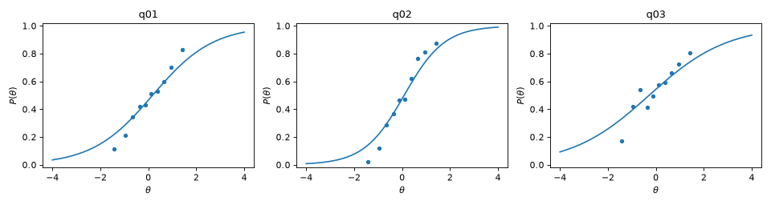
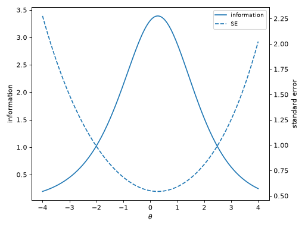
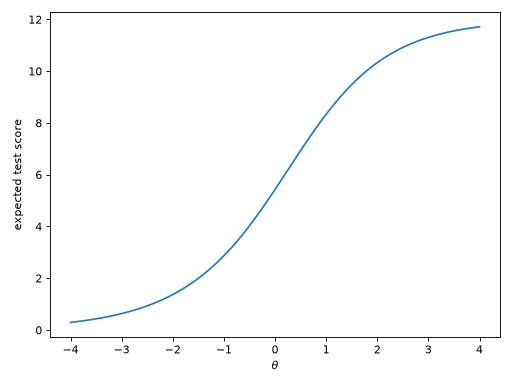
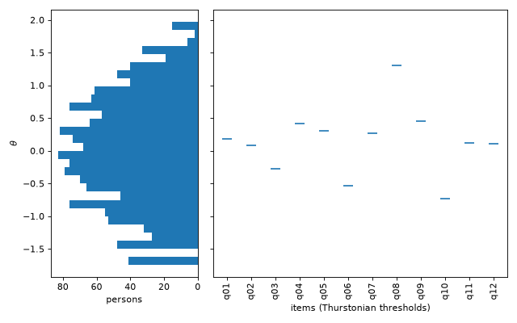
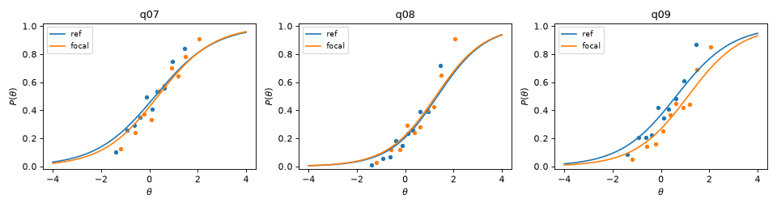

# User guide

English | [日本語](guide.ja.md)

How to specify, fit and interpret IRT models with flexpyirt. The code on this page runs top to
bottom as one script. For the arguments of each function, see the [API reference](reference.md);
for the models and algorithms behind them, see [Theory](theory.md).

1. [Setup](#1-setup)
2. [Data format](#2-data-format)
3. [Specifying a model](#3-specifying-a-model)
4. [Fitting](#4-fitting)
5. [Reading the results](#5-reading-the-results)
6. [Standard errors](#6-standard-errors)
7. [Scoring](#7-scoring)
8. [Latent distributions and identification](#8-latent-distributions-and-identification)
9. [Multiple groups](#9-multiple-groups)
10. [Fixed item parameter calibration (FIPC)](#10-fixed-item-parameter-calibration-fipc)
11. [Priors and MAP estimation](#11-priors-and-map-estimation)
12. [Editing the ParameterTable](#12-editing-the-parametertable)
13. [Choosing the quadrature grid](#13-choosing-the-quadrature-grid)
14. [Confirmatory multidimensional models](#14-confirmatory-multidimensional-models)
15. [Scale linking](#15-scale-linking)
16. [Polychoric correlations](#16-polychoric-correlations)
17. [Number of dimensions](#17-number-of-dimensions)
18. [Local dependence and the dimensionality report](#18-local-dependence-and-the-dimensionality-report)
19. [DETECT](#19-detect)
20. [User-defined item models](#20-user-defined-item-models)
21. [Errors and warnings](#21-errors-and-warnings)

## 1. Setup

flexpyirt computes in 64-bit floating point. The JAX setting belongs to you, so the library does
not change it at import. Enable it before fitting (calling `fit()` without it raises
`PrecisionError`).

```python
import jax

jax.config.update("jax_enable_x64", True)

import numpy as np
import pandas as pd

from flexpyirt import (
    BAEM,
    GPCM,
    GRM,
    PCM,
    BetaPrior,
    FitResult,
    FourPL,
    LogNormalPrior,
    Model,
    Nominal,
    Normal,
    NormalPrior,
    Quadrature,
    Rasch,
    ThreePL,
    TwoPL,
    fit,
)
```

Simulate the data used in the examples below.

```python
rng = np.random.default_rng(2026)


def simulate_2pl(a, d, theta, rng):
    """Generate 0/1 responses from a 2PL model."""
    p = 1.0 / (1.0 + np.exp(-(np.outer(theta, a) + d)))
    return (rng.random(p.shape) < p).astype(float)


n_items = 12
items = [f"q{j:02d}" for j in range(1, n_items + 1)]
a_true = rng.lognormal(0.0, 0.3, n_items)
d_true = rng.normal(0.0, 1.0, n_items)
df = pd.DataFrame(simulate_2pl(a_true, d_true, rng.normal(0, 1, 1500), rng), columns=items)
```

## 2. Data format

- **One row per respondent, one column per item.** Column names are the item names.
- A pandas DataFrame, a polars DataFrame or a 2-D numpy array. For an array, pass the column names
  with `item_names=` (without it, columns are taken in the model's item order).
- Values are category numbers `0, 1, ..., K-1`; dichotomous items are 0/1. **Missing is NaN**
  (missing at random; it is left out of the likelihood).
- Columns that are not in the model, or model items missing from the data, are errors. Drop extra
  columns first.
- Every category of an item with estimated parameters must appear at least once in the data
  (otherwise its threshold diverges; collapse categories or fix the item).

```python
arr = df.to_numpy()
spec = Model.uniform(TwoPL(), items=items)
res_np = fit(spec, arr, item_names=items, se=None)
```

## 3. Specifying a model

A model is an immutable `Model` object. Methods such as `.fix()` and `.with_groups()` return a new
`Model` and leave the original unchanged.

```python
spec = Model.uniform(TwoPL(), items=items)  # same item model for every item
# per item
mixed = Model.from_items({"x1": TwoPL(), "x2": Rasch(), "s1": GRM(n_categories=4)})
print(spec.item_names[:3], mixed.item_names)
```

### Item models

| Class | Response probability | Internal parameters | Display (added to `items`) |
|---|---|---|---|
| `TwoPL()` | $P(y=1)=\sigma(a\theta+d)$ | `a`, `d` | `b = -d/a` |
| `Rasch()` | $P(y=1)=\sigma(\theta+d)$ ($a=1$ fixed) | `a` (fixed), `d` | `b = -d` |
| `ThreePL()` | $P(y=1)=g+(1-g)\sigma(a\theta+d)$ ($u=1$ fixed) | `a`, `d`, `g`, `u` (fixed) | `b = -d/a` |
| `FourPL()` | $P(y=1)=g+(u-g)\sigma(a\theta+d)$ | `a`, `d`, `g`, `u` | `b = -d/a` |
| `GRM(n_categories=K)` | $P(y\ge k)=\sigma(a\theta+d_k)$, $d_1>\dots>d_{K-1}$ | `a`, `d1`…`d{K-1}` | `bk = -dk/a` |
| `GPCM(n_categories=K)` | $P(y=k)\propto\exp(k\,a\theta+d_k)$, $d_0=0$ | `a`, `d1`…`d{K-1}` | `bk = -(dk - d{k-1})/a` |
| `PCM(n_categories=K)` | $P(y=k)\propto\exp(k\theta+d_k)$ ($a=1$ fixed, $d_0=0$) | `a` (fixed), `d1`…`d{K-1}` | `bk = -(dk - d{k-1})` |
| `Nominal(n_categories=K)` | $P(y=k)\propto\exp(a\,\mathrm{ak}_k\,\theta+d_k)$, $\mathrm{ak}_0=0, \mathrm{ak}_{K-1}=K-1, d_0=0$ | `a`, `ak1`…`ak{K-2}`, `d1`…`d{K-1}` | — |

The parameterization is mirt's slope–intercept form (`itemtype = "2PL"`, `"Rasch"`, `"3PL"`,
`"4PL"`, `"graded"`, `"gpcm"`, `"nominal"` — mirt's `"Rasch"` on polytomous data is `PCM`). For 3PL and 4PL,
`g` and `u` are estimated on the natural scale with $0 < g < u \le 1$ (mirt optimizes them on the
logit scale; the interior ML estimates agree). Polytomous categories start at 0 (subtract 1 from
data coded from 1, such as mirt's `Science`). `Nominal` has no display `b` columns: its
categories are not ordered, so adjacent-category thresholds on the $\theta$ scale are not defined
in general (they are singular when $\mathrm{ak}_k=\mathrm{ak}_{k-1}$), and mirt's
`coef(m, IRTpars = TRUE)` reports Bock's zero-sum slopes and intercepts instead. A model that is
not in the table can be written by the user ([section 20](#20-user-defined-item-models)).

```python
theta3 = rng.normal(0, 1, 2000)
a3 = np.array([1.6, 1.8, 1.7, 1.6, 1.9, 1.7, 1.8, 1.6, 1.9, 1.7])
d3 = np.array([-1.0, -0.7, -1.2, -0.8, -0.9, -0.6, -1.1, -0.8, -1.0, -0.7])
g3 = np.full(len(a3), 0.2)
p3 = g3 + (1.0 - g3) / (1.0 + np.exp(-(np.outer(theta3, a3) + d3)))
df_3pl = pd.DataFrame(
    (rng.random(p3.shape) < p3).astype(float), columns=[f"c{j}" for j in range(1, len(a3) + 1)]
)
res_3pl = fit(Model.uniform(ThreePL(), items=df_3pl.columns), df_3pl)
print(res_3pl.items[["item", "a", "d", "g", "b"]].round(3))
```

```python
n_categories = 4
cuts = np.array([-1.0, 0.2, 1.3])
theta = rng.normal(0, 1, 800)
latent_cont = np.outer(theta, np.ones(5)) + rng.logistic(0, 1, (800, 5))
grm_df = pd.DataFrame(
    np.searchsorted(cuts, latent_cont).astype(float), columns=[f"s{j}" for j in range(1, 6)]
)
grm = fit(Model.uniform(GRM(n_categories=n_categories), items=grm_df.columns), grm_df)
print(grm.items[["item", "a", "d1", "d2", "d3", "b1", "b2", "b3"]].round(3))
```

```python
gpcm = fit(Model.uniform(GPCM(n_categories=n_categories), items=grm_df.columns), grm_df)
print(gpcm.items[["item", "a", "d1", "d2", "d3", "b1", "b2", "b3"]].round(3))
```

```python
nominal = fit(Model.uniform(Nominal(n_categories=n_categories), items=grm_df.columns), grm_df)
print(nominal.items[["item", "a", "ak1", "ak2", "d1", "d2", "d3"]].round(3))
```

### Fixing parameters

`.fix(item=..., <param>=value)` fixes internal (slope–intercept) parameters. Fixed parameters are
not estimated and their standard errors are NaN.

```python
spec_fixed = Model.uniform(TwoPL(), items=items).fix(item="q01", a=1.0, d=0.0)
```

## 4. Fitting

```python
res = fit(
    spec,
    df,
    method=BAEM(tol=1e-4, max_iter=2000, m_step_newton_steps=3, squarem=False),  # defaults
    quadrature=Quadrature.equispaced(61, bounds=(-6, 6)),  # default
    se="oakes",  # default
)
```

- **`method`**: EM settings. EM stops when the largest absolute change of the free parameters
  between successive accepted iterates is below `tol` (the same definition as mirt's `TOL`).
  Reaching `max_iter` gives a `ConvergenceWarning`. Each M-step takes `m_step_newton_steps`
  Newton steps; none of them decreases the expected log-likelihood, so EM stays monotone.
- **`squarem=True`**: enables SQUAREM acceleration (scheme S3; Varadhan & Roland, 2008). Each
  SQUAREM iteration performs two EM map evaluations, extrapolates along the step, and applies one
  stabilizing EM step (3 EM evaluations per accepted iterate, or 2 if the monotonicity/feasibility
  safeguard falls back to $\theta_2$). Turn it on for slow-converging models (Rasch/PCM with free
  variance, multiple groups, 3PL/4PL, or tight `tol`). It converges to the same fixed point with
  monotone `history["loglik"]` and far fewer EM evaluations. Plain EM (`squarem=False`) is the
  default.
- **`m_step_scale="unconstrained"`** (default `"natural"`): runs the M-step's Newton steps on
  $\operatorname{logit}$ / $\log$ scales of the parameters that have a bound — $g$ and $u$ on
  $\operatorname{logit}$, latent variances on $\log$, factor correlations on
  $2\operatorname{atanh}\rho$, and a slope only when a `LogNormalPrior` or an edited bound
  restricts it to $(0, \infty)$. Unbounded parameters such as slopes are not transformed, so
  negative slopes stay possible. The objective is the same, so an interior solution is the same as
  with the default; the estimates, parameter table, priors and standard errors stay on the natural
  scale. The difference is at a bound: the default stops exactly on it (e.g. $g=0$), while the
  unconstrained scale only approaches it, sometimes after many more iterations. Both raise
  `HeywoodWarning` once a parameter is within `1e-4` of its bound.
- **`quadrature`**: the latent-variable grid. The default is 61 equally spaced points on
  $[-6, 6]$ (mirt's default). See [section 13](#13-choosing-the-quadrature-grid) for when to
  widen it.
- **`se`**: `"oakes"` (default), `"hessian"`, `"sandwich"`, `"crossprod"`, or `None` (skip); see
  [section 6](#6-standard-errors).

```python
res_sq = fit(spec, df, method=BAEM(tol=1e-6, squarem=True), se=None)
print(res_sq.n_iter, res_sq.n_em_evaluations, res_sq.n_safeguards)
print(res_sq.history.tail(3))  # iter, loglik, max_change, em_evaluations, safeguard
```

The first fit includes JAX compilation time. Later fits of data with the same shape are faster.

### Sampling weights

For data from a complex sample (a survey with unequal selection probabilities, large-scale
assessments), pass one weight per row with `weights=`. The estimates then maximize the weighted
log-likelihood $\sum_i w_i \log L_i$ (mirt's `survey.weights`).

```python
sampling_weights = np.random.default_rng(7).uniform(0.5, 2.0, len(df))
# Optional: rescale so that the weights sum to the number of rows.
sampling_weights *= len(df) / sampling_weights.sum()
res_w = fit(spec, df, weights=sampling_weights, se=None)
print(res_w.loglik, res_w.bic)
```

- `weights` is an array with one finite, non-negative number per row (it works with `group=`,
  missing data, fixed parameters, priors and every latent distribution). Rows with weight 0 are
  ignored. Integer weights give the same result as repeating the rows.
- The weights are used as given. `loglik`, `aic` and `bic` are on the scale of the weights, and
  `bic` uses the logarithm of the sum of the weights in place of $\log N$. Rescale the weights to
  sum to the number of rows if you want values comparable with an unweighted fit.
- **Standard errors**: `se="oakes"` and `se="hessian"` invert the information of the weighted
  log-likelihood. That is correct for frequency weights (repeated rows) but **not a valid variance
  estimate under sampling weights**; `fit()` warns (`FlexpyirtWarning`) when `weights` is used
  with either. Pass `se=None` unless your weights are frequencies.
- Scoring (`res_w.score(...)`) works as usual. `item_fit()`, `m2()`, `local_dependence()`,
  `jsi()`, `dif()` and `model_parallel_analysis()` are not available for a weighted fit and raise
  `SpecificationError`.

## 5. Reading the results

`fit()` returns a `FitResult`. Call `res.summary()` for a readable plain-text report (in Jupyter
notebooks, evaluating `res` renders an equivalent HTML summary via `_repr_html_()`).

```python
print(res)  # FitResult(loglik=..., n_params=..., n_obs=..., converged in ... iterations, se=oakes)
print(res.summary())  # readable summary: model, fit statistics, latent and item tables
print(res.items.head(3))  # estimates and SEs per item (including b and delta-method b_se)
print(res.latent)  # latent distribution per group (mean, var and their SEs)
print(res.loglik, res.aic, res.bic, res.n_params, res.n_obs)
print(res.converged, res.n_iter, res.n_em_evaluations, res.n_safeguards)
print(res.history.tail(3))  # iter, loglik, max_change, em_evaluations, safeguard
```

| Attribute / method | Contents |
|---|---|
| `summary(digits=4)` | Readable text summary of the model, sample/group/convergence info, log-likelihood, log-posterior, AIC/BIC (with an inline note under MAP), latent table and item table; Jupyter displays an HTML rendering via `_repr_html_()` |
| `items` | One row per item (per group × item with groups): `model`, internal parameters, `<param>_se`, display `b` / `bk` and delta-method `b_se` / `bk_se` |
| `latent` | One row per group: `group`, `mean`, `var`, `mean_se`, `var_se` (SEs of fixed values are NaN) |
| `parameters` | The ParameterTable ([section 12](#12-editing-the-parametertable)) plus `estimate` and `se` |
| `loglik`, `log_posterior`, `aic`, `bic` | Marginal log-likelihood, log posterior (equals `loglik` without priors), and information criteria ($-2\ell+2k$, $-2\ell+k\log N$; warn with `FlexpyirtWarning` under MAP) |
| `n_params`, `n_obs` | Number of free parameters and respondents |
| `converged`, `n_iter`, `n_em_evaluations`, `n_safeguards` | Whether EM converged, accepted iterations, total EM map evaluations (equal to `n_iter` for plain EM), and SQUAREM safeguard interventions |
| `history` | Per accepted iterate: `iter`, `loglik`, `log_posterior`, `max_change`, `em_evaluations` (cumulative), and `safeguard` (whether the SQUAREM safeguard fired) |
| `vcov`, `se_method` | Covariance matrix of the free parameters (in `free_id` order) and how it was computed |
| `to_json(path=None, *, indent=2)` / `FitResult.from_json(source)` | Save a fitted result to plain, strict JSON (optionally writing `path`) and reload it without refitting |

`history.loglik` never decreases between iterations (EM is monotone). If it does, that is a bug;
please report it.

```python
assert (res.history["loglik"].diff().dropna() >= -1e-8).all()
```

### Saving and loading (JSON)

Save a `FitResult` to plain, versioned JSON with `to_json()` and reload it later with
`FitResult.from_json()` without refitting. No `pickle` or `eval` is used: finite float64 values are
stored as `repr`-exact JSON numbers and non-finite values (`NaN`, `±inf`) are encoded explicitly so
the output is valid strict JSON and round-trips bit-for-bit. A loaded result reproduces every
attribute, `summary()`, `_repr_html_()`, and `score()` identically. Enable JAX 64-bit floating
point before calling `from_json()` (`PrecisionError` otherwise).

```python
import tempfile
from pathlib import Path

json_str = res.to_json()  # returns a strict JSON string (pass indent=None for compact output)
loaded_str = FitResult.from_json(json_str)

with tempfile.TemporaryDirectory() as tmp:
    out_path = Path(tmp) / "fit_result.json"
    res.to_json(out_path)  # writes UTF-8 JSON to disk and also returns the string
    loaded = FitResult.from_json(out_path)

assert loaded.summary() == res.summary()
np.testing.assert_array_equal(loaded.score(df).to_numpy(), res.score(df).to_numpy())
```

### Item fit (S-X2)

`item_fit(data)` computes Orlando and Thissen's S-X2 for every item: observed versus model-implied
counts of each response category at each summed score, with sparse cells collapsed exactly as
mirt's `itemfit()` does (`min_cell=1` by default). It needs complete data, every response category
observed, and `Normal` latent distributions. A confirmatory model with two or three factors
(`with_factors()`, single group) works too: the summed score is still the total over all items, and
the expected counts integrate over the product grid of the fit. For a multiple-group
model pass `group=`: S-X2 is computed within each group (as mirt does), with a leading `group`
column.

```python
fit_table = res.item_fit(df)  # item, s_x2, df, rmsea, p (one row per item)
print(fit_table.round(3))
```

### Summed-score distribution

`summed_score_distribution(probs)` gives the distribution of the summed score when the item scores
are independent with the category probabilities `probs` (shape `(..., J, K)`), which is the
situation of an IRT model at a fixed $\theta$. For dichotomous items this is the Poisson-binomial
distribution; the default method is the Lord–Wingersky recursion, which S-X2 above uses as well.
Leading axes are batch axes, so one call covers all quadrature nodes.

```python
import jax.numpy as jnp

from flexpyirt import summed_score_distribution

theta_grid = jnp.linspace(-3.0, 3.0, 7)
a_ss = jnp.array([1.2, 0.8, 1.5, 1.0, 1.7])
b_ss = jnp.array([-1.0, -0.3, 0.0, 0.6, 1.2])
p_correct = 1.0 / (1.0 + jnp.exp(-a_ss * (theta_grid[:, None] - b_ss)))  # (7 nodes, 5 items)
probs_ss = jnp.stack([1.0 - p_correct, p_correct], axis=-1)  # (7, 5, 2)

score_dist = summed_score_distribution(probs_ss)  # (7, 6): P(S = 0..5 | theta)
print(np.round(np.asarray(score_dist), 3))
print(np.asarray(score_dist).sum(axis=1))  # each row sums to 1
```

`method="fft"` is an alternative exact method whose error is absolute (about `1e-16`), so it is
not suited to very small tail probabilities; `"normal"`, `"refined_normal"` and `"poisson"` are
approximations for dichotomous items. `log=True` returns log probabilities and keeps tails that
would underflow. The results are checked against R's `poibin` and mirt's summed-score tables. See
the [reference](reference.md#summed_score_distribution) for details.

### Information, expected score and reliability

`item_information(res, theta)` and `test_information(res, theta)` give the Fisher information of
each item and of the whole test at the values `theta`, and `expected_score(res, theta)` gives the
expected item scores and their sum, the test characteristic curve. They work for every item
model. Each returns a DataFrame indexed by `theta`, so `.plot()` draws the curves (multidimensional
models: [section 14](#information-of-multidimensional-models)). `test_information` also has the conditional standard error `se` $=1/\sqrt{I(\theta)}$ (unidimensional models).

`reliability(res)` returns the marginal reliability: the reliability
$\sigma^2/(\sigma^2+1/I(\theta))$ of a score with error variance $1/I(\theta)$, averaged over the
fitted latent distribution. With response data, `reliability(res, data)` adds the empirical
reliability of the EAP scores of those respondents: the variance of the scores divided by that
variance plus the mean squared standard error.

```python
from flexpyirt import expected_score, item_information, reliability, test_information

theta_values = np.linspace(-3.0, 3.0, 13)
item_info = item_information(res, theta_values)  # index theta, one column per item
test_info = test_information(res, theta_values)  # columns information, se
tcc = expected_score(res, theta_values)  # one column per item, and total
print(item_info.iloc[:3, :3].round(3))
print(test_info.head(3).round(3))
print(tcc["total"].head(3).round(2))

print(reliability(res))  # column marginal
print(reliability(res, df))  # with data: columns marginal, empirical
```

- For a multiple-group model the three functions of `theta` need `group="<group name>"`, and
  `reliability()` returns one row per group (pass `group=labels` together with `data`).
- The marginal reliability equals mirt's `marginal_rxx()` when the latent distribution is
  $N(0, 1)$. For another mean or variance mirt's function does not use the fitted distribution;
  flexpyirt's value does, and it does not change when the latent scale is transformed linearly.
- `reliability()` needs `Normal` latent distributions.

### Plots

`flexpyirt.plotting` draws the figures looked at in every analysis: item characteristic curves
with observed proportions, information curves, the test characteristic curve and the
item–person (Wright) map. It needs matplotlib, installed with `pip install "flexpyirt[plot]"`;
without it `import flexpyirt` still works and the plot functions raise
`MissingDependencyError`. The functions return matplotlib objects (save them with
`fig.savefig(...)`) and never call `plt.show()`.

Every number in a figure comes from a function that returns a DataFrame, so the figures can be
redrawn with any other library:

- `item_probabilities(res, theta)`: the category probabilities $P_{jk}(\theta)$ (mirt's
  `probtrace()`), one row per item, category and `theta`.
- `empirical_item_curve(res, data)`: respondents sorted by EAP $\theta$ and cut into `n_bins`
  bins of equal size (as mirt's `itemfit()`); per bin and category the mean `theta`, the number
  of respondents `n`, the `observed` proportion and the model's `expected` probability at that
  mean.
- `wright_map_table(res, data)`: `persons` (EAP scores) and `items` (for each item and category
  $k\ge1$ the `location` where $P(Y\ge k\mid\theta)=1/2$, the Thurstonian threshold; $b$ for
  2PL items).

```python
from flexpyirt import empirical_item_curve, item_probabilities, wright_map_table

trace = item_probabilities(res, np.linspace(-3.0, 3.0, 7), items="q01")
print(trace.head(3).round(3))  # item, category, theta, probability
observed = empirical_item_curve(res, df, items=["q01"], n_bins=10)
print(observed.head(4).round(3))  # item, bin, theta, n, category, observed, expected
wright = wright_map_table(res, df)
print(wright.items.head(3).round(3))  # item, category, location
```

```python
from flexpyirt.plotting import (
    plot_expected_score,
    plot_information,
    plot_item_curves,
    plot_wright_map,
)

fig_curves = plot_item_curves(res, items[:3], data=df)  # one panel per item, observed points
ax_information = plot_information(res, standard_error=True)  # test information and its SE
ax_expected = plot_expected_score(res)  # test characteristic curve
fig_wright = plot_wright_map(res, df)  # persons beside item locations
```








- `plot_item_curves` draws $P(Y=1\mid\theta)$ for dichotomous items and every category for
  polytomous items; `ax=` draws a single item into existing axes.
- `plot_information(res, items=[...])` draws item information instead of test information.
- For a multiple-group model the curves of every group are drawn (see
  [DIF](#differential-item-functioning-dif)); with `data`, pass `group=labels` as for
  `score()`.

### Limited-information fit (M2)

`m2(data)` computes the Maydeu-Olivares & Joe (2005, 2006) limited-information goodness-of-fit
statistic on the item-score means and pairwise cross-products (mirt's default `M2(type = "M2*")`;
identically $M_2$ for dichotomous items), together with RMSEA and its confidence interval
(`ci=0.90` by default), SRMSR, and — for dichotomous models — TLI and CFI against the independence
null model (polytomous models report `NaN` for `tli` and `cfi`, because the independence null
model is defined for dichotomous items only).
It requires complete data and a single-group `Normal` MLE fit (no priors), unidimensional or
confirmatory with two or three factors (`with_factors()`). With free factor correlations the value
is slightly smaller than mirt's `M2()`, which leaves the correlations out of the derivative matrix
while counting them in the degrees of freedom. Bifactor and two-tier models are not supported yet
by `m2()` or `item_fit()`.

```python
m2_table = res.m2(df)  # m2, df, p, rmsea, rmsea_5, rmsea_95, srmsr, tli, cfi
print(m2_table.round(3))
```

## 6. Standard errors

- **`se="oakes"`** (default): the observed information from Oakes' (1999) identity. The second
  derivatives through the E-step expected counts come from JAX autodiff.
- **`se="hessian"`**: the second derivative of the marginal log-likelihood, taken directly.

- **`se="crossprod"`**: the inverse of the cross-product of the per-respondent scores (the
  gradients of each respondent's log-likelihood).
- **`se="sandwich"`**: the robust (Huber–White) covariance, the inverse information multiplied on
  both sides of the cross-product.

`"oakes"` and `"hessian"` are the same quantity mathematically and agree numerically up to
rounding. Rows and columns of `vcov` follow the free-parameter numbers (`free_id` in the
ParameterTable).

```python
res_h = fit(spec, df, se="hessian")
print(np.max(np.abs(res.vcov - res_h.vcov)))  # practically 0

params = res.parameters
labels = params[params["free"]].drop_duplicates("free_id").sort_values("free_id")
vcov = pd.DataFrame(
    res.vcov,
    index=labels["item"] + "." + labels["param"],
    columns=labels["item"] + "." + labels["param"],
)
print(vcov.iloc[:2, :2])
```

**Robust standard errors.** `"oakes"` and `"hessian"` assume that the model is correct. When it
is not (local dependence, a wrong item model, a latent distribution far from the one assumed),
the estimates still converge to the best-fitting parameters, but those standard errors are no
longer valid; `se="sandwich"` remains valid. `se="crossprod"` is a third estimate that equals the
other two in large samples when the model is correct. A sandwich SE that is clearly different from
the Oakes SE is itself a sign of misfit.

```python
res_sw = fit(spec, df, se="sandwich")
print((res_sw.parameters["se"] / res.parameters["se"]).describe())  # near 1 if the model fits
```

- Everything computed from `vcov` uses the covariance you chose: the `se` column, `b_se` /
  `bk_se`, the latent `sd` / `cor` SEs, and `link()`.
- With priors, the prior's curvature is added to the cross-product as it is to the information.
- With `EmpiricalHistogram`, the histogram is held at its estimate, as for the other methods.
- Not available with `DavidianCurve` or `NormalMixture`, or for bifactor and two-tier models
  (`SpecificationError`).
- Respondents are treated as independent; sampling weights and clustered samples are not handled,
  and a fit with `weights=` raises `SpecificationError` for both options.
- `"sandwich"` and `"crossprod"` need more distinct response patterns than free parameters, and
  are noisier than `"oakes"` in small samples.

If the information matrix is not positive definite (estimates on a boundary, weak
identification), flexpyirt warns and the SEs are NaN. `FitResult.items` also includes delta-method
standard errors (`b_se` / `bk_se`) for the display IRT thresholds (`b = -d/a`, GRM `bk = -dk/a`,
and GPCM/PCM step difficulties `bk = -(dk - d{k-1})/a`), computed from `vcov` with JAX autodiff
Jacobians; fixed parameters contribute no variance (so Rasch/PCM with `a = 1` fixed has
`b_se = d_se` / `b1_se = d1_se`), and the columns are NaN when `se=None` or every parameter
entering a threshold is fixed.

## 7. Scoring

`FitResult.score()` estimates each respondent's latent ability $\theta$ with six methods:

| `method` | Definition | Extreme patterns (all lowest / highest) | All-missing row | When to use |
|---|---|---|---|---|
| `"EAP"` (default) | Posterior mean & SD on the fitted quadrature grid (Bock & Mislevy, 1982) | Finite | Prior mean & SD | Fast, low MSE for individual scores; good general default |
| `"MAP"` | Posterior mode with continuous normal prior $N(\mu_g,\sigma_g^2)$ & observed curvature SE | Finite | Prior mode $\mu_g$ & SD $\sigma_g$ | Modal Bayesian estimate without grid discretization |
| `"ML"` | Maximum likelihood & observed-information SE | $-\infty$ / $+\infty$, SE NaN | NaN, SE NaN | Prior-free score when reporting individual performance without shrinkage |
| `"WLE"` | Weighted likelihood $\partial\log L/\partial\theta + I'(\theta)/(2I(\theta))=0$ & observed curvature SE (Warm, 1989; Firth, 1993) | Finite | NaN, SE NaN | Prior-free score with reduced finite-test bias and finite extreme scores |
| `"PV"` | `n_draws` independent draws per respondent from the posterior (Mislevy, 1991), columns `pv1..pvM` | Finite | Drawn from the prior | Downstream population / regression analyses that must propagate measurement error |

| `"EAPsum"` | Posterior mean & SD given the summed score instead of the response pattern (Thissen et al., 1995) | Finite | NaN, SE NaN | Scores that depend on the summed score only (score conversion tables) |

- Bayesian methods (`"EAP"`, `"MAP"`, `"PV"`, `"EAPsum"`) use the respondent's group's estimated latent
  distribution as the prior; `"ML"` and `"WLE"` use the item likelihood only.
- Missing responses are dropped from the likelihood (and from $I(\theta)$ in `"WLE"`) for every
  method except `"EAPsum"`, which returns NaN for a row with any missing response (see below). In 3PL/4PL models, low-score patterns whose likelihood increases monotonically toward
  $-\infty$ due to guessing also return $-\infty$ with SE NaN under `"ML"`. For `Nominal` items,
  "lowest" / "highest" means the category with the smallest / largest category slope
  $a\,\mathrm{ak}_c$, which need not be category 0 / $K-1$ (e.g. with $\mathrm{ak}_1<0$ the all-0
  pattern has a finite ML estimate; mirt returns $-\infty$ there, see
  [Accuracy and validation](accuracy.md)).
- **`method="PV"` requires an explicit JAX PRNG `key`** (e.g. `jax.random.key(0)`): flexpyirt
  never uses global random state, so results are fully deterministic given `key` while giving
  independent draws to respondents even when they share the same response pattern.

```python
scores_eap = res.score(df)  # default: method="EAP" -> columns theta, se
scores_map = res.score(df, method="MAP")
scores_ml = res.score(df, method="ML")
scores_wle = res.score(df, method="WLE")
print(scores_eap.head(3))  # theta, se (index follows df)
print(scores_wle.head(3))

# Plausible values require an explicit JAX PRNG key (deterministic given key).
key = jax.random.key(0)
pvs = res.score(df.iloc[:5], method="PV", key=key, n_draws=5)
print(pvs)  # columns pv1..pv5

new = df.iloc[:2].copy()
new.iloc[0, :3] = np.nan  # partly missing rows are scored too
print(res.score(new, method="MAP"))
```

The scored data need not be the data used for fitting (the columns must be the same items).

### Summed-score EAP

`summed_score_table(res)` lists, for every possible summed score, the posterior mean (`theta`) and
standard deviation (`se`) of $\theta$ among respondents with that score, and the probability of
the score under the fitted model (`probability`). It is a conversion table from summed scores to
the $\theta$ scale. `score(data, method="EAPsum")` looks each respondent up in it.

```python
from flexpyirt import summed_score_table

score_table = summed_score_table(res)  # score, theta, se, probability
print(score_table.head(4).round(3))
scores_sum = res.score(df, method="EAPsum")  # theta, se of each row's summed score
print(scores_sum.head(3))
```

- A respondent with a missing response gets NaN: a summed score over fewer items is not
  comparable with the table (mirt returns `NA` as well). Use `"EAP"` for incomplete data.
- The table uses the quadrature grid and latent distribution of the fit, like `"EAP"`. For a
  multiple-group model it has a `group` column, and each respondent is scored with the table of
  their group.
- Unidimensional models with `Normal` latent distributions only.

## 8. Latent distributions and identification

The latent distribution is a normal `Normal`, with weights from the density normalized on the
grid.

```python
Normal.standard()  # N(0, 1), nothing estimated
Normal(free_var=True)  # N(0, σ²), variance estimated (mean fixed at 0)
Normal.free()  # mean and variance estimated
Normal(mean=0.5, var=1.2)  # fixed values
```

**Default**: in a single-group model without an explicit latent distribution, it is
$N(0,\sigma^2)$ with the variance estimated when every item is Rasch or PCM, and $N(0,1)$
otherwise. Rasch and PCM slopes are fixed at 1, so the variance carries the scale (as in mirt).

```python
rasch = fit(Model.uniform(Rasch(), items=items), df)
print(rasch.latent[["mean", "var", "var_se"]])
```

Estimating the latent mean or variance needs something that fixes the scale. flexpyirt checks
this before fitting and raises `IdentificationError` if it is missing.

- A free variance needs at least one **fixed slope** with a nonzero value (Rasch items,
  `.fix(a=...)`, or, with multiple groups, anchor items whose slopes are equal across groups).
- A free mean needs at least one **fixed intercept** (FIPC, or anchor items with multiple groups).

```python
from flexpyirt.errors import IdentificationError

try:
    fit(Model.uniform(TwoPL(), items=items).with_latent(Normal(free_var=True)), df)
except IdentificationError as e:
    print("IdentificationError:", e)
```

### Empirical histogram (EH)

`EmpiricalHistogram()` replaces the normal distribution with free weights on the quadrature nodes
(Woods, 2007), for skewed or multimodal latent distributions. The weights are re-estimated at every
EM iteration and count as parameters (`n_params`, AIC, BIC).

```python
from flexpyirt import EmpiricalHistogram

eh = fit(Model.uniform(TwoPL(), items=items).with_latent(EmpiricalHistogram()), df)
print(eh.latent)  # group, mean, var, sd, skewness, kurtosis (excess)
print(eh.latent_weights.head())  # group, node, weight
```

- **Identification**: unless fixed items set the scale (FIPC), the reference group's histogram is
  constrained to mean 0 and variance 1 at every iteration (mean only for Rasch/PCM). Under FIPC
  the histogram is free. With multiple groups every group uses EH, and focal groups are linked by
  anchor items.
- `min_weight` (default `1e-10`) is a floor on every node, so empty nodes keep finite log-weights.
- Standard errors are for the item parameters with the histogram held at its estimate (as in
  mirt).
- Scoring: EAP, ML, WLE and PV use the histogram; MAP needs a continuous prior and raises
  `SpecificationError`.
- Many histogram weights are only weakly determined, so EM converges slowly at tight tolerances;
  `BAEM(squarem=True)` helps.

### Davidian curves

`DavidianCurve(degree)` models a smooth non-normal unidimensional latent density
$h_k(z;\boldsymbol\phi) = P_k(z;\boldsymbol\phi)^2\varphi(z)$ using $k \in \{1,\dots,10\}$ angle
parameters `phi_1`…`phi_k` (Zhang & Davidian, 2001; Woods & Lin, 2009), analytically standardized
so the continuous mean and variance equal `mean` (default `0`) and `var` (default `1`) for every
$\boldsymbol\phi$. Unlike `EmpiricalHistogram`, it adds only $k$ latent parameters and provides
joint Oakes and Hessian standard errors for both item and latent parameters.

```python
from flexpyirt import DavidianCurve

theta_skew = (rng.chisquare(4.0, 1200) - 4.0) / np.sqrt(8.0)
skew_df = pd.DataFrame(simulate_2pl(a_true, d_true, theta_skew, rng), columns=items)

dc = fit(
    Model.uniform(TwoPL(), items=items).with_latent(DavidianCurve(3)),
    skew_df,
    method=BAEM(squarem=True),
)
print(dc.latent.round(3))  # mean, var, phi_1..phi_3 and SEs
print(dc.score(skew_df.iloc[:3], method="EAP").round(3))  # uses the fitted Davidian prior
```

- **Identification**: `mean` and `var` follow the same rules as `Normal` (fixed at `0` and `1` by
  default; pass `free_var=True` for Rasch/PCM, or `DavidianCurve.free(degree)` under FIPC).
- **Scope**: single-group unidimensional models only (`with_groups()` and `with_factors()` raise
  `SpecificationError`).
- **Scoring**: `"EAP"` and `"PV"` use the fitted Davidian density; `"ML"` and `"WLE"` are
  likelihood-only; `"MAP"` raises `SpecificationError` because a Davidian density can be multimodal
  and vanish at real roots of $P_k$.
- **Near-normal traits and local maxima**: at $\boldsymbol\phi=\mathbf 0$ (the normal density) the
  first-order effects of `phi_1` and `phi_2` are pure location / scale changes, which the
  standardization removes, so the Fisher information is singular there (in `phi_1` for
  `degree=1`). When the trait is close to normal, the angles are poorly determined, their
  standard errors are unreliable, and a likelihood-ratio test of `DavidianCurve` against `Normal`
  does not follow its usual $\chi^2$ distribution; compare degrees (and `Normal`) by AIC / BIC
  instead (Woods & Lin, 2009). The likelihood can also have several local maxima (in a `degree=1`
  example the default start reached `phi_1 = 0.50` while a start at `-1.0` reached a fit 2.2
  log-likelihood points better), so for important analyses refit from a few starting angles
  (edit `value` of the `phi_*` rows of `Model.parameter_table()` and pass `table=`) and keep the
  fit with the highest `loglik`.

### Normal mixtures

`NormalMixture(n_components)` models the latent density as a finite mixture of $k \in
\{2,\dots,10\}$ normal components with one common set of item parameters (Mislevy, 1984), for
example a population made of two subpopulations. The shape follows mirt's `dentype = "mixture-k"`
(raw component 1 is $N(0,1)$; components $c\ge 2$ have `rmean_c`, `rvar_c` and
`logit_c` $=\log(\pi_c/\pi_1)$), and the whole mixture is analytically standardized so its
continuous mean and variance equal `mean` (default `0`) and `var` (default `1`), like
`DavidianCurve`. `latent` adds the standardized components: mixing proportions `pi_c`, means
`mean_c` and variances `var_c`, with delta-method SEs.

```python
from flexpyirt import NormalMixture

group_b = rng.random(1500) < 0.35
theta_bi = np.where(group_b, rng.normal(2.2, 0.6, 1500), rng.normal(0.0, 1.0, 1500))
bi_df = pd.DataFrame(simulate_2pl(a_true, d_true, theta_bi, rng), columns=items)

mix = fit(
    Model.uniform(TwoPL(), items=items).with_latent(NormalMixture(2)),
    bi_df,
    method=BAEM(squarem=True),
)
print(mix.latent[["pi_1", "pi_2", "mean_1", "mean_2", "var_1", "var_2"]].round(3))
print(mix.score(bi_df.iloc[:3], method="EAP").round(3))  # uses the fitted mixture prior
```

- **Identification and scope**: as for `DavidianCurve` (`free_var=True` for Rasch/PCM,
  `NormalMixture.free(k)` under FIPC; single-group unidimensional models only). Equispaced and
  Gauss–Hermite grids are supported.
- **Scoring**: `"EAP"` and `"PV"` use the fitted mixture, `"ML"` and `"WLE"` are likelihood-only,
  and `"MAP"` raises `SpecificationError` (a mixture prior can be multimodal). `item_fit()` and
  `m2()` are not available yet.
- **Starting values, label switching, degenerate fits**: the components are exchangeable, so their
  numbering is arbitrary, and the likelihood can have several local maxima. Refit from a few
  starting shapes (`NormalMixture(2, means=[0, 2], variances=[1, 0.3], weights=[0.7, 0.3])`) and
  keep the highest `loglik`. A `HeywoodWarning` flags a component with almost no weight, one
  narrower than the grid, one centred outside the grid, or two coinciding components: the data
  then support fewer components.
- **Grid resolution**: narrow components with many informative items make the posteriors about as
  narrow as the grid spacing; then refine the grid (e.g. `Quadrature.equispaced(121)`, spacing
  0.1) and check that `loglik` no longer changes.
- **mirt**: mirt's `dentype = "mixture-k"` estimates class-specific item parameters by default (a
  mixture IRT model). The flexpyirt model equals mirt's with every item constrained equal across
  classes (`invariance = c(<items>, "free_means", "free_var")`), up to the scale of $\theta$
  (see [Accuracy and validation](accuracy.md)).

## 9. Multiple groups

Calibrate responses from several populations (grades, test years, language versions) together.
Anchor items with parameters equal across groups link the scales, and the focal groups' latent
means and variances are estimated.

```python
n_per_group = 1200
theta_ref = rng.normal(0.0, 1.0, n_per_group)
theta_foc = rng.normal(0.5, 1.1, n_per_group)
d_foc = d_true.copy()
d_foc[6:] += rng.normal(0, 0.4, n_items - 6)  # non-anchor items may differ between groups
mg_df = pd.DataFrame(
    np.vstack(
        [simulate_2pl(a_true, d_true, theta_ref, rng), simulate_2pl(a_true, d_foc, theta_foc, rng)]
    ),
    columns=items,
)
group = np.repeat(["ref", "focal"], n_per_group)

anchors = items[:6]
# Groups are defined in keyword order; the first is the reference group.
mg_spec = (
    Model.uniform(TwoPL(), items=items)
    .with_groups(ref=Normal.standard(), focal=Normal.free())
    .equal_across_groups(items=anchors)  # all parameters equal across groups
)
mg = fit(mg_spec, mg_df, group=group, quadrature=Quadrature.equispaced(81, bounds=(-8, 8)))
print(mg.latent)
print(mg.items[mg.items["item"] == "q01"])  # anchors have the same values in both groups
```

- `group=` gives each row's group label. Labels must match the groups declared in
  `with_groups()`.
- By default, parameters of items that are not made equal are **estimated separately per group**
  (mirt `multipleGroup`'s default).
- `equal_across_groups(items=..., params=["a"])` makes only some parameters equal. `items=`
  accepts a list of names or a function such as `lambda name: name.startswith("q0")`.
- Estimating a focal group's variance with no anchors, or with only intercepts equal, raises
  `IdentificationError`. If a focal group's mean is linked by a single parameter, flexpyirt warns
  because the estimate tends to be unstable.
- With multiple groups, `items` has a `group` column. Pass groups to `score(data, group=labels)`.

```python
mg_scores = mg.score(mg_df.iloc[[0, -1]], group=["ref", "focal"])
print(mg_scores)
```

### Differential item functioning (DIF)

`dif(data, group=..., items=...)` runs multiple-group likelihood-ratio tests, one refit per item.
With `scheme="add"` (default) the fitted model is the baseline and the item's parameters are made
equal across groups; with `scheme="drop"` (start from a model with the items equal) they are freed.
`params=["d"]` tests only some parameters. `x2 = 2(loglik_free - loglik_constrained)`, `df` is the
number of parameters the constraint removes, and `aic`, `sabic`, `hq`, `bic` are the model with
the item free minus the constrained one (negative values favour DIF), as in mirt's `DIF()`.
`adj_p` is Holm-adjusted over the tested items by default (`p_adjust="BH"` or `"none"`).

```python
# Likelihood-ratio DIF tests: constrain each non-anchor item's parameters to be equal across
# groups and refit (mirt's DIF(scheme = "add")).
dif_table = mg.dif(mg_df, group=group, items=items[6:9])
print(dif_table.round(4))  # item, converged, aic, sabic, hq, bic, x2, df, p, adj_p
```

`plot_item_curves` on a multiple-group fit draws each group's curve, with the observed
proportions of each group when `data` and `group` are given: the DIF plot of an item.

```python
from flexpyirt.plotting import plot_item_curves

fig_dif = plot_item_curves(mg, items[6:9], data=mg_df, group=group)
```



### Observed-score DIF (Mantel–Haenszel, logistic regression)

flexpyctt screens items for DIF without fitting an IRT model: respondents are matched on their
total score (or on `anchor_items`, or an external `matching` variable) and the groups are compared
at each score. `mantel_haenszel()` gives the Mantel–Haenszel $\chi^2$, the common odds ratio
$\hat\alpha_{MH}$, the ETS delta $\Delta_{MH}=-2.35\ln\hat\alpha_{MH}$ and the ETS classes A / B / C;
`logistic_dif()` tests uniform and non-uniform DIF with nested logistic regressions and reports
Nagelkerke's $\Delta R^2$. `mantel()` (ordered polytomous items) and
`generalized_mantel_haenszel()` (several focal groups, or unordered categories) take the same
arguments. With `purify=True`, flagged items are removed from the matching score and the tests
are repeated until the flagged set repeats.

```python
from flexpyctt import logistic_dif, mantel_haenszel

# 20 binary items; the focal group has a lower mean, and items q03 and q07 are harder for it
# (uniform DIF).
dif_rng = np.random.default_rng(7)
dif_theta = np.concatenate([dif_rng.normal(0.0, 1.0, 1200), dif_rng.normal(-0.5, 1.0, 800)])
dif_group = np.repeat(["ref", "focal"], [1200, 800])
dif_shift = np.where(dif_group[:, None] == "focal", np.isin(np.arange(20), [2, 6]) * 0.8, 0.0)
dif_prob = 1 / (1 + np.exp(-1.2 * (dif_theta[:, None] - np.linspace(-1.5, 1.5, 20) - dif_shift)))
dif_df = pd.DataFrame(
    (dif_rng.random((2000, 20)) < dif_prob).astype(int),
    columns=[f"q{j:02d}" for j in range(1, 21)],
)

mh = mantel_haenszel(dif_df, group=dif_group, focal="focal", purify=True, p_adjust="holm")
print(mh.table[["item", "chi2", "delta", "ets_class", "adj_p", "flagged"]].round(3).head(8))
print(mh.flagged_items, mh.n_iter, mh.converged)
lr = logistic_dif(dif_df, group=dif_group, focal="focal", purify=True, p_adjust="holm")
print(lr.table.loc[lr.table["flagged"], ["item", "chi2", "delta_r2", "jodoin_gierl_class"]])
```

- $\Delta_{MH}<0$ means the item is harder for the focal group at the same total score. Class C
  (here q03 and q07) needs $|\Delta_{MH}|\ge1.5$ and significantly above 1; class A means
  $|\Delta_{MH}|<1$ or not significant. `classification="effect_size"` uses the thresholds only.
- Matching is on the observed total, so with large group differences in ability and few items
  some items without DIF can be flagged (q17 here, with a negligible effect size): read the
  effect sizes, not only the p-values.
- The matching items must be complete: drop rows with missing responses first.

## 10. Fixed item parameter calibration (FIPC)

Fix some items at the values of an already scaled item bank and estimate the new items and the
latent distribution. The fixed items set the scale, so the latent mean and variance are estimated
(equivalent to Kim's (2006) MWU-MEM).

```python
theta_new = rng.normal(0.4, 1.15, 2000)
fipc_df = pd.DataFrame(simulate_2pl(a_true, d_true, theta_new, rng), columns=items)

bank = pd.DataFrame({"item": items[:6], "a": a_true[:6], "d": d_true[:6]})
fipc_spec = (
    Model.uniform(TwoPL(), items=items)
    .fix_from(bank)  # fix the bank items in every group
    .with_latent(Normal.free())  # estimate the mean and variance
)
fipc = fit(fipc_spec, fipc_df, quadrature=Quadrature.equispaced(81, bounds=(-8, 8)))
print(fipc.latent[["mean", "var"]])  # generating values: mean 0.4, variance 1.3225
```

For a bank in IRT form ($a, b$), pass `parameterization="irt"` (converted with $d=-ab$; GRM uses
columns `b1`, `b2`, … with $d_k=-ab_k$, and GPCM/PCM use step difficulties `b1`, `b2`, … with
$d_k=-a\sum_{c=1}^{k}b_c$). A bank of Rasch or PCM items may omit the `a` column.

```python
bank_irt = pd.DataFrame({"item": items[:6], "a": a_true[:6], "b": -d_true[:6] / a_true[:6]})
fipc_spec_irt = (
    Model.uniform(TwoPL(), items=items)
    .fix_from(bank_irt, parameterization="irt")
    .with_latent(Normal.free())
)
```

## 11. Priors and MAP estimation

Attach prior distributions to item parameters with `Model.prior(*, param, dist, items=None)` to
perform Bayes modal (MAP) estimation (Mislevy, 1986; Swaminathan & Gifford, 1986). Four
natural-scale priors are provided:

| Class | Support | Typical use |
|---|---|---|
| `NormalPrior(mean, sd)` | $(-\infty, \infty)$ | Intercepts `d` / `dk`, or slopes `a` |
| `LogNormalPrior(mean_log, sd_log)` | $(0, \infty)$ | Slopes `a` ($\log a \sim N(\mu, s^2)$) |
| `BetaPrior(a, b)` | $(0, 1)$ | 3PL / 4PL asymptotes `g` and `u` |
| `LogitNormalPrior(mean_logit, sd_logit)` | $(0, 1)$ | 3PL / 4PL asymptotes ($\operatorname{logit} g \sim N(\mu, s^2)$) |

Priors are evaluated directly on the **natural parameter scale** without a Jacobian term
(matching R mirt's log-prior objective `LL.Priors`). `LogitNormalPrior` is the density of $g$
when $\operatorname{logit} g$ is normal (Aitchison & Shen, 1980), so its formula contains
$-\log g - \log(1 - g)$: that term is part of the density of $g$, not a change of scale. For
example, `LogitNormalPrior(-1.0986, 0.5)` centers $g$ on $1/4$, the chance rate of four-option
items. flexMIRT's `Guessing : Normal(mean, sd)` (and R mirt's `PRIOR = (..., g, norm, mean, sd)`)
describes the same distribution of $g$ but maximizes the posterior over $\operatorname{logit} g$,
which leaves that term out, so its estimates of $g$ typically lie somewhat closer to $1/2$. To
reproduce those estimates, pass `mode_scale="logit"`:
`LogitNormalPrior(-1.0986, 0.5, mode_scale="logit")` evaluates
$\log\phi(\operatorname{logit} g; \mu, s)$ without the Jacobian, so the MAP estimate, the
log posterior and the standard errors are those of the logit-metric objective (the SE of $g$
is the delta-method SE $g(1-g)\,\mathrm{SE}(\operatorname{logit} g)$). In a multiple-group model, `.prior()`
applies to every group, and a parameter shared across groups (same `free_id`) is counted **once**.
Fixed parameters ignore their prior. Priors on latent-distribution parameters (`"mean"`, `"var"`)
are not supported (`SpecificationError`).

```python
map_spec = (
    Model.uniform(ThreePL(), items=df_3pl.columns)
    .prior(param="a", dist=LogNormalPrior(0.2, 0.3))
    .prior(param="d", dist=NormalPrior(0.0, 2.0))
    .prior(param="g", dist=BetaPrior(5, 17))
)
map_res = fit(map_spec, df_3pl)
print(map_res.loglik, map_res.log_posterior)
print(map_res.items[["item", "a", "d", "g", "g_se"]].head(3).round(3))
assert (map_res.history["log_posterior"].diff().dropna() >= -1e-8).all()
```

- `res.loglik` stays the marginal log-likelihood only; `res.log_posterior` reports
  $\ell(\hat\eta) + \log\pi(\hat\eta)$ (equal to `loglik` when no priors are active).
- Both plain EM and SQUAREM are monotone in `history["log_posterior"]`.
- Standard errors (`se="oakes"` and `se="hessian"`) add the prior's negative Hessian
  $-\nabla^2_\eta\log\pi(\hat\eta)$ to the observed information matrix and remain identical to
  each other; `se="crossprod"` and `se="sandwich"` add it to the cross-product in the same way.
- `res.aic` and `res.bic` emit a `FlexpyirtWarning` when priors are active because they evaluate
  the likelihood at the MAP estimate rather than the MLE.

## 12. Editing the ParameterTable

Every constraint is a column of the ParameterTable (like mirt's `pars = "values"`). Take the
table out, edit it with pandas and pass it to `fit(..., table=...)`; the table overrides the
`Model`'s settings.

```python
table = spec.parameter_table(df)
print(table.head(4))
```

| Column | Meaning |
|---|---|
| `group`, `item`, `param` | Row identifiers (the single group is `"all"`; latent rows have `item == "__latent__"` and `param` `mean` / `var`) |
| `model` | Item model name (edits are ignored) |
| `value` | Starting value (the fixed value if not free) |
| `free` | Whether the parameter is estimated |
| `lower`, `upper` | Bounds; starting values must lie strictly inside |
| `prior` | Prior object (`NormalPrior`, `LogNormalPrior`, `BetaPrior`, `LogitNormalPrior`, or `None`; ignored if fixed) |
| `free_id` | Free-parameter number. **Rows with the same number are constrained to be equal.** Newly freed rows may keep `-1` (they get a number) |

```python
edited = table.copy()
row = (edited["item"] == "q05") & (edited["param"] == "a")
edited.loc[row, "value"] = 1.0
edited.loc[row, "free"] = False  # fix q05's slope at 1
row_d = (edited["item"] == "q05") & (edited["param"] == "d")
edited.loc[row_d, "value"] = 0.3  # change only the intercept's starting value
res_edit = fit(spec, df, table=edited, se=None)
print(res_edit.items.set_index("item").loc["q05", ["a", "d"]])
```

- Rows cannot be added, removed or renamed (`SpecificationError`).
- Rows sharing a `free_id` may belong to different groups and to **different items** (also of
  different item models, e.g. a slope shared by 2PL and GRM items); within one item a `free_id`
  maps to one parameter, and the shared rows must agree on bounds and prior.

### Equality constraints across items

`Model.equal_across_items(items=..., params=[...])` makes each listed parameter one common
parameter for the selected items (within each group, like mirt's `CONSTRAIN`). It combines with
`equal_across_groups`, and is the same as giving those rows one `free_id` in the table.

```python
# One common slope for every item (a "1PL" with N(0, 1)); intercepts stay item-specific.
common_spec = Model.uniform(TwoPL(), items=items).equal_across_items(items=None, params=["a"])
res_common = fit(common_spec, df, se="oakes")
print(res_common.items[["item", "a", "a_se", "d"]].head(3))
print(res_common.n_params)  # 1 slope + one intercept per item
```

- Items connected by such constraints are solved jointly in the M-step; SEs, SQUAREM, priors
  (counted once per shared parameter), JSON and the other features work as usual.
- A common free slope does not identify a free latent variance (`IdentificationError`), just as
  separate free slopes do not.

## 13. Choosing the quadrature grid

The latent weights are normalized on the grid $[\text{lower}, \text{upper}]$, so a distribution cut
off at the grid's ends affects the estimates. The default 61 points on $[-6, 6]$ are enough near
$N(0,1)$. When **an estimated group's variance is large (above 2) or its mean is far from 0**,
widen the grid while keeping the spacing.

```python
wide = Quadrature.equispaced(81, bounds=(-8, 8))  # same 0.2 spacing, wider range
```

The reported `var` is the parameter of the normal distribution before the grid cuts it off; the
variance of the distribution on the grid is slightly smaller. mirt updates the variance with
closed-form moments, so where the grid ends matter its values differ from flexpyirt's. Widening
the grid makes them agree (see [Theory](theory.md) and [Accuracy and validation](accuracy.md)).

**Gauss–Hermite.** For `Normal` latent distributions, `Quadrature.gauss_hermite(n)` places `n`
Gauss–Hermite nodes per dimension and reweights them for the estimated mean and variance; it is
usually more accurate than an equispaced grid with the same number of points near $N(0,1)$, but
loses accuracy for variances well above 1. `NormalMixture` can use it too (each component is
reweighted like a `Normal`). `EmpiricalHistogram` and `DavidianCurve` need an equispaced grid.

```python
gh = Quadrature.gauss_hermite(41)
res_gh = fit(spec, df, quadrature=gh)
print(round(res_gh.loglik - res.loglik, 6))  # differs from the 61-point equispaced fit by < 1e-4
```

## 14. Confirmatory multidimensional models

Fit confirmatory 2- or 3-dimensional models with `.with_factors({...})`. Each entry maps a factor
name to the items loading on it; an item may load on several factors (cross-loading), and slopes on
unloaded factors are fixed at `0`. Item parameters become `a1`…`aD` and `d` (`d1`… for GRM / GPCM /
PCM), matching mirt's slope–intercept form $z = \mathbf a^\top\boldsymbol\theta + d$.

The latent distribution is multivariate normal with means fixed at `0`, variances fixed at `1` (or
variances free when all items are `Rasch` or `PCM`), and correlations free by default (matching
mirt's `COV = F1*F2`; pass `correlated=False` for orthogonal factors). Product quadrature defaults
to mirt's `select_quadpts` (31 points per dimension for 2 factors, 15 per dimension for 3 factors
on $[-6, 6]$).

```python
a_mirt = np.array(
    [
        [1.3, 0.0],
        [1.1, 0.0],
        [1.4, 0.0],
        [1.0, 0.0],
        [1.2, 0.0],
        [0.7, 0.8],  # cross-loading on both factors
        [0.0, 1.2],
        [0.0, 1.5],
        [0.0, 1.0],
        [0.0, 1.3],
    ]
)
d_mirt = np.linspace(-0.8, 0.8, a_mirt.shape[0])
theta_mirt = rng.multivariate_normal([0.0, 0.0], [[1.0, 0.5], [0.5, 1.0]], size=1200)
p_mirt = 1.0 / (1.0 + np.exp(-(theta_mirt @ a_mirt.T + d_mirt)))
mirt_items = [f"m{j:02d}" for j in range(1, a_mirt.shape[0] + 1)]
mirt_df = pd.DataFrame((rng.random(p_mirt.shape) < p_mirt).astype(float), columns=mirt_items)

mirt_spec = Model.uniform(TwoPL(), items=mirt_items).with_factors(
    {"F1": mirt_items[:6], "F2": mirt_items[5:]}
)
res_mirt = fit(
    mirt_spec,
    mirt_df,
    method=BAEM(squarem=True),
    quadrature=Quadrature.equispaced(21, bounds=(-6, 6)),
)
print(res_mirt.latent[["mean_1", "mean_2", "var_1", "var_2", "cor_12", "cor_12_se"]].round(3))
print(res_mirt.items[["item", "a1", "a2", "d", "a1_se", "a2_se"]].round(3))
print(res_mirt.score(mirt_df.iloc[:3], method="EAP").round(3))  # theta_F1, theta_F2, se_F1, se_F2
```

- **Identification and sign orientation**: confirmatory models need zero (or fixed) loadings to
  prevent rotational indeterminacy (`IdentificationError` if all items load freely on every
  factor). Factor orientation is anchored to the positive direction by strictly positive starting
  slopes derived from factor-specific item–rest correlations.
- **Scoring**: `"EAP"`, `"MAP"` (with the estimated multivariate normal as the prior), `"ML"`
  and `"WLE"` return `theta_<factor>` and `se_<factor>` per declared factor; ML gives $\pm\infty$
  on a dimension whose estimate diverges. `"PV"` returns `pv<m>_<factor>` columns.
- **Multiple groups**: combine `with_factors()` with `with_groups()` (in either order) and anchor
  items. Each group's `Normal` applies to every factor (`Normal.free()` frees all of that group's
  factor means and variances), and correlations follow `with_factors(correlated=...)` in every
  group. Each free focal mean / variance needs anchors on that factor (`IdentificationError`
  otherwise). `EmpiricalHistogram` is unidimensional only.

```python
mg_spec = (
    Model.uniform(TwoPL(), items=mirt_items)
    .with_factors({"F1": mirt_items[:6], "F2": mirt_items[5:]})
    .with_groups(ref=Normal.standard(), focal=Normal.free())
    .equal_across_groups(items=[mirt_items[0], mirt_items[1], mirt_items[7], mirt_items[8]])
)
mg_group = np.repeat(["ref", "focal"], len(mirt_df) // 2)
res_mg = fit(
    mg_spec,
    mirt_df,
    group=mg_group,
    method=BAEM(squarem=True),
    quadrature=Quadrature.equispaced(21, bounds=(-6, 6)),
)
print(res_mg.latent.round(3))  # focal mean_1, mean_2, var_1, var_2 and both groups' cor_12
```

### Information of multidimensional models

The information functions of section 5 also work for confirmatory, bifactor and two-tier models.
With several factors the information about $\boldsymbol\theta$ is a matrix,
$\mathbf I(\boldsymbol\theta)=\sum_j\sum_kP_{jk}\,\nabla\log P_{jk}\,\nabla\log P_{jk}^\top$, which
`information_matrix(res, theta)` returns as an array of shape `(T, D, D)` (one item's with
`item=`). `item_information` and `test_information` give the information in one direction
$\mathbf u$ of the latent space, $\mathbf u^\top\mathbf I(\boldsymbol\theta)\mathbf u$ (Reckase &
McKinley, 1991), so they need `direction=`, a vector with one entry per factor (it is scaled to
length 1). `theta` is a `(T, D)` array or a DataFrame with the factor names as columns, and the
results are indexed by the factor values. `expected_score` needs no direction.

```python
from flexpyirt import expected_score, information_matrix, item_information, test_information

grid = pd.DataFrame({"F1": [-1.0, 0.0, 1.0], "F2": [0.0, 0.0, 0.5]})
angle = np.radians(30.0)
direction = [np.cos(angle), np.sin(angle)]  # 30 degrees from F1 (mirt: degrees = c(30, 60))
print(item_information(res_mirt, grid, direction=direction).iloc[:, :3].round(3))
print(test_information(res_mirt, grid, direction=direction).round(3))  # information, se
print(information_matrix(res_mirt, grid)[0].round(3))  # 2 x 2 test information at (-1, 0)
print(expected_score(res_mirt, grid)["total"].round(2))
```

- mirt's `degrees=` (the angle to each axis) corresponds to `direction=np.cos(np.radians(degrees))`
  when the angles are consistent ($\sum_m\cos^2\alpha_m=1$); flexpyirt scales the direction to length
  1, mirt does not.
- `test_information`'s `se` is the standard error of the estimate of the combination
  $\mathbf u^\top\boldsymbol\theta$, $\sqrt{\mathbf u^\top\mathbf I^{-1}\mathbf u}$, which is at least
  $1/\sqrt{\mathbf u^\top\mathbf I\mathbf u}$ because the other directions are estimated too. It is
  infinite where the information matrix is singular. mirt's `plot(type = "SE")` draws
  $1/\sqrt{\mathbf u^\top\mathbf I\mathbf u}$ instead, `1 / np.sqrt` of the `information` column.
- In bifactor and two-tier models `theta` has a column for every factor, general and specific.
- Reliability and the summed-score functions are for unidimensional models only.

### Bifactor models

`.with_bifactor(specific={...}, general="general")` declares one general factor on which every item
loads and specific factors on which each item loads at most once (items listed under no specific
factor load on the general factor only; each specific factor needs at least two items). Item
parameters are `a1` (general), `a2`… (specific, in declared order) and `d`, matching the columns of
mirt's `bfactor()`. The factors are orthogonal standard normals.

Because each item depends only on the general factor and its own specific factor, the likelihood
is integrated by Gibbons and Hedeker's (1992) dimension reduction: one two-dimensional grid per
specific factor instead of a $(1+S)$-dimensional product grid, so any number of specific factors
stays cheap. One `Quadrature` gives the grid of every factor; the default is 31 points on
$[-6, 6]$ (mirt's `bfactor()` default). Validated against mirt's `bfactor()` in V32.

```python
a_bif = np.zeros((9, 4))
a_bif[:, 0] = [1.4, 1.2, 1.5, 1.1, 1.3, 1.6, 1.0, 1.2, 1.4]  # general
a_bif[0:3, 1] = [0.9, 1.0, 0.8]  # specific s1
a_bif[3:6, 2] = [1.1, 0.7, 0.9]  # specific s2
a_bif[6:9, 3] = [0.8, 1.0, 0.9]  # specific s3
theta_bif = rng.standard_normal((1500, 4))
p_bif = 1.0 / (1.0 + np.exp(-(theta_bif @ a_bif.T + np.linspace(-1.0, 1.0, 9))))
bif_items = [f"b{j}" for j in range(1, 10)]
bif_df = pd.DataFrame((rng.random(p_bif.shape) < p_bif).astype(float), columns=bif_items)

bif_spec = Model.uniform(TwoPL(), items=bif_items).with_bifactor(
    specific={"s1": bif_items[0:3], "s2": bif_items[3:6], "s3": bif_items[6:9]},
    general="G",
)
res_bif = fit(
    bif_spec,
    bif_df,
    method=BAEM(squarem=True),
    quadrature=Quadrature.equispaced(21, bounds=(-6, 6)),  # 21^2 nodes per specific factor
)
print(res_bif.items[["item", "a1", "a2", "a3", "a4", "d", "a1_se"]].round(3))
print(res_bif.score(bif_df.iloc[:3]).round(3))  # theta_G, theta_s1, ..., se_G, se_s1, ...
```

- **Supported**: every item model with free slopes (2PL, 3PL, 4PL, GRM, GPCM, nominal), Oakes and
  Hessian SEs, `"EAP"` scoring (columns per factor), equality constraints, priors, and JSON.
- **Not yet supported** (`SpecificationError`): multiple groups, Rasch / PCM items (their factor
  variances would have to be free), free latent means or variances, MAP / ML / WLE / PV scoring,
  item fit, $M_2$, and local dependence.

### Two-tier models

`.with_two_tier(primary={...}, specific={...}, correlated=True)` generalizes the bifactor model
(Cai, 2010): one or two **primary** factors, which may correlate with each other, plus specific
factors that are orthogonal to everything. Every item loads on at least one primary factor
(cross-loadings among primary factors are allowed) and on at most one specific factor. Item
parameters are `a1`… (primary, in declared order), then the specific slopes, and `d`, matching the
columns of mirt's `bfactor(data, model, model2 = ...)`. With `correlated=True` the correlation of
two primary factors (`cor_12`) is estimated; `correlated=False` fixes it at 0.

The likelihood is integrated over the product grid of the primary factors and one more dimension
per specific factor, so a model with two primary factors needs one three-dimensional grid per
specific factor, however many specific factors there are. The default is 15 points per dimension
on $[-6, 6]$ for two primary factors (31 for one), as in mirt. The results are validated against
mirt's `bfactor()`.

```python
a_tt = np.zeros((10, 4))
a_tt[0:5, 0] = [1.4, 1.2, 1.5, 1.1, 1.3]  # primary math
a_tt[5:10, 1] = [1.6, 1.0, 1.2, 1.4, 1.3]  # primary reading
a_tt[0:3, 2] = [0.9, 1.0, 0.8]  # specific t1 (a testlet within math)
a_tt[5:8, 3] = [1.1, 0.7, 0.9]  # specific t2 (a testlet within reading)
cov_tt = np.eye(4)
cov_tt[0, 1] = cov_tt[1, 0] = 0.5
theta_tt = rng.multivariate_normal(np.zeros(4), cov_tt, size=1500)
p_tt = 1.0 / (1.0 + np.exp(-(theta_tt @ a_tt.T + np.linspace(-1.0, 1.0, 10))))
tt_items = [f"t{j}" for j in range(1, 11)]
tt_df = pd.DataFrame((rng.random(p_tt.shape) < p_tt).astype(float), columns=tt_items)

tt_spec = Model.uniform(TwoPL(), items=tt_items).with_two_tier(
    primary={"math": tt_items[0:5], "reading": tt_items[5:10]},
    specific={"t1": tt_items[0:3], "t2": tt_items[5:8]},
)
res_tt = fit(
    tt_spec,
    tt_df,
    method=BAEM(squarem=True),
    quadrature=Quadrature.equispaced(11, bounds=(-6, 6)),  # 11^3 nodes per specific factor
)
print(res_tt.items[["item", "a1", "a2", "a3", "a4", "d"]].round(3))
print(res_tt.latent[["cor_12", "cor_12_se"]].round(3))  # correlation of math and reading
print(res_tt.score(tt_df.iloc[:3]).round(3))  # theta_math, theta_reading, theta_t1, ...
```

The same features are supported, and the same ones are not, as for bifactor models; a model with
three or more primary factors raises `SpecificationError`.

## 15. Scale linking

When two forms are calibrated separately on different samples and share common items,
`flexpyirt.link(source, target)` estimates the linear transformation $\theta^* = A\theta + B$
($A > 0$; for multidimensional models see [below](#multidimensional-models)) that places the `source` (new) scale onto the `target` (base) scale using
characteristic-curve methods (Stocking & Lord, 1983, default; or Haebara, 1980, via
`method="haebara"`, plus symmetric versions via `symmetric=True`, Kim & Lee, 2006). Derivatives
for Newton optimization and Ogasawara (2001) delta-method standard errors come from JAX automatic
differentiation.

```python
from flexpyirt import link

new_items = [*items[:6], "n01", "n02", "n03", "n04"]
a_new = np.concatenate([a_true[:6], rng.lognormal(0.0, 0.3, 4)])
d_new = np.concatenate([d_true[:6], rng.normal(0.0, 1.0, 4)])
src_df = pd.DataFrame(simulate_2pl(a_new, d_new, rng.normal(0.5, 1.2, 800), rng), columns=new_items)
src_res = fit(Model.uniform(TwoPL(), items=new_items), src_df, method=BAEM(squarem=True))

linked_sl = link(src_res, res, method="stocking_lord")
linked_hb = link(src_res, res, method="haebara", symmetric=True)
print(linked_sl)
print(
    f"SL: A={linked_sl.A:.3f} (SE={linked_sl.A_se:.3f}), B={linked_sl.B:.3f} (SE={linked_sl.B_se:.3f})"
)
print(f"HB sym: A={linked_hb.A:.3f}, B={linked_hb.B:.3f}")
print(linked_sl.items.head(4))
print(linked_sl.transform_theta(src_res.score(src_df.iloc[:3])).round(3))
```

- Common items must share the same kernel and category count on both sides. Linking is validated
  against independent R implementations for 2PL, 3PL, 4PL, GRM, GPCM, nominal, mixed 2PL + GPCM
  and mixed 2PL + nominal common items; Rasch and PCM items use the same kernels and are covered
  by unit tests only. Haebara sums over all categories (Kim & Lee, 2006), so a dichotomous item
  counts twice Haebara's original term.
- Under the transformation a 4PL item keeps both asymptotes and a nominal item keeps its scoring
  coefficients `ak`; only slopes and intercepts change. Stocking–Lord scores a nominal item by
  its category index (0, 1, ...), so the result depends on how unordered categories are coded;
  Haebara does not use scores and is the natural choice for nominal items.
- Standard errors assume independent calibrations. Passing the same multiple-group fit as
  `source` and `target` (with `source_group=` / `target_group=`) uses its joint covariance; no SEs
  are reported when the optimizer did not converge.
- Pass `items={source_name: target_name}` if common items have different names in the two forms,
  `nodes=` / `weights=` to override the default quadrature grid (the fitted latent distribution),
  and `source_group=` / `target_group=` when linking a group from a multiple-group fit.
- `linked.items` transforms every source item onto the target scale (and works directly with
  `Model.fix_from()`; Rasch/PCM items get slope $1/A$); `linked.transform_theta()` transforms
  scalars, arrays, Series, or scoring DataFrames (`theta`, `se`, and plausible values `pv1..`),
  treating $(A, B)$ as known (the transformed `se` excludes linking error).

### Screening the common items

Before a linking is trusted, the common items are checked for item parameter drift: an item whose
parameters moved between the two calibrations (exposure, a changed context) is removed from the
anchor set and the linking is repeated. `screen_common_items(source, target)` links with `link()`,
transforms the source items and computes for every common item

| `statistic` | Per item | Default `threshold` |
|---|---|---|
| `"robust_z"` (default) | $\max(\lvert z_a\rvert, \lvert z_b\rvert)$: robust z of the log slope ratios and of the location differences, $(x - \mathrm{median}) / (0.74\,\mathrm{IQR})$ over the common items (Huynh & Meyer, 2010) | 1.645 |
| `"displacement"` | $\lvert b^* - b^{\mathrm{tgt}}\rvert$, the location difference after the transformation (logits) | 0.3 |
| `"rmsd"` | root mean squared difference of the two expected item score curves, weighted by the target's latent distribution | 0.1 |

The location $b$ is the difficulty of a dichotomous item and the mean of the thresholds of a GRM
or GPCM item. With `purify=True` (default) the flagged item with the largest statistic is removed
and the linking repeated until no kept item is flagged (`removal="all"` removes every flagged item
per step; `min_items` and `max_iter` bound the loop and a `ScreeningWarning` says when they stop
it):

```python
from flexpyirt import screen_common_items

# A later administration in which the first common item became one logit harder.
d_drift = d_new.copy()
d_drift[0] -= a_new[0]
drift_df = pd.DataFrame(
    simulate_2pl(a_new, d_drift, rng.normal(0.5, 1.2, 800), rng), columns=new_items
)
drift_res = fit(Model.uniform(TwoPL(), items=new_items), drift_df, method=BAEM(squarem=True))

screened = screen_common_items(drift_res, res, statistic="displacement")
print(screened.removed_items)
print(screened.history[["iteration", "n_items", "A", "B", "removed"]].round(3))
print(screened.table[["item", "difference_b", "rmsd", "flagged", "kept"]].round(3))
linked_screened = screened.link  # the LinkResult on the kept items
```

- `screened.table` has one row per common item under the final linking: transformed source and
  target slopes and locations, `log_ratio_a`, `difference_b`, `displacement`, `robust_z_a`,
  `robust_z_b`, `rmsd`, `flagged`, `kept` and `iteration_removed`. `history` gives $(A, B)$ and the
  removed items at every step, and `initial_link` the linking on all common items.
- The thresholds are conventions, not derived values; set them for your programme. Robust z with
  few common items (fewer than about 8) has an unstable IQR.
- For drift across several administrations, screen each against the base form and stack the
  tables: `stack_screening_tables({"2025": screened_2025, "2026": screened_2026})`.
- Unidimensional fits only. DIF tests inside one multiple-group fit are `FitResult.dif()`.
  Validated against a base-R recomputation of the same rules on mirt calibrations (2PL and mixed
  2PL + GRM + GPCM).

### Multidimensional models

Two fits of confirmatory models with the same number of factors are linked by
$\boldsymbol\theta^* = \mathbf A\boldsymbol\theta + \boldsymbol\beta$ (Oshima, Davey & Lee, 2000):
slopes become $\mathbf a^* = \mathbf A^{-\top}\mathbf a$ and intercepts
$d^* = d - \mathbf a^{*\top}\boldsymbol\beta$. The same criteria are summed over the product
quadrature grid. Factors are matched by position, and `transformation=` chooses the family of
$\mathbf A$:

| `transformation` | $\mathbf A$ | Use |
|---|---|---|
| `"diagonal"` (default) | $\operatorname{diag}(A_1, \dots, A_D)$, $A_m > 0$ | Two calibrations of the same confirmatory structure: each factor has its own unit and origin. Zero slopes stay zero |
| `"orthogonal"` | $k\,\mathbf R$: one dilation $k > 0$ and a rotation $\mathbf R$ (Li & Lissitz, 2000) | Forms whose factor axes differ by a rotation |
| `"oblique"` | any matrix with $\det\mathbf A > 0$ (Oshima, Davey & Lee, 2000) | The general linear transformation |

Here the new sample comes from a population with factor means $(0.4, -0.3)$ and standard
deviations $(1.2, 0.8)$, and both forms are calibrated with means 0 and variances 1:

```python
theta_new = rng.multivariate_normal([0.4, -0.3], [[1.44, 0.48], [0.48, 0.64]], size=1200)
p_new = 1.0 / (1.0 + np.exp(-(theta_new @ a_mirt.T + d_mirt)))
new_mirt_df = pd.DataFrame((rng.random(p_new.shape) < p_new).astype(float), columns=mirt_items)
res_mirt_new = fit(
    mirt_spec,
    new_mirt_df,
    method=BAEM(squarem=True),
    quadrature=Quadrature.equispaced(21, bounds=(-6, 6)),
)

linked_md = link(res_mirt_new, res_mirt, method="haebara")  # transformation="diagonal"
print(linked_md.A.round(3))  # about diag(1.2, 0.8)
print(linked_md.B.round(3), linked_md.B_se.round(3))  # about (0.4, -0.3)
print(linked_md.items[["item", "a1", "a2", "d"]].head(3).round(3))
print(linked_md.transform_theta(res_mirt_new.score(new_mirt_df.iloc[:3])).round(3))
```

- `linked.A` is a $D \times D$ array and `linked.B` a length-$D$ array; `A_se` and `B_se` have the
  same shapes, and `vcov` is the covariance of `(A.ravel(), B)`. Entries of a diagonal
  $\mathbf A$ that are zero by construction have standard error 0.
- A rotation or an oblique transformation turns the zero slopes of the source items into non-zero
  slopes, so `linked.items` no longer has the source model's structure; under `"diagonal"` it does.
- `transform_theta()` maps the `theta_<factor>` columns (and plausible values `pv<m>_<factor>`)
  or an array whose last axis has length $D$. `se_<factor>` columns are rescaled under a diagonal
  $\mathbf A$ and set to NaN otherwise, because the standard error of a rotated score needs the
  posterior covariance.
- Reflections are not searched: `"orthogonal"` and `"oblique"` keep $\det\mathbf A > 0$. Bifactor
  and two-tier fits are not supported. Validated against an independent R implementation for
  two- and three-factor 2PL and two-factor GRM models.

## 16. Polychoric correlations

Sections 16, 17 and 19 use **flexpyctt**, the companion package for analyses that need no fitted
model. It is installed together with flexpyirt, and can be installed on its own
(`pip install flexpyctt`) where JAX is not wanted: it depends on NumPy, SciPy and pandas only and
needs no 64-bit setting. Its functions take `rng` (an integer seed or a
`numpy.random.Generator`) where they draw random numbers.

`flexpyctt.polychoric(data)` estimates the polychoric correlation matrix of ordinal responses
(tetrachoric for binary items), the usual input to eigenvalue-based checks of dimensionality. It
uses two-step maximum likelihood (Olsson, 1979): thresholds from each item's marginal proportions,
then one correlation per pair of items.

```python
from flexpyctt import polychoric

pc = polychoric(df)
print(pc.correlation.iloc[:4, :4].round(3))
print(pc.thresholds[items[0]].round(3))
print(pc.n_obs.iloc[:2, :2])
```

- Responses are ordered codes in any numbering (`1..5`, `0, 10, 20`, ...); only their order
  matters. Missing responses (NaN) use available cases: thresholds from every response to the
  item, each pair from respondents who answered both.
- A 2 x 2 table with exactly one empty cell has its maximum at $|\rho| = 1$. By default 0.5 is
  moved into the empty cell's diagonal, keeping the margins, as lavaan does
  (`zero_cell_correction=0` turns it off). Remaining maxima at $|\rho| \to 1$ give a
  `HeywoodWarning` and are listed in `pc.at_boundary`.
- A matrix assembled from pairwise estimates need not be positive definite. It is then smoothed
  (psych's `cor.smooth` rule) with a `NotPositiveDefiniteWarning`; `pc.unsmoothed_correlation`
  keeps the pairwise estimates.
- `flexpyirt.polychoric()` is a JAX implementation of the same estimator with the same
  arguments and result; the two agree to about $10^{-9}$.

## 17. Number of dimensions

Before fitting a unidimensional model it is worth asking how many dimensions the responses
support. Each method below is a diagnostic with known biases, so look at several of them together.

```python
from flexpyctt import efa, empirical_kaiser, hull, parallel_analysis, velicer_map

pa = parallel_analysis(df, rng=0, n_replications=20)
print(pa.n_factors, pa.observed[:3].round(3), pa.reference[:3].round(3))
print(velicer_map(pc).n_factors, empirical_kaiser(pc).n_factors)
print(hull(pc, rng=4).n_factors)
print(efa(pc, n_factors=1).loadings.head(3).round(3))
```

- `parallel_analysis()` (Horn, 1965) counts the leading eigenvalues of the polychoric matrix
  above the 95th percentile of eigenvalues from reference data without common factors. By
  default the reference permutes each item's responses independently, which keeps the item
  marginals; `reference="normal"` uses normal data instead, and `eigen_type="smc"` uses the
  reduced matrix. Results depend on `rng`; use more replications (the default is 100) for a
  final analysis.
- `velicer_map()` minimizes the average partial correlation after removing $m$ principal
  components; the revised fourth-power version is the default (`power=2` for the original).
- `hull()` fits factor models with $0, 1, \dots, J$ factors (`efa()`, ULS or ML) and picks the
  number after which more factors add little fit relative to the degrees of freedom they use
  (Lorenzo-Seva, Timmerman & Kiers, 2011); it needs at least 6 items.
- `comparison_data()` (Ruscio & Roche, 2012) generates populations with $1, 2, \dots$ factors that
  reproduce the observed correlations and item distributions, and adds a factor while it makes
  the eigenvalues of samples from that population closer to the observed ones.
- `empirical_kaiser()` compares each eigenvalue with a sample-size-dependent reference
  (Braeken & van Assen, 2017).
- These count dimensions; they do not test whether a unidimensional IRT model fits. For that,
  see section 18, `FitResult.m2()` and `FitResult.item_fit()`.

## 18. Local dependence and the dimensionality report

The counts of section 17 use the data only. With a fitted unidimensional model you can also ask
whether the model leaves dependence between items unexplained. These tools are part of flexpyirt
and take a JAX PRNG `key`.

```python
import jax

from flexpyirt import dimensionality, model_parallel_analysis

ld = res.local_dependence(df)
cols = ["item_i", "item_j", "q3_star", "x2", "p_x2"]
print(ld.pairs.sort_values("q3_star", ascending=False)[cols].head(3).round(3))
jsi = res.jsi(df)
print(jsi.pairs.sort_values("folded", ascending=False).head(3).round(2))
mpa = model_parallel_analysis(res, df, key=jax.random.key(1), n_replications=20)
print(round(mpa.statistic, 3), round(mpa.p_value, 3))
report = dimensionality(df, key=jax.random.key(2), fit=res, n_replications=20)
print(report)
```

- `FitResult.local_dependence()` gives, for every pair, Yen's Q3 (the correlation of residuals
  from EAP scores), Q3\* (Q3 minus its mean over pairs) and Chen & Thissen's LD $X^2$ / $G^2$,
  as mirt's `residuals()`. Large Q3\* or $X^2$ point to pairs that share something beyond
  $\theta$ (a common stem, a testlet, a second dimension). It also works for multiple-group
  models (pass `group=`; the statistics are computed within each group and `pairs` gets a
  `group` column), for `EmpiricalHistogram`, `DavidianCurve` and `NormalMixture` latent
  distributions (the fitted distribution is used) and for models with 2 or 3 factors (pairs
  that still depend on each other given all the factors). For bifactor and two-tier models
  (section 14) a pair inside a specific factor is tested for dependence beyond that factor, so
  a testlet you did not declare shows up as large positive values among its items; the
  expected tables are summed on the reduced grids, so the cost does not grow with the number of
  specific factors. `jsi()`, `model_parallel_analysis()`
  and `dimensionality(fit=...)` need a single-group unidimensional model with a `Normal`
  latent distribution.
- `FitResult.jsi()` is Edwards, Houts & Cai's (2018) jackknife slope index: each item is removed
  in turn, the model is re-estimated, and every other item's slope change is divided by its
  standard error. If two items depend on each other, removing one lowers the other's slope, so
  the pair has large values in both directions (`folded` adds them). There is no fixed cutoff;
  look for pairs that stand out. The default re-estimates the model for every item, as mirt's
  `residuals(type = "JSI")`. `method="one_step"` skips the re-estimation (one Taylor step from
  the full model) and is far faster on long tests; it agrees closely with the default from about
  15 items on, but not on short tests, where it warns. JSI is defined only for single-group
  unidimensional models: its multidimensional / multiple-group extension has not been studied and
  there is no reference implementation, so `jsi()` raises `SpecificationError` for
  multiple-group, multidimensional (including bifactor and two-tier) and non-`Normal` latent
  models. Use `local_dependence()` for those.
- `model_parallel_analysis()` simulates data from the fitted model and asks whether the observed
  second eigenvalue is larger than the model produces (Drasgow & Lissak, 1983). Because the
  model was fitted to the same data the $p$-value is conservative: a small value is evidence of a
  second dimension, a large one (here even 1) is not proof of unidimensionality.
- `dimensionality()` runs the methods of section 17, DETECT (section 19) and, with `fit=`,
  these checks and $M_2$,
  and prints every result with two separate consensus lines: how many dimensions, and how many
  checks support essential unidimensionality. It does not merge them into one verdict.

## 19. DETECT

DETECT (Zhang & Stout, 1999) looks at the covariance of item pairs among respondents with the
same total (or rest) score. Under essential unidimensionality these conditional covariances are
near zero; with several dimensions they are positive within clusters of items and negative
across them.

```python
from flexpyctt import detect, dimtest, exploratory_detect

halves = {item: ("A" if i < len(items) // 2 else "B") for i, item in enumerate(items)}
print(detect(df, halves).indices.round(3))
explore = exploratory_detect(df, max_clusters=3, rng=3)
print(explore.table.round(3))
test = dimtest(df, rng=5)
print(test.assessment_items, round(test.statistic, 3), round(test.p_value, 3))
```

- `detect()` scores a partition you supply (confirmatory DETECT); `exploratory_detect()`
  searches partitions on half of the respondents and reports them on both halves, so a
  partition that only fits the noise of the first half shows up as a low validation DETECT.
- A common reading: DETECT below 0.2 is essentially unidimensional, 0.2–0.4 weak, 0.4–1
  moderate and above 1 strong multidimensionality; ASSI above 0.25 or RATIO above 0.36 points to
  an approximately simple structure. For unidimensional data DETECT is close to zero or
  negative for every partition, as here.
- DETECT needs complete data. `dimensionality()` includes the exploratory DETECT (validation half)
  among its unidimensionality checks.
- `dimtest()` (Stout, 1987; Stout, Froelich & Gao, 2001) turns the same idea into a test for
  binary items: it picks an assessment subtest on a third of the respondents and tests it on
  the rest. It is conservative, so a small $p$ is strong evidence of a second dimension and a
  large $p$ is only weak evidence for unidimensionality.

## 20. User-defined item models

An item model that flexpyirt does not provide can be written in Python and used like a built-in
one. You write two small classes against the protocols `ItemKernel` and `ItemModel` in
`flexpyirt.items` (full contract in the [API reference](reference.md#user-defined-item-models)):

- the **kernel** holds the response function: `log_prob(theta, params)` returns the
  `(Q, n_categories)` log-probabilities at the nodes `theta` of shape `(Q, D)`, written with
  `jax.numpy`. Gradients and Hessians come from automatic differentiation, so nothing else has to
  be derived. It also names the parameters (`param_names`, with the `D` slopes first;
  `slope_params`; `intercept_params`) and returns a copy for `D` factors (`with_factors`). It must
  be hashable: a frozen dataclass.
- the **item model** gives the `name` shown in the tables, the `kernel`, which parameters are free
  by default, starting values from an item's responses and rest scores, and bounds.

The example re-implements the 2PL, so the result can be checked against `TwoPL`.

```python
from dataclasses import dataclass
from typing import ClassVar

import jax.numpy as jnp

from flexpyirt.items import register_item_model


@dataclass(frozen=True)
class LogisticKernel:
    """The pure log-probability function of P(y = 1 | theta) = sigmoid(a'theta + d)."""

    n_factors: int = 1
    n_categories: ClassVar[int] = 2

    def with_factors(self, n_factors):
        return LogisticKernel(n_factors)

    @property
    def param_names(self):
        if self.n_factors == 1:
            return ("a", "d")
        return (*(f"a{m}" for m in range(1, self.n_factors + 1)), "d")

    @property
    def slope_params(self):
        return self.param_names[: self.n_factors]

    @property
    def intercept_params(self):
        return ("d",)

    def log_prob(self, theta, params):
        z = theta @ params[: self.n_factors] + params[self.n_factors]  # theta: (Q, D)
        return jnp.stack([jax.nn.log_sigmoid(-z), jax.nn.log_sigmoid(z)], axis=-1)


@dataclass(frozen=True)
class MyTwoPL:
    """The item model: name, kernel, free pattern, starting values and bounds."""

    name: ClassVar[str] = "My2PL"

    @property
    def kernel(self):
        return LogisticKernel()

    def default_free(self):
        return (True, True)

    def start_values(self, item, rest):
        p = np.clip(item.mean(), 0.01, 0.99)
        return np.array([1.0, np.log(p / (1.0 - p))])

    def bounds(self):
        return (-np.inf, -np.inf), (np.inf, np.inf)


custom = fit(Model.uniform(MyTwoPL(), items=items), df, method=BAEM(tol=1e-6, squarem=True))
print(custom.items.head(3))
gap = (custom.parameters["estimate"] - res_sq.parameters["estimate"]).abs().max()
print(f"largest difference from the built-in TwoPL: {gap:.1e}")
```

Both fits reach the same maximum; the small difference comes from the convergence tolerance and
the different starting values. (The test suite checks that re-implementations of the 2PL and the
GRM give the built-in estimates, standard errors and scores to machine precision.)

Everything that evaluates the response function works with a user-defined model: standard errors,
scoring, item fit, M2, information, multiple groups, priors and multidimensional models. `link()`
and `fix_from(..., parameterization="irt")` need model-specific transformations and raise
`SpecificationError`; ML and WLE scoring assume that the response categories increase with
$\theta$. Display thresholds (`b` columns) appear only if the kernel defines the optional members
`irt_names`, `irt_dependency_indices` and `irt_thresholds`.

To save the fit as JSON, register the class first; register it again in a new session before
loading the file.

```python
register_item_model(MyTwoPL)  # or use @register_item_model on the class
restored = FitResult.from_json(custom.to_json())
print(restored.items.equals(custom.items))
```

flexpyirt checks the machinery, not your model: a user-defined model is as correct as its
`log_prob`. Check a new model against an independent implementation before relying on it.

## 21. Errors and warnings

| Type | When |
|---|---|
| `PrecisionError` | `fit()` (or another estimating function) was called with JAX's 64-bit floating point disabled |
| `SpecificationError` | The specification and data disagree (missing or extra columns, out-of-range values, unobserved categories, fixing an unknown item, invalid table or prior edits, unknown group labels) |
| `IdentificationError` | The scale is not identified ([section 8](#8-latent-distributions-and-identification)) |
| `ConvergenceWarning` | EM did not converge within `max_iter`, or SQUAREM fell back to plain EM on > 50% of iterations (at least 5 times) |
| `HeywoodWarning` | A free item parameter ended within `1e-4` of a finite bound (e.g. `g` near 0 or `u` near 1 in 3PL/4PL) or a free slope has $|a| > 20$; or a `NormalMixture` component is degenerate; or a polychoric pair is at $|\rho| \to 1$ |
| `NotPositiveDefiniteWarning` | A polychoric matrix was not positive definite and was smoothed |
| `FlexpyirtWarning` | The information matrix is not positive definite (SEs are NaN), an anchor is a single parameter, `aic` / `bic` is accessed under MAP, or parallel-analysis replications (or model-based simulations) were skipped |

Every exception derives from `flexpyirt.errors.FlexpyirtError` and every warning from
`flexpyirt.errors.FlexpyirtWarning`. `SpecificationError` and `IdentificationError` are also
`ValueError`s.

```python
from flexpyirt.errors import SpecificationError

try:
    fit(spec, df.assign(extra=0))
except SpecificationError as e:
    print("SpecificationError:", e)
```

## References

- Aitchison, J., & Shen, S. M. (1980). Logistic-normal distributions: Some properties and uses. *Biometrika*, 67(2), 261–272.
- Bock, R. D. (1972). Estimating item parameters and latent ability when responses are scored in two or more nominal categories. *Psychometrika*, 37(1), 29–51.
- Bock, R. D., & Aitkin, M. (1981). Marginal maximum likelihood estimation of item parameters: Application of an EM algorithm. *Psychometrika*, 46, 443–459.
- Bock, R. D., & Mislevy, R. J. (1982). Adaptive EAP estimation of ability in a microcomputer environment. *Applied Psychological Measurement*, 6(4), 431–444.
- Chalmers, R. P. (2012). mirt: A multidimensional item response theory package for the R environment. *Journal of Statistical Software*, 48(6).
- Firth, D. (1993). Bias reduction of maximum likelihood estimates. *Biometrika*, 80(1), 27–38.
- Haebara, T. (1980). Equating logistic ability scales by a weighted least squares method. *Japanese Psychological Research*, 22(3), 144–149.
- Huber, P. J. (1967). The behavior of maximum likelihood estimates under nonstandard conditions. In *Proceedings of the Fifth Berkeley Symposium on Mathematical Statistics and Probability* (Vol. 1, pp. 221–233). University of California Press.
- Kim, S. (2006). A comparative study of IRT fixed parameter calibration methods. *Journal of Educational Measurement*, 43, 355–381.
- Kim, S., & Lee, W.-C. (2006). An extension of four IRT linking methods for mixed-format tests. *Journal of Educational Measurement*, 43(3), 193–213.
- Kolen, M. J., & Brennan, R. L. (2014). *Test Equating, Scaling, and Linking: Methods and Practices* (3rd ed.). Springer.
- Masters, G. N. (1982). A Rasch model for partial credit scoring. *Psychometrika*, 47, 149–174.
- Mislevy, R. J. (1984). Estimating latent distributions. *Psychometrika*, 49(3), 359–381.
- Mislevy, R. J. (1986). Bayes modal estimation in item response models. *Psychometrika*, 51, 177–195.
- Mislevy, R. J. (1991). Randomization-based inference about latent variables from complex samples. *Psychometrika*, 56(2), 177–196.
- Muraki, E. (1992). A generalized partial credit model: Application of an EM algorithm. *Applied Psychological Measurement*, 16, 159–176.
- Oakes, D. (1999). Direct calculation of the information matrix via the EM algorithm. *JRSS B*, 61, 479–482.
- Ogasawara, H. (2001). Standard errors of item response theory equating/linking by response function methods. *Applied Psychological Measurement*, 25(1), 53–67.
- Reckase, M. D. (2009). *Multidimensional Item Response Theory*. Springer.
- Reckase, M. D., & McKinley, R. L. (1991). The discriminating power of items that measure more than one dimension. *Applied Psychological Measurement*, 15(4), 361–373.
- Samejima, F. (1969). Estimation of latent ability using a response pattern of graded scores. *Psychometrika Monograph*, 17.
- Stocking, M. L., & Lord, F. M. (1983). Developing a common metric in item response theory. *Applied Psychological Measurement*, 7(2), 201–210.
- Swaminathan, H., & Gifford, J. A. (1986). Bayesian estimation in the three-parameter logistic model. *Psychometrika*, 51, 589–601.
- Thissen, D., Cai, L., & Bock, R. D. (2010). The nominal categories item response model. In M. L. Nering & R. Ostini (Eds.), *Handbook of Polytomous Item Response Theory Models* (pp. 43–75). Routledge.
- Varadhan, R., & Roland, C. (2008). Simple and globally convergent methods for accelerating the convergence of any EM algorithm. *Scand. J. Statist.*, 35, 335–353.
- Warm, T. A. (1989). Weighted likelihood estimation of ability in item response theory. *Psychometrika*, 54(3), 427–450.
- White, H. (1982). Maximum likelihood estimation of misspecified models. *Econometrica*, 50(1), 1–25.
- Woods, C. M. (2007). Empirical histograms in item response theory with ordinal data. *Educational and Psychological Measurement*, 67, 73–87.
- Woods, C. M., & Lin, N. (2009). Item response theory with estimation of the latent density using Davidian curves. *Applied Psychological Measurement*, 33, 102–117.
- Zhang, D., & Davidian, M. (2001). Linear mixed models with flexible distributions of random effects for longitudinal data. *Biometrics*, 57, 795–802.
